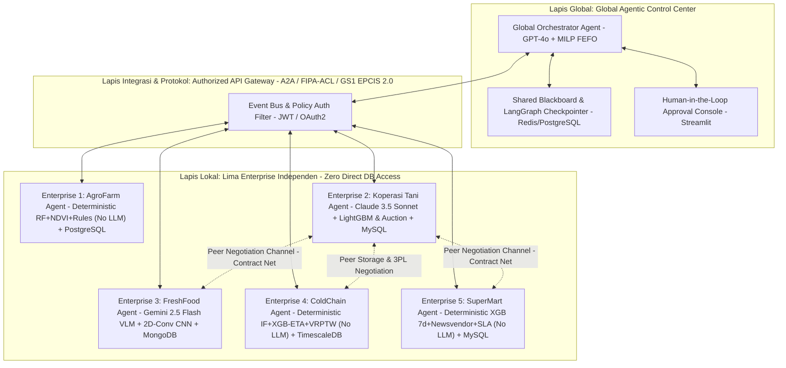
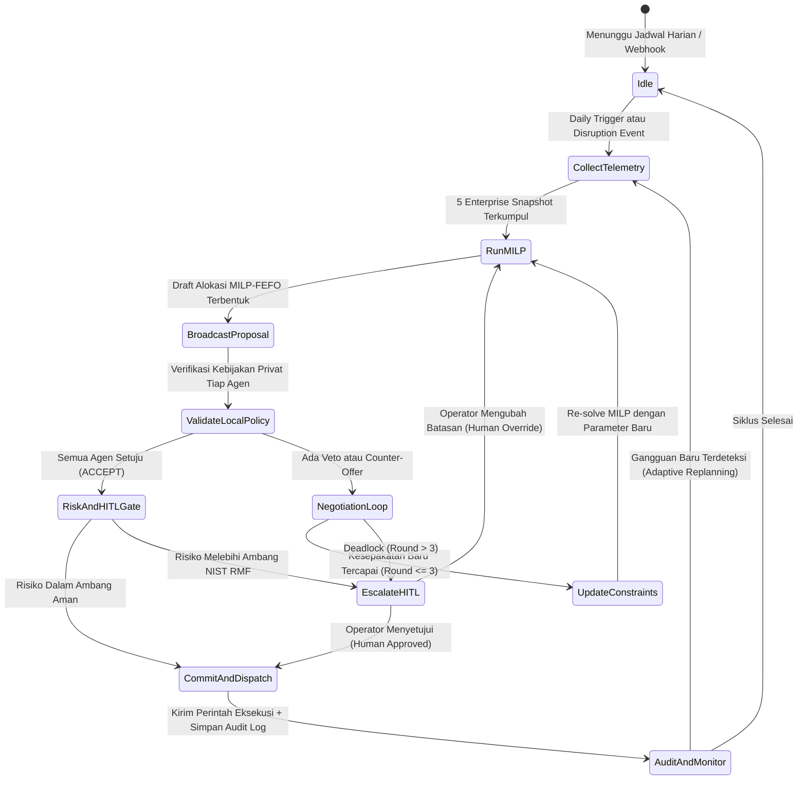
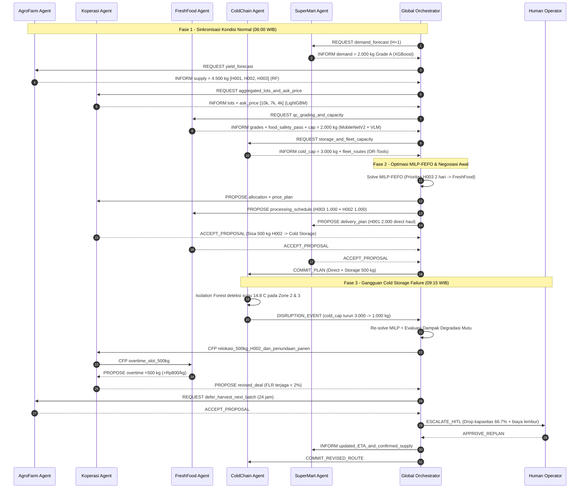
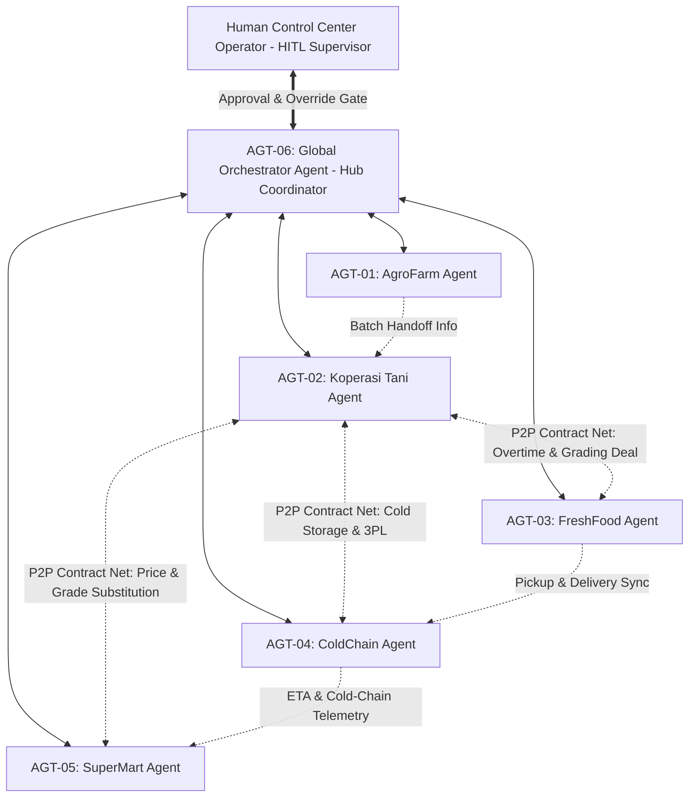

# LAPORAN PROYEK MAGISTER KECERDASAN ARTIFISIAL

## SMART AGRICULTURE & FOOD SUPPLY CHAIN:
### *Heterogeneous Multi-Enterprise Agentic AI Ecosystem untuk Optimasi Produksi Pertanian, Distribusi Pangan, dan Adaptive Replanning*

**Mata Kuliah:** Agent Enterprise  
**Program Studi:** Magister Kecerdasan Artifisial  
**Cakupan Dokumen:** Bab 1 (Pendahuluan) sampai Bab 11 (Kesimpulan dan Saran) + Daftar Pustaka  
**Repositori Implementasi:** `agrichain-agentic-ai` v2.2 (Selective 3-LLM Hybrid + 3 Deterministic ML/Rules, LangGraph, PuLP MILP-FEFO, OR-Tools VRPTW, FastAPI 20 Endpoint, Streamlit Demo-Ready Cockpit)  
**Komoditas Studi Kasus:** Tomat (*Solanum lycopersicum*) — SOP Suhu Aman `7,0–12,0°C`  

**Tim Penyusun & Pembagian Tugas:**

| No | Nama Anggota | NIM | Pembagian Tugas (Enterprise / Lapis) |
| :---: | :--- | :---: | :--- |
| 1 | **M. Al lail Qadrillah** | `26/590736/PPA/07413` | Koperasi Tani (`AGT-02`) |
| 2 | **Dimas Prabowo** | `26/590092/PPA/07382` | ColdChain Logistics (`AGT-04`) |
| 3 | **Monanta Alfiareza** | `26/591492/PPA/07455` | AgroFarm (`AGT-01`) |
| 4 | **Frans Alwan Purba** | `25/563545/PPA/07116` | FreshFood Processing (`AGT-03`), SuperMart (`AGT-05`), & Global Orchestration (`AGT-06`) |

---

## Ringkasan Eksekutif

Rantai pasok pangan pertanian (*agri-food supply chain*) memiliki karakteristik kompleksitas tinggi karena melibatkan berbagai entitas bisnis independen dengan sistem informasi heterogen, tujuan komersial yang saling berkonflik, serta komoditas mudah rusak (*perishable*) dengan umur simpan singkat. Proyek ini merancang dan mengimplementasikan **Heterogeneous Multi-Enterprise Agentic AI Ecosystem (v2.2 — Selective-LLM Hybrid)** yang mengoordinasikan lima entitas perusahaan—**AgroFarm**, **Koperasi Tani**, **FreshFood Processing**, **ColdChain Logistics**, dan **SuperMart**—melalui pusat koordinasi **Global Orchestrator Agent**.

Berbeda dari pendekatan prediktif tunggal atau sistem ERP terpusat yang melanggar otonomi data perusahaan, rancangan ini memisahkan secara tegas antara **Local Enterprise Intelligence** dan **Global Ecosystem Intelligence** berdasarkan prinsip kedaulatan data (*data sovereignty*) yang ditegakkan secara langsung di **sisi server FastAPI (`Server-Side RBAC Firewall` berbasis `X-Scoped-Token`)** disertai keterlacakan *canonical cross-enterprise lineage* (`block_id → lot_id → qc_doc_id → shipment_id → trip_id → vehicle_id → po_ref`). Ekosistem ini terdiri atas **enam agen otonom** (5 agen enterprise lokal + 1 agen orkestrator global) yang menerapkan **arsitektur *Selective-LLM Hybrid* berbasis kebutuhan nyata**: keenam agen dilengkapi model *machine learning*/optimasi domain berbeda (**Random Forest 250 Trees + NDVI + 80% Quantile PI & 14-day ± 2σ Deviation Engine**, **LightGBM + Contract Net Auction**, **2D-Conv Spatial-Spectral CNN + Food Safety Hard-Block**, **Isolation Forest 7–12°C + XGBoost ETA + OR-Tools VRPTW**, **XGBoost 7-Day + Newsvendor PO**, dan **MILP berbasis FEFO**), sementara **Large Language Model (LLM) hanya diterapkan secara selektif pada 3 agen kognitif** yang membutuhkan penalaran strategis multi-ronde, sintesis multimodal, atau orkestrasi lintas enterprise (**Claude 3.5 Sonnet** pada Koperasi Tani, **Gemini 2.5 Flash Multimodal** pada FreshFood Processing, dan **GPT-4o** pada Global Orchestrator). Sebaliknya, tiga agen operasional berjalur kritis deterministik (**AgroFarm**, **ColdChain Logistics**, dan **SuperMart**) dieksekusi murni sebagai **Deterministic ML + Rule/Optimization Engine (tanpa LLM)** demi **0 token biaya, latensi ~8–14 ms, dan bebas risiko halusinasi**. Komunikasi antar-agen mengadopsi protokol *Agent-to-Agent* (A2A) berbasis performatif **FIPA-ACL** dan standar pertukaran *event* **GS1 EPCIS 2.0**, dilengkapi *Impact-Preview* **Human-in-the-Loop (HITL)** dan *concurrency-safe* **SHA-256 Audit Trail** yang mengacu pada **NIST AI RMF 1.0**.

Seluruh rancangan telah diimplementasikan secara penuh dalam repositori **`agrichain-agentic-ai` v2.2** (**20 endpoint REST FastAPI** dengan kesetaraan penuh 5 enterprise, *closed-loop* *QC Feedback*, *VRPTW Dynamic Dock Sync*, proyeksi permintaan **7 hari SuperMart** & *Goods Receipt SLA*, *Demo-Ready Role-Adaptive Light-Mode Cockpit* dengan *1-Klik Presenter Storyboard* & *Side-by-Side RBAC Proof*, serta **14/14 pengujian otomatis `pytest` lulus**) dan dievaluasi secara empiris pada 19.575 rekaman dataset dummy lintas 5 basis data terisolasi serta 3.000 citra RGB tomat. Kelima model ML lokal melampaui seluruh target KPI—termasuk peningkatan AgroFarm v2 menjadi **MAE 87,84 kg (6,83% mean, R² 0,9449, PI80 Coverage 91,67%)**, ColdChain **XGBoost ETA MAE 7,66 menit** dan **OR-Tools VRPTW -31,15% dengan 0 pelanggaran jendela waktu**. Sementara itu, eksperimen ekosistem ($N = 30$ siklus gangguan berpasangan) membuktikan bahwa *adaptive replanning* berbasis *neuro-symbolic* MILP-FEFO dan negosiasi terbatas menurunkan *Food Loss Rate* dari **15,47% menjadi 0,00%**, memulihkan *Order Fulfillment Rate* dari **92,92% ke 98,25%**, menaikkan profit bersih ekosistem **+39,3%**, menjaga **0% pelanggaran kendala** dan **0 kebocoran data privat**, serta melalui arsitektur *Selective 3-LLM Hybrid* menghemat biaya token LLM sebesar **62,64%** dan menurunkan latensi *replanning* **29,58%** (dengan latensi operasional AgroFarm/ColdChain/SuperMart turun **-98,3% hingga -99,5%**) dibanding arsitektur *All-LLM* 6× GPT-4o.

---

# BAB 1. PENDAHULUAN

## 1.1 Latar Belakang

Sektor pertanian dan rantai pasok pangan merupakan tulang punggung ketahanan pangan nasional maupun global, namun sekaligus menjadi salah satu sektor dengan tingkat inefisiensi dan kehilangan pascapanen (*post-harvest food loss*) tertinggi. Laporan Food and Agriculture Organization (FAO, 2019) menunjukkan bahwa sekitar 14% dari total pangan dunia hilang sejak tahap pascapanen hingga sebelum mencapai ritel, dengan komoditas hortikultura segar seperti buah dan sayuran (termasuk tomat) mencatat persentase kehilangan tertinggi akibat sensitivitas terhadap suhu, keterlambatan distribusi, serta ketidakseimbangan pasokan dan permintaan.

Pada praktik konvensional, rantai pasok pangan terdiri atas berbagai perusahaan independen yang beroperasi secara terisolasi (*siloed*). Produsen pertanian (*farm*) mengelola data lahan, cuaca, dan prediksi panen secara internal; koperasi menghimpun stok petani dan melakukan tawar-menawar harga secara manual; pabrik pengolahan pangan merencanakan kapasitas mesin dan penyortiran mutu berdasarkan bahan baku yang tiba tanpa visibilitas hulu; penyedia logistik rantai dingin (*cold chain*) mengelola armada dan gudang pendingin dengan informasi permintaan yang terlambat; sedangkan peritel (*supermarket*) memprediksi penjualan hanya berdasarkan riwayat *Point-of-Sale* (POS) internal.

Ketiadaan koordinasi lintas perusahaan yang bersifat adaptif menimbulkan efek domino yang merugikan seluruh ekosistem:
1. **Ketidaksesuaian pasokan dan permintaan (*supply–demand mismatch*)** yang memicu *overproduction* di hulu serta *stockout* atau *overstock* di hilir.
2. **Alokasi pasokan yang tidak optimal (*poor allocation*)**, misalnya bahan baku berumur simpan pendek (*short shelf-life*) justru tertahan menunggu pembeli sementara bahan baku segar tertumpuk di gudang.
3. **Kerentanan terhadap gangguan operasional (*disruption fragility*)**, seperti kerusakan mendadak fasilitas *cold storage* atau lonjakan permintaan musiman yang tidak dapat direspons secara cepat lintas organisasi.
4. **Konflik kepentingan komersial** di mana petani dan koperasi menginginkan harga jual tinggi serta penyerapan penuh, sedangkan peritel dan pabrik pengolahan menuntut harga kompetitif, mutu seragam, dan ketepatan waktu kirim.

Perkembangan terbaru di bidang **Agentic Artificial Intelligence (Agentic AI)** membuka paradigma baru untuk mengatasi persoalan ini. Berbeda dengan sistem AI prediktif tradisional yang hanya menghasilkan angka estimasi secara pasif, sistem *Multi-Agent* berbasis kombinasi *Predictive AI*, *Mathematical Optimization*, dan *Large Language Models* (LLM) mampu melakukan penalaran kontekstual, menggunakan perkakas eksternal (*tool use*), bernegosiasi secara otonom sesuai batasan kebijakan masing-masing perusahaan, serta melaksanakan perencanaan ulang secara adaptif (*adaptive replanning*) ketika gangguan terjadi (Wooldridge, 2009; Yao et al., 2023; Jannelli et al., 2026).

Namun, menerapkan satu model AI yang sama untuk seluruh peran dalam ekosistem multi-perusahaan bukanlah pendekatan yang efisien. Setiap agen memiliki kebutuhan komputasi yang berbeda secara mendasar: inspeksi kualitas tomat memerlukan kemampuan visi multimodal, pemantauan anomali suhu gudang dingin memerlukan inferensi berlatensi sangat rendah di *edge*, negosiasi harga memerlukan kemampuan penalaran strategis multi-ronde, sementara orkestrasi global memerlukan perpaduan formulasi optimasi matematis yang eksak dengan koordinasi lintas kendala. Oleh karena itu, proyek ini mengusulkan perancangan **Heterogeneous Multi-Enterprise Agentic AI Ecosystem** untuk komoditas tomat yang mengintegrasikan enam agen dengan spesifikasi model AI dan LLM yang berbeda-beda sesuai tanggung jawab fungsionalnya, dikoordinasikan oleh sebuah **Global Orchestrator** tanpa melanggar privasi database internal tiap perusahaan.

## 1.2 Rumusan Masalah

Berdasarkan latar belakang di atas, rumusan masalah dalam proyek penelitian ini adalah sebagai berikut:

1. Bagaimana merancang arsitektur ekosistem *Multi-Enterprise Agentic AI* yang mampu mengoordinasikan lima perusahaan independen (AgroFarm, Koperasi Tani, FreshFood Processing, ColdChain Logistics, dan SuperMart) dengan tetap menjaga pemisahan *Local Enterprise Intelligence* dan *Global Ecosystem Intelligence* serta kedaulatan data masing-masing perusahaan?
2. Bagaimana merancang **Global Orchestrator** yang mengombinasikan optimasi matematis *Mixed-Integer Linear Programming* (MILP) berbasis prioritas *First-Expired, First-Out* (FEFO) dengan mekanisme negosiasi antar-agen (*Contract Net Protocol*) agar keputusan global tetap menghormati batasan lokal dan kepentingan ekonomi setiap perusahaan?
3. Bagaimana memilih dan memadukan model AI prediktif serta model LLM yang **heterogen (berbeda-beda)** bagi minimal empat agen (enam agen pada rancangan ini) sehingga setiap agen bekerja optimal sesuai karakteristik tugas, modalitas data, latensi, dan biayanya?
4. Bagaimana merancang skema *dataset dummy* lintas perusahaan yang realistis serta protokol komunikasi terstandar (berbasis A2A, FIPA-ACL, dan GS1 EPCIS 2.0) untuk menguji ketangguhan sistem dalam kondisi normal maupun gangguan (*cold storage failure* dan lonjakan permintaan) dibandingkan *baseline* non-kolaboratif?

## 1.3 Tujuan Penelitian

Tujuan yang ingin dicapai melalui perancangan dan pengembangan proyek ini adalah:

1. **Merancang arsitektur ekosistem multi-enterprise heterogen** yang memisahkan kecerdasan lokal perusahaan dan kecerdasan global melalui antarmuka API terotorisasi tanpa akses langsung ke basis data privat.
2. **Merancang komponen Global Orchestrator** yang mampu menjalankan siklus perencanaan global, deteksi konflik, mediasi negosiasi terbatas (*bounded negotiation*), *adaptive replanning* saat gangguan, dan eskalasi kontrol manusia (*Human-in-the-Loop*).
3. **Menyusun rancangan 6 agen otonom dengan model AI/ML dan LLM yang berbeda-beda** beserta spesifikasi *system prompt*, *tool schema*, dan alasan pemilihannya berdasarkan kebutuhan masing-masing peran.
4. **Menyusun spesifikasi dataset dummy terpadu** untuk lima entitas rantai pasok tomat (data lahan/cuaca, transaksi/negosiasi koperasi, citra & uji keamanan pangan, telemetri suhu IoT & rute logistik, serta penjualan ritel) guna mendukung pelatihan model dan eksperimen simulasi.
5. **Menetapkan kerangka evaluasi kuantitatif dan studi ablasi** (*Siloed Baseline* vs *Single-Agent* vs *Multi-Agent Adaptive*) berdasarkan *Food Loss Rate* (FLR), *Order Fulfillment Rate* (OFR), *Total Supply Chain Cost*, *Enterprise Fairness*, *Negotiation Success Rate* (NSR), dan *Replanning Response Time*.

## 1.4 Batasan Masalah

Agar ruang lingkup proyek tetap terfokus, terukur, dan dapat dievaluasi secara mendalam di tingkat Magister Kecerdasan Artifisial, ditetapkan batasan sebagai berikut:

1. **Komoditas tunggal berkarakteristik *perishable*:** Studi kasus difokuskan pada komoditas **tomat segar dan olahan** yang terbagi atas tiga kelas mutu (Grade A, Grade B, Grade C) dengan variasi umur simpan (*shelf life*) antara 2 hingga 5 hari.
2. **Jumlah entitas perusahaan:** Ekosistem dibatasi pada lima entitas enterprise (AgroFarm, Koperasi Tani, FreshFood Processing, ColdChain Logistics, SuperMart) dan satu pusat koordinasi global (*Global Agentic Control Center*).
3. **Data simulasi (*dummy/synthetic dataset*):** Seluruh proses pelatihan model prediktif, negosiasi harga, dan skenario gangguan menggunakan *synthetic dataset* yang dibangkitkan mengikuti distribusi realistis agronomi, pasar, dan telemetri rantai dingin; tidak menggunakan data pribadi petani nyata.
4. **Lingkungan eksekusi simulasi:** Sistem tidak mengendalikan perangkat keras IoT, sensor fisik, mesin pabrik, atau melakukan transaksi finansial nyata. Seluruh interaksi antarperusahaan disimulasikan melalui layanan REST API/A2A dan basis data heterogen (PostgreSQL/TimescaleDB, MySQL, MongoDB).
5. **Pengawasan manusia (*Human-in-the-Loop*):** Agen AI bertindak memberikan rekomendasi serta mengeksekusi keputusan simulasi dalam ambang batas aman (*safe operating envelope*), sedangkan keputusan bisnis kritis (kerugian tinggi, penurunan kapasitas ekstrem, atau *deadlock* negosiasi) wajib mendapatkan persetujuan manusia.

## 1.5 Manfaat Penelitian

1. **Manfaat Akademis:** Memberikan kontribusi konseptual dan arsitektural pada literatur *Multi-Agent LLM Systems* untuk domain *cross-enterprise supply chain*, khususnya pada integrasi *neuro-symbolic* antara optimasi deterministik (MILP/CVRP), prediksi statistik/visi komputer, dan penalaran strategis berbasis LLM heterogen.
2. **Manfaat Praktis bagi Ekosistem Agribisnis:** Menjadi cetak biru (*blueprint*) sistem kolaborasi digital lintas pelaku rantai pasok pangan untuk menekan *food loss*, menjaga stabilitas harga yang adil bagi petani dan ritel, serta mempercepat respons terhadap gangguan rantai dingin.
3. **Manfaat Rekayasa Perangkat Lunak AI:** Menunjukkan praktik terbaik (*best practices*) dalam orkestrasi agen heterogen, pertukaran pesan terstandar GS1 EPCIS 2.0, serta penerapan tata kelola risiko AI berbasis NIST AI RMF 1.0 pada sistem enterprise.

## 1.6 Pembagian Tugas dan Kontribusi Anggota Kelompok

Pengembangan ekosistem **AgriChain v2.1** dilaksanakan secara kolaboratif oleh empat anggota kelompok pada Program Studi **Magister Kecerdasan Artifisial** (Mata Kuliah **Agent Enterprise**). Setiap anggota bertanggung jawab penuh atas perancangan arsitektur agen lokal, pemodelan AI/optimasi domain, layanan *endpoint* API, validasi skenario gangguan, serta antarmuka peran (*role workspace*) pada entitas enterprise masing-masing, sebagaimana dirinci pada **Tabel 1.1**.

**Tabel 1.1.** Pembagian Tugas dan Kontribusi Anggota Kelompok

| No | Nama Anggota | NIM | Enterprise / Lapis | Kontribusi Perancangan & Implementasi Utama |
| :---: | :--- | :---: | :--- | :--- |
| 1 | **M. Al lail Qadrillah** | `26/590736/PPA/07413` | **Koperasi Tani** (`AGT-02`) | Perancangan agen agregator & *trading* (*Cooperative Manager*), model prediksi harga pasar **LightGBM**, protokol negosiasi *Contract Net Protocol* dengan *server-side redaction* `floor_price_rp`, layanan `/api/v1/koperasi/price-forecast`, serta *workspace* Koperasi Tani. |
| 2 | **Dimas Prabowo** | `26/590092/PPA/07382` | **ColdChain Logistics** (`AGT-04`) | Perancangan agen logistik rantai dingin (*Fleet & Cold Chain Manager*), deteksi anomali suhu **Isolation Forest** (`7,0–12,0°C`), prediksi durasi **XGBoost ETA**, optimasi rute **Google OR-Tools VRPTW** (*dynamic dock sync*), layanan CRUD armada & pengiriman `/api/v1/coldchain/{fleet,shipments,vrptw,eta}`, serta peta geospasial VRPTW. |
| 3 | **Monanta Alfiareza** | `26/591492/PPA/07455` | **AgroFarm** (`AGT-01`) | Perancangan agen produksi pertanian (*Farm Manager*), model prediksi hasil panen **Random Forest 250 Trees + NDVI + 80% Quantile PI**, *Crop Monitoring Deviation Engine* (`14-hari ± 2σ`), *Sensor Outage Safety Fallback*, skenario `EXTREME_RAIN`, layanan `/api/v1/agrofarm/{monitoring,predict}`, serta *workspace* AgroFarm v2. |
| 4 | **Frans Alwan Purba** | `25/563545/PPA/07116` | **FreshFood Processing** (`AGT-03`), **SuperMart** (`AGT-05`), & **Global Orchestration** (`AGT-06`) | Perancangan agen pengolahan (**2D-Conv CNN**, *Food Safety Hard-Block*, penjadwalan FEFO, *QC Feedback*, *Waste Valorization*) & agen ritel (**XGBoost 7-Day Horizon**, Newsvendor PO, *Flash-Promo*, *Goods Receipt SLA*); serta **Global Orchestrator** (**LangGraph**, **PuLP MILP-FEFO**, *Canonical Lineage*, *Server-Side RBAC Firewall*, *Impact-Preview HITL*, *SHA-256 Audit Trail*, integrasi FastAPI Gateway 20 endpoint, Streamlit Light-Mode Cockpit, dan pengujian otomatis `pytest`). |

---

# BAB 2. PROBLEM DAN STUDI KASUS

## 2.1 Konteks Domain Rantai Pasok Pangan (*Agri-Food Supply Chain*)

Rantai pasok pangan hortikultura merupakan sistem terdistribusi yang dicirikan oleh empat sifat fundamental: (1) **ketidakpastian biologis di hulu** (hasil panen dan kualitas sangat dipengaruhi cuaca, kelembapan tanah, dan pemupukan); (2) **degradasi kualitas kontinu (*perishability*)** di mana nilai ekonomi produk turun secara eksponensial seiring waktu dan penyimpangan suhu (Rong et al., 2011); (3) **kapasitas bottleneck di tengah** (kapasitas pengolahan pabrik dan ruang *cold storage* terbatas serta mahal); dan (4) **fluktuasi permintaan di hilir** (dipengaruhi musim, harga, promosi, dan perilaku konsumen).

Dalam rancangan ekosistem ini, aliran fisik produk dan aliran informasi bergerak melintasi lima perusahaan independen secara berurutan maupun paralel, sebagaimana dirangkum pada **Tabel 2.1**.

**Tabel 2.1.** Struktur Lima Enterprise dalam Ekosistem *Smart Agriculture & Food Supply Chain*

| Tahap | Nama Enterprise | Peran Ekosistem | Tanggung Jawab Operasional Utama | Fokus Keputusan AI Lokal |
| :---: | :--- | :--- | :--- | :--- |
| 1 | **AgroFarm** | *Agricultural Producer* | Budidaya blok lahan tomat (`BLK-07`, `BLK-03`, `BLK-11`), pemantauan deviasi NDVI 14-hari, penjadwalan panen | *Crop monitoring* 14-hari ± 2σ, prediksi hasil panen RF + 80% Quantile PI & *sensor fallback* |
| 2 | **Koperasi Tani** | *Aggregation & Trading* | Pengumpulan panen dari banyak petani, konsolidasi stok, negosiasi harga jual | Agregasi panen, prediksi harga pasar (LightGBM), & negosiasi harga (*Contract Net*) |
| 3 | **FreshFood Processing** | *Food Manufacturer* | Pemeriksaan mutu (*grading*), verifikasi keamanan pangan, pengolahan saus/pasta | Klasifikasi kualitas visual (2D-Conv CNN), *Food Safety Hard-Block*, & penjadwalan FEFO |
| 4 | **ColdChain Logistics** | *Logistics Provider* | Penyimpanan berpendingin (`7,0–12,0°C`), manajemen armada/shipment, pemantauan suhu | Optimasi rute **VRPTW** (*Time Windows*), prediksi ETA (**XGBoost**), & deteksi anomali suhu |
| 5 | **SuperMart** | *Retailer* | Pengelolaan inventori gerai ritel, penetapan harga/promo, pemenuhan konsumen akhir | Prediksi permintaan (*demand forecasting* XGBoost) & perencanaan pembelian (*Newsvendor PO*) |

Ketika kelima perusahaan tersebut mengelola sistem informasi dan basis data secara terpisah tanpa koordinasi *real-time*, timbul tujuh permasalahan bisnis utama yang saling terkait (**Tabel 2.2**).

**Tabel 2.2.** Pemetaan Permasalahan Operasional dan Dampak Bisnis

| No | Permasalahan | Akar Penyebab Sistemik | Dampak Bisnis |
| :---: | :--- | :--- | :--- |
| 1 | **Overproduction** | AgroFarm memanen tanpa sinyal permintaan aktual dari SuperMart dan kapasitas FreshFood | Surplus stok menumpuk di lahan dan koperasi |
| 2 | **Demand Mismatch** | Fluktuasi permintaan ritel tidak tersampaikan tepat waktu ke hulu (*bullwhip effect*) | *Stockout* saat permintaan tinggi atau *overstock* saat permintaan turun |
| 3 | **Poor Allocation** | Alokasi batch tidak mempertimbangkan kombinasi mutu (*grade*), sisa umur simpan (*shelf life*), dan kapasitas | Grade A tertahan di pabrik olahan atau Grade C berumur pendek tidak segera diproses |
| 4 | **Food Loss** | Keterlambatan distribusi, deviasi suhu dingin, dan lambatnya relokasi saat stok berlebih | Produk membusuk sebelum terjual sehingga menimbulkan kerugian finansial & lingkungan |
| 5 | **Storage Limitation** | Kapasitas *cold storage* terbatas dan tidak terpantau lintas perusahaan | Kemacetan (*bottleneck*) penyimpanan dan risiko kerusakan massal saat gagal pendinginan |
| 6 | **Distribution Delay** | Rute pengiriman tidak teroptimasi dan tidak memprioritaskan produk yang mendekati kedaluwarsa | Penurunan kualitas di perjalanan dan penalti keterlambatan dari ritel |
| 7 | **Price Fluctuation** | Ketidakseimbangan pasokan–permintaan tanpa mekanisme negosiasi transparan | Harga jatuh saat panen raya (merugikan petani) atau melonjak saat langka (merugikan konsumen) |

## 2.2 Analisis Pemangku Kepentingan (*Stakeholders*) dan Konflik Kepentingan

### A. Pemangku Kepentingan Internal Utama (*1 Primary Stakeholder per Enterprise*)

Untuk menjamin akuntabilitas keputusan yang tunggal (*single point of accountability*) serta keselarasan 1:1 antara struktur organisasi, agen otonom, dan peran login RBAC pada aplikasi (*lean enterprise cluster*), setiap perusahaan menetapkan **satu pemangku kepentingan internal utama** sebagai pengambil keputusan sekaligus penyetuju *Human-in-the-Loop* (HITL), ditambah satu operator pada lapis global (**Tabel 2.3**).

**Tabel 2.3.** Pemetaan Pemangku Kepentingan Internal Utama (*1 Stakeholder per Enterprise + Global Control Center*)

| Enterprise / Lapis | Agen | Pemangku Kepentingan Utama | Tanggung Jawab Operasional & Wewenang HITL | Kepentingan Bisnis Dominan |
| :--- | :---: | :--- | :--- | :--- |
| **AgroFarm** | `AGT-01` | **Farm Manager** | Mengelola budidaya blok lahan, memantau deviasi NDVI 14-hari ± 2σ, menyetujui jadwal panen, pergeseran panen ekstrem (`-2 hari`), & *harvest deferral* | Seluruh panen terserap dengan akurasi estimasi tinggi (MAE ≤ 10%) & biaya minimum |
| **Koperasi Tani** | `AGT-02` | **Cooperative Manager** | Mengonsolidasi stok petani, menjaga *floor price* privat, serta memvalidasi diskon & hasil negosiasi *Contract Net* | Stok tak terjual (*unsold inventory*) ≤ 5%, transaksi cepat, & kesejahteraan petani terjaga |
| **FreshFood Processing** | `AGT-03` | **Quality Control & Production Manager** | Memegang hak veto mutlak kelayakan *food safety* (grading CNN & uji lab) sekaligus mengotorisasi kapasitas reguler & lembur pabrik (+500 kg) | Zero pelanggaran *food safety*, akurasi grading ≥ 90%, & utilisasi lini 80–95% |
| **ColdChain Logistics** | `AGT-04` | **Fleet & Cold Chain Manager** | Mengelola armada reefer, optimasi rute VRPTW/ETA, stabilitas suhu gudang `7,0–12,0°C`, serta sewa kapasitas cadangan 3PL | Pengiriman tepat waktu (OTD ≥ 95%, 0 *TW violations*), kepatuhan suhu ≥ 98%, & efisiensi jarak |
| **SuperMart** | `AGT-05` | **Purchasing Manager** | Mengendalikan prediksi permintaan POS, *ceiling price* privat, penerbitan PO (*Newsvendor*), pengendalian *stockout/overstock*, & izin substitusi Grade B | Harga beli kompetitif, *stockout* ≤ 5%, *overstock* ≤ 10%, & kepastian pasokan Grade A |
| **Global Control Center** | `AGT-06` | **Global Control Center Operator** | Memantau orkestrasi 6 agen, meninjau *Impact-Preview HITL Console*, & mengaudit integritas SHA-256 lintas perusahaan | Menekan *food loss* global (FLR → 0%), menjaga keadilan profit (*Jain's Index*), & 0 *privacy leak* |

### B. Pemangku Kepentingan Eksternal

- **Petani Mitra:** Membutuhkan kepastian penyerapan hasil panen dan harga jual yang adil di atas biaya pokok produksi.
- **Konsumen Akhir:** Menginginkan produk tomat segar maupun olahan yang aman, berkualitas baik, tersedia, dan berharga wajar.
- **Pemasok Sarana Produksi Pertanian (*Input Suppliers*):** Menyediakan benih, pupuk, dan nutrisi sesuai jadwal tanam AgroFarm.
- **Pemerintah (Kementerian Pertanian/Perdagangan):** Memantau ketahanan pangan, stabilitas harga pangan pokok, dan pengurangan susut pangan (*food loss*).
- **Regulator Keamanan Pangan (BPOM / Otoritas Kompeten Keamanan Pangan):** Memastikan produk pangan (khususnya Grade C yang diolah) memenuhi batas keamanan biologis dan kimiawi.
- **Mitra Transportasi & Cold Storage Pihak Ketiga (3PL):** Menyediakan kapasitas cadangan saat terjadi lonjakan volume atau gangguan fasilitas utama ColdChain.

### C. Pemetaan Konflik Kepentingan Antar-Stakeholder

Inti persoalan *multi-enterprise* bukan hanya optimasi satu fungsi objektif tunggal, melainkan **negosiasi antar-tujuan yang saling bertentangan**:
1. **Konflik Harga (AgroFarm/Koperasi vs SuperMart/FreshFood):** Koperasi menuntut harga tinggi demi margin petani (misal ≥ Rp9.500/kg untuk Grade A), sementara SuperMart berupaya menekan harga beli (misal ≤ Rp10.200/kg) demi menjaga margin ritel.
2. **Konflik Prioritas Mutu vs Umur Simpan (FreshFood/SuperMart vs Koperasi):** SuperMart hanya ingin Grade A segar, sementara Koperasi memiliki stok Grade B dan Grade C yang cepat membusuk (umur simpan 2–3 hari) dan harus segera diserap agar tidak menjadi *food loss*.
3. **Konflik Kapasitas vs Waktu Tunggu (ColdChain/FreshFood vs AgroFarm):** AgroFarm ingin segera menyalurkan seluruh 4.500 kg hasil panen begitu matang, namun FreshFood hanya sanggup mengolah 2.000 kg/hari dan ColdChain hanya memiliki ruang simpan 3.000 kg (atau anjlok ke 1.000 kg saat gangguan).

Oleh karena itu, tujuan bisnis ekosistem dirumuskan secara berimbang ke dalam tiga pilar: **(1) Operational Efficiency**, **(2) Economic Optimization & Fairness** (mengoptimalkan profit kolektif tanpa mengorbankan kelangsungan satu perusahaan pun), dan **(3) Food Loss Reduction**.

## 2.3 Contoh Studi Kasus Nyata dan Skenario *End-to-End*

Untuk mengilustrasikan cara kerja ekosistem secara terukur, digunakan studi kasus **Tomato Supply Chain Optimization** pada satu siklus panen harian dengan tiga batch hasil panen (**Tabel 2.4**) dan kapasitas ekosistem awal (**Tabel 2.5**).

**Tabel 2.4.** Kondisi Awal Batch Hasil Panen Tomat (AgroFarm → Koperasi Tani)

| Batch / Lot ID | Volume Panen (kg) | Kelas Mutu (Grade) | Harga Dasar Koperasi (Rp/kg) | Sisa Umur Simpan (*Shelf Life*) | Status Kelayakan Pangan (*Food Safety*) | Peruntukan Utama |
| :---: | :---: | :---: | :---: | :---: | :---: | :--- |
| **H001** | 2.000 | Grade A | Rp10.000 | 5 hari | Lolos (Segar Premium) | Ritel Segar (SuperMart) |
| **H002** | 1.500 | Grade B | Rp7.000 | 3 hari | Lolos (Olahan Standar) | Pengolahan Saus/Pasta (FreshFood) |
| **H003** | 1.000 | Grade C | Rp4.000 | 2 hari | Wajib Verifikasi QC Lab | Olahan Prioritas FEFO / Pembeli Alternatif |
| **Total** | **4.500 kg** | — | — | — | — | — |

**Tabel 2.5.** Kapasitas dan Permintaan Awal Lima Enterprise

| Enterprise | Parameter Operasional (Kondisi Normal) | Parameter Saat Gangguan (*Disruption*) |
| :--- | :--- | :--- |
| **AgroFarm** | Estimasi panen total: **4.500 kg** (3 batch) | Tetap 4.500 kg (telah siap panen/dipanen) |
| **Koperasi Tani** | Agregasi 4.500 kg; batas *unsold inventory* ≤ 5% | Harus menegosiasikan relokasi & diskon cepat |
| **FreshFood Processing** | Kapasitas pengolahan reguler: **2.000 kg/hari** | Dapat mengaktifkan lembur (*overtime*) +500 kg dengan biaya tambahan Rp800/kg melalui negosiasi |
| **ColdChain Logistics** | Kapasitas *cold storage*: **3.000 kg**; armada 3 truk (kapasitas total 4.500 kg/hari untuk *direct-haul*) | **Skenario Gangguan 1 (Cold Storage Failure):** Kapasitas gudang anjlok **3.000 kg → 1.000 kg** akibat kerusakan kompresor |
| **SuperMart** | Prediksi permintaan normal: **2.000 kg** (Grade A) | **Skenario Gangguan 2 (Demand Surge):** Permintaan melonjak **2.000 kg → 2.800 kg** (bersedia menerima sebagian Grade B terpilih jika disetujui negosiasi) |

### Skenario A: Kondisi Normal (*Baseline Allocation vs FEFO-Aware Agentic Optimization*)

1. **Prediksi & Inspeksi Lokal:** SuperMart Agent memprediksi permintaan 2.000 kg (XGBoost); AgroFarm Agent memprediksi panen 4.500 kg (Random Forest); FreshFood Agent melakukan *grading* visual (MobileNetV2) + verifikasi keamanan pangan (Gemini 2.5 Flash) dan mengonfirmasi H003 lolos batas keamanan pangan untuk diolah segera.
2. **Identifikasi Celah Alokasi Naif:** Jika alokasi dilakukan secara naif hanya berdasarkan urutan kualitas (H001 2.000 kg → SuperMart; H002 1.500 kg → FreshFood; H003 500 kg → FreshFood), maka tersisa **500 kg H003 (Grade C, umur simpan hanya 2 hari)** tanpa pembeli yang berisiko 100% membusuk (*food loss* 11,1%). Selain itu, total 4.500 kg melebihi kapasitas gudang ColdChain (3.000 kg), sehingga perlu pemilahan antara pengiriman langsung (*direct delivery*) dan penyimpanan dingin.
3. **Optimasi MILP-FEFO & Negosiasi Agen:** Global Orchestrator mendeteksi tingginya risiko *spoilage* pada H003 (umur 2 hari). Orchestrator menghasilkan proposal berbasis **FEFO (*First-Expired, First-Out*)**:
   - **H001 (2.000 kg, Grade A, 5 hari):** 2.000 kg dialokasikan ke **SuperMart** melalui pengiriman langsung (*direct refrigerated haul*) sehingga tidak membebani kapasitas *cold storage* gudang transit.
   - **H003 (1.000 kg, Grade C, 2 hari):** Diprioritaskan **penuh 1.000 kg** masuk lini olahan **FreshFood** hari ke-1 karena umur simpannya paling kritis.
   - **H002 (1.500 kg, Grade B, 3 hari):** **1.000 kg** masuk lini olahan **FreshFood** hari ke-1 (memenuhi kuota reguler 2.000 kg FreshFood), sedangkan sisa **500 kg H002** (masih memiliki umur simpan 3 hari) masuk ke **ColdChain Storage** (memakai 500 kg dari kapasitas 3.000 kg) untuk diproses FreshFood hari ke-2 **atau** dinegosiasikan oleh Koperasi Agent untuk diproses lewat slot *overtime* FreshFood (+500 kg) / pembeli pasar sekunder dengan harga diskon terukur.
   - Hasilnya: *Food Loss Rate* ditekan dari **11,1%** (alokasi naif) menjadi **0–2%**, kapasitas penyimpanan ColdChain aman, dan seluruh permintaan SuperMart terpenuhi 100%.

### Skenario B: Kondisi Gangguan (*Cold Storage Failure* — Kapasitas Turun 3.000 kg → 1.000 kg)

1. **Deteksi Anomali Real-Time:** Sensor IoT gudang dingin ColdChain mencatat lonjakan suhu dari 8°C menjadi 14,8°C pada dua dari tiga ruang pendingin. **ColdChain Agent** (*Deterministic Isolation Forest + Rule Engine*, tanpa LLM) dalam ~14 milidetik mendeteksi anomali, menurunkan kapasitas efektif gudang dari **3.000 kg → 1.000 kg**, dan memancarkan `DisruptionEvent` berformat GS1 EPCIS ke **Global Orchestrator**.
2. **Evaluasi Dampak & Adaptive Replanning:** Global Orchestrator segera membekukan rencana distribusi lama dan menjalankan ulang *MILP Solver* dengan kendala baru $C_{\text{storage}} = 1.000\text{ kg}$ serta mempercepat degradasi umur simpan lot yang terdampak suhu.
3. **Putaran Negosiasi Antar-Agen (*Contract Net Protocol*):**
   - Global Orchestrator memprioritaskan seluruh **H003 (1.000 kg, 2 hari)** dan **1.000 kg H002** langsung ke pabrik FreshFood (*zero transit storage*).
   - **Koperasi Agent** (Claude 3.5 Sonnet) membuka *Call for Proposals (CFP)* ke **FreshFood Agent** (Gemini 2.5 Flash) untuk slot lembur pengolahan 500 kg H002 dan ke ColdChain Agent untuk penggunaan sisa 1.000 kg ruang dingin yang sehat atau sewa 3PL sementara.
   - **AgroFarm Agent** (*Deterministic Random Forest + Harvest Deferral Rule Engine*, tanpa LLM) menerima instruksi penundaan panen (*harvest deferral*) selama 24 jam bagi sebagian blok lahan Grade A yang belum dipetik guna mencegah penumpukan di gudang dingin yang rusak.
   - **SuperMart Agent** (*Deterministic XGBoost + Policy/SLA Rule Engine*, tanpa LLM) menerima pembaruan *Estimated Time of Arrival* (ETA) dan konfirmasi bahwa pasokan Grade A tetap aman melalui *direct delivery* armada berpendingin.
4. **Gerbang Kontrol Manusia (HITL):** Karena penurunan kapasitas *cold storage* mencapai 66,7% (melampaui ambang batas eskalasi 40%) dan melibatkan biaya lembur FreshFood/3PL, Global Orchestrator menyajikan **Impact-Preview Confirmation Console** (perbandingan metrik statis vs rencana adaptif serta daftar mitra terdampak) ke *Control Center Operator* untuk persetujuan satu-klik sebelum eksekusi final.

### Skenario C & D: Gangguan Hulu Pertanian (*Extreme Rain* & *Sensor Outage Fallback*)

Melengkapi gangguan logistik dan ritel, ekosistem v2.0 juga menangani dua skenario gangguan agronomi kritis di hulu (**AgroFarm**):
- **Skenario C — *Extreme Rain* (`EXTREME_RAIN` pada blok `BLK-11` / lot `H003`):** Curah hujan 14 hari melonjak menjadi `96 mm` (> ambang `90 mm`), kelembapan tanah mencapai `83%`, dan indeks vegetasi **NDVI** turun ke `0,41` (di bawah batas bawah `2σ` sebesar `0,56`). *Crop Monitoring Deviation Engine* menandai blok `BLK-11` sebagai `MENYIMPANG`, memicu prediksi ulang Random Forest dengan **80% Quantile Prediction Interval** melebar (`[476,5; 1.264,7] kg`), menurunkan estimasi panen ~13,9% (`1.000 → 861 kg`), memajukan jendela panen sebesar **`-2 hari`** untuk mencegah busuk lahan, serta mengaktifkan eskalasi HITL (`AGROFARM_HARVEST_WINDOW_SHIFTED_2_DAYS`) sekaligus memicu penyesuaian rute ColdChain (`ROAD_DISRUPTION`).
- **Skenario D — *Sensor Outage* (`SENSOR_OUTAGE` ≥ 3 Hari Offline):** Apabila sensor IoT pada blok `BLK-11` gagal mengirim data selama `≥ 3 hari` berturut-turut, `AgroFarm Agent` secara otomatis beralih dari mode inferensi ML standar (`RF_QUANTILE_PI80`) ke mode cadangan aman (**`FALLBACK_HISTORICAL_MEAN`**) dengan pita ketidakpastian melebar (`± 28%`), menerbitkan peringatan **`STALE DATA WARNING`** pada kokpit operator, dan mengaktifkan gerbang HITL (`AGROFARM_SENSOR_OFFLINE_FALLBACK_ACTIVE`) agar keputusan panen tetap aman meski data telemetri tidak lengkap (*graceful degradation*).

## 2.4 Ukuran Keberhasilan (*Key Performance Indicators* — KPI)

Keberhasilan ekosistem diukur pada dua tingkat: **KPI Lokal per Enterprise** (**Tabel 2.6**) dan **KPI Global Ekosistem** beserta formulasi matematisnya (**Tabel 2.7**).

**Tabel 2.6.** Target KPI Simulasi Tingkat Lokal (Enterprise-Level)

| Enterprise | Indikator KPI Lokal | Target Simulasi |
| :--- | :--- | :--- |
| **AgroFarm** | *Yield Prediction MAE* | ≤ 10% dari rata-rata hasil panen |
| | *Harvest Planning Accuracy* | ≥ 90% |
| | *Forecast Availability* | 100% batch panen terdaftar |
| | *Harvest Delay Reduction* | Turun ≥ 15% dibanding *baseline* |
| **Koperasi Tani** | *Harvest Aggregation Accuracy* | ≥ 95% |
| | *Unsold Inventory Rate* | ≤ 5% |
| | *Negotiation Success Rate* (NSR) | ≥ 80% |
| | *Average Transaction Processing Time* | ≤ 10 menit (simulasi ≤ 15 detik/siklus) |
| **FreshFood Processing** | *Quality Classification Accuracy* (CNN F1/Acc) | ≥ 90% |
| | *Processing Capacity Utilization* | 80% – 95% |
| | *Processing Waste Rate* | ≤ 5% |
| | *Production Schedule Adherence* | ≥ 90% |
| **ColdChain Logistics** | *On-Time Delivery Rate* (OTD) | ≥ 95% |
| | *Route Distance Efficiency* | Pengurangan jarak tempuh ≥ 10% |
| | *Temperature Compliance Rate* | ≥ 98% |
| | *Product Damage During Delivery* | ≤ 2% |
| **SuperMart** | *Demand Forecasting MAPE* | ≤ 15% |
| | *Stockout Rate* | ≤ 5% |
| | *Overstock Rate* | ≤ 10% |
| | *Inventory Turnover Improvement* | Meningkat ≥ 10% |

**Tabel 2.7.** Rumus dan Target KPI Global Ekosistem (*Ecosystem-Level*)

| Global KPI | Rumus Matematis | Tujuan Pengukuran |
| :--- | :--- | :--- |
| **Food Loss Rate (FLR)** | $\text{FLR} = \dfrac{\sum_{i \in I} q_i^{\text{rusak}}}{\sum_{i \in I} Q_i^{\text{total}}} \times 100\%$ | Mengukur persentase tomat yang rusak/kedaluwarsa atau tidak terserap |
| **Order Fulfillment Rate (OFR)** | $\text{OFR} = \dfrac{\sum_{j \in J} d_j^{\text{terpenuhi}}}{\sum_{j \in J} D_j^{\text{permintaan}}} \times 100\%$ | Mengukur tingkat pemenuhan permintaan pembeli (SuperMart & FreshFood) |
| **Total Supply Chain Cost ($C_{\text{total}}$)** | $C_{\text{total}} = C_{\text{prod}} + C_{\text{proc}} + C_{\text{stor}} + C_{\text{trans}} + C_{\text{penalti}}$ | Mengukur total biaya operasional dan penalti keterlambatan/lembur ekosistem |
| **Enterprise Profit Fairness (Jain's Index)** | $\mathcal{F} = \dfrac{\left(\sum_{e=1}^{E} \pi_e^{\text{norm}}\right)^2}{E \cdot \sum_{e=1}^{E} \left(\pi_e^{\text{norm}}\right)^2}$ | Menjamin keuntungan terdistribusi adil antar-5 enterprise ($\mathcal{F} \to 1$) |
| **Resource Utilization (RU)** | $\text{RU} = \dfrac{1}{2}\left(\dfrac{V_{\text{proc}}}{C_{\text{proc}}^{\max}} + \dfrac{V_{\text{stor}}}{C_{\text{stor}}^{\max}}\right) \times 100\%$ | Mengukur efektivitas pemanfaatan kapasitas pabrik dan gudang dingin |
| **Negotiation Success Rate (NSR)** | $\text{NSR} = \dfrac{N_{\text{sepakat}}}{N_{\text{total\_sesi}}} \times 100\%$ | Mengukur proporsi sesi negosiasi lintas agen yang menghasilkan kontrak |
| **Replanning Response Time ($T_{\text{replan}}$)** | $T_{\text{replan}} = t_{\text{rencana\_baru\_disetujui}} - t_{\text{event\_gangguan}}$ | Mengukur kecepatan orkestrator & agen merespons gangguan (*end-to-end latency*) |
| **LLM Cost & Latency per Cycle** | $\text{Cost}_{\text{cycle}} = \sum_{a=1}^{6} (n_{\text{in},a} p_{\text{in},a} + n_{\text{out},a} p_{\text{out},a})$ | Mengevaluasi efisiensi biaya token dan latensi arsitektur LLM heterogen |

---

# BAB 3. TINJAUAN PUSTAKA

## 3.1 Penelitian Terkait (*Related Work*)

Pengembangan ekosistem *Agentic AI* untuk rantai pasok pangan berdiri di persimpangan tiga ranah penelitian utama: (1) optimasi rantai pasok pangan mudah rusak (*perishable food supply chain optimization*), (2) sistem multi-agen klasik dan protokol negosiasi terdistribusi, serta (3) sistem multi-agen berbasis *Large Language Models* (LLM-MAS).

### A. Optimasi Rantai Pasok Pangan Mudah Rusak (*Perishable Supply Chain*)
Rong et al. (2011) memelopori integrasi kinetika degradasi kualitas pangan ke dalam formulasi *Mixed-Integer Linear Programming* (MILP) untuk rantai pasok produk segar, menunjukkan bahwa pengendalian suhu penyimpanan dan alokasi berbasis sisa kualitas secara signifikan mengurangi *food waste* sekaligus menekan total biaya distribusi. Penelitian mutakhir oleh Jeremi dan Vanany (2023) memperluas pendekatan MILP multi-eselon untuk komoditas pangan mudah rusak guna meminimalkan biaya logistik, limbah pangan, dan emisi secara simultan. Namun, model optimasi matematis murni umumnya mengasumsikan keberadaan satu pengambil keputusan sentral yang mengetahui seluruh data privat semua perusahaan (*complete information assumption*), sebuah asumsi yang jarang terpenuhi dalam ekosistem bisnis multi-perusahaan yang independen.

### B. Sistem Multi-Agen Klasik, Koordinasi, dan Protokol Negosiasi
Secara teoritis, Jennings et al. (1998) dan Wooldridge (2009) mendefinisikan agen otonom sebagai entitas komputasi yang mampu mempersepsi lingkungan, bertindak proaktif untuk mencapai tujuan lokalnya, serta berinteraksi secara sosial melalui kerja sama, koordinasi, dan negosiasi. Salah satu protokol negosiasi paling berpengaruh adalah **Contract Net Protocol (CNP)** yang diperkenalkan oleh Smith (1980), di mana entitas manajer menyiarkan *Call for Proposals* (CFP), entitas kontraktor mengajukan penawaran (*bid/propose*), dan kontrak diberikan kepada penawaran terbaik. Standarisasi komunikasi antar-agen kemudian diformalkan melalui **FIPA-ACL** (*Foundation for Intelligent Physical Agents — Agent Communication Language*, FIPA, 2002) yang mendefinisikan struktur performatif seperti `cfp`, `propose`, `accept-proposal`, `reject-proposal`, dan `inform`. Kelemahan pendekatan MAS klasik adalah sifat aturan negosiasinya yang kaku (*hard-coded heuristics*), sehingga sulit beradaptasi terhadap gangguan tak terduga atau negosiasi multi-isu berbasis konteks bahasa alami.

### C. Sistem Multi-Agen Berbasis LLM (*LLM-Based Multi-Agent Systems*)
Kemajuan LLM membuka era baru sistem multi-agen yang mampu memadukan penalaran bahasa alami dengan eksekusi alat (*tool use*). Yao et al. (2023) memperkenalkan paradigma **ReAct** yang menyinergikan jejak penalaran (*Thought*) dan tindakan (*Action*) terhadap lingkungan eksternal untuk mengurangi halusinasi dan meningkatkan interpretabilitas. Shinn et al. (2023) memperkenalkan **Reflexion** yang memungkinkan agen melakukan refleksi verbal atas kegagalan eksekusi sebelumnya guna memperbaiki keputusan pada iterasi berikutnya—sebuah prinsip yang sangat relevan untuk *adaptive replanning* dan negosiasi ulang.

Pada tingkat orkestrasi banyak agen, Wu et al. (2023) mengembangkan **AutoGen** yang memungkinkan percakapan terprogram antar-agen yang dapat dikustomisasi serta terintegrasi dengan eksekusi kode dan umpan balik manusia. Hong et al. (2024) melalui **MetaGPT** membuktikan bahwa penerapan *Standard Operating Procedures* (SOP) dan pertukaran artefak terstruktur (bukan sekadar obrolan teks bebas) secara drastis menurunkan *cascading hallucination* pada tim multi-agen. Survei komprehensif oleh Guo et al. (2024) di IJCAI 2024 memetakan taksonomi LLM-MAS berdasarkan profil agen, topologi komunikasi, memori, dan mekanisme koordinasi, seraya menyoroti tantangan krusial pada skalabilitas, biaya inferensi, dan kendali deterministik.

Secara spesifik di domain rantai pasok, Jannelli et al. (2026) dalam *International Journal of Production Research* menunjukkan bahwa *Agentic LLMs* mampu melaksanakan pencarian konsensus (*autonomous multi-agent consensus-seeking*) dan negosiasi antar-eselon rantai pasok untuk meredam *bullwhip effect*. Namun, studi tersebut belum menggabungkan heterogenitas model ML prediktif spesifik domain (seperti CNN visi komputer, *anomaly detection* IoT, dan *gradient boosting*), formulasi MILP berbasis degradasi umur simpan (*perishable FEFO*), standar pertukaran *event* industri (**GS1 EPCIS 2.0**, GS1, 2022), serta manajemen risiko berbasis **NIST AI RMF 1.0** (NIST, 2023).

**Tabel 3.1.** Matriks Perbandingan Penelitian Terkait dan Posisi Proyek Ini

| Penelitian | Domain | Optimasi Matematis (MILP/CVRP) | Model Prediktif Heterogen (ML/CV/AD) | Multi-Agent LLM & Negosiasi | Model LLM Heterogen per Agen | Privasi Data Lintas Enterprise & Standar EPCIS/NIST |
| :--- | :--- | :---: | :---: | :---: | :---: | :---: |
| Rong et al. (2011) | *Fresh Food Supply Chain* | Ya (MILP Kualitas) | Tidak | Tidak | Tidak | Tidak (Sentral penuh) |
| Jeremi & Vanany (2023) | *Perishable Food (Dairy)* | Ya (MILP Multi-eselon) | Tidak | Tidak | Tidak | Tidak |
| Smith (1980) / FIPA (2002) | *Distributed MAS* | Tidak | Tidak | Protokol Klasik (CNP/ACL) | Tidak | Parsial |
| Yao et al. (2023) / Shinn et al. (2023) | *General Reasoning Agents* | Tidak | Tidak | Single-Agent ReAct/Reflexion | Tidak | Tidak |
| Wu et al. (2023) — AutoGen | *General LLM-MAS* | Tidak (opsional via kode) | Tidak | Ya (Konversasional) | Opsional | Tidak |
| Hong et al. (2024) — MetaGPT | *Software Engineering MAS* | Tidak | Tidak | Ya (SOP Terstruktur) | Homogen (umumnya) | Tidak |
| Jannelli et al. (2026) | *Supply Chain Consensus* | Parsial | Tidak | Ya (Konsensus LLM) | Homogen | Parsial |
| **Proyek Ini (Usulan v2.2)** | ***Smart Agriculture & Perishable Supply Chain*** | **Ya (MILP-FEFO + OR-Tools VRPTW)** | **Ya (RF+NDVI/PI80, LightGBM, CNN, IF+XGB-ETA, XGBoost 7d)** | **Ya (Hybrid Orchestrator + CNP/FIPA-ACL)** | **Selective 3-LLM + 3 Deterministic ML/Rules** | **Ya (Server-Side RBAC API + GS1 EPCIS 2.0 + Lineage + NIST RMF)** |

## 3.2 Pola Agentik (*Agentic Design Patterns*) yang Digunakan

Proyek ini mengombinasikan enam pola arsitektur agentik modern secara terpadu:

1. **Orchestrator–Worker Pattern (Orkestrator Global & Agen Enterprise):** Global Orchestrator bertindak sebagai koordinator tingkat ekosistem yang memecah siklus rantai pasok menjadi subtugas terdefinisi, mendelegasikan pengumpulan estimasi/kapasitas ke lima agen enterprise, lalu menyintesiskan rencana alokasi. Berbeda dari pola *orchestrator* kaku, setiap *worker* di sini bersifat **semi-otonom** dan dapat menolak proposal yang melanggar kebijakan lokalnya.
2. **Tool-Use / Function Calling Pattern:** Setiap agen tidak melakukan perhitungan angka atau prediksi secara spekulatif menggunakan bobot LLM semata (yang rentan kesalahan aritmetika), melainkan memanggil *tool* deterministik berupa model ML terlatih (RF, XGBoost, LightGBM, MobileNetV2, Isolation Forest), *solver* MILP/OR-Tools, dan *query* API basis data lokal.
3. **ReAct (Reasoning + Acting) Pattern (Yao et al., 2023):** Digunakan pada agen enterprise dan orkestrator saat menangani situasi ambigu (misal memutuskan apakah sisa 500 kg tomat Grade B lebih menguntungkan disimpan di *cold storage* untuk besok atau diolah melalui *overtime* hari ini), dengan siklus eksplisit `Observe → Reason → Tool Call → Evaluate`.
4. **Multi-Agent Negotiation / Contract Net Protocol (Smith, 1980):** Digunakan saat proposal awal MILP ditolak oleh satu atau lebih agen enterprise atau saat terjadi gangguan kapasitas. Agen saling bertukar pesan terstruktur (`CFP` → `PROPOSE` → `COUNTER_PROPOSE` → `ACCEPT`/`REJECT`) dalam batas putaran tertentu (*bounded rounds*) untuk mencapai kesepakatan *win-win*.
5. **Reflection & Adaptive Replanning Pattern (Shinn et al., 2023):** Saat terjadi `ColdStorageFailureEvent` atau penolakan negosiasi, Global Orchestrator mengevaluasi akar kegagalan (*constraint violation analysis*), memperbarui parameter kendala MILP secara dinamis, dan menghasilkan rencana cadangan (*replanning*) beserta catatan evaluasinya ke memori episodik.
6. **Human-in-the-Loop (HITL) Escalation Pattern:** Menginterupsi eksekusi otonom pada titik-titik berisiko tinggi (berdasarkan ambang batas finansial, kehilangan pangan, atau pelanggaran keamanan pangan) untuk meminta persetujuan eksplisit dari pengambil keputusan manusia sebelum perintah operasional diterbitkan.

## 3.3 Celah Penelitian (*Research Gap*) yang Diisi Proyek Ini

Berdasarkan tinjauan pustaka di atas, terdapat empat celah utama yang dijembatani secara langsung oleh proyek ini:

1. **Gap 1 — Kesenjangan *Neuro-Symbolic* antara Optimasi Matematis dan Negosiasi Otonom:** Literatur optimasi *perishable supply chain* (Rong et al., 2011; Jeremi & Vanany, 2023) bersifat deterministik-sentralistik tanpa otonomi perusahaan, sedangkan literatur LLM-MAS rantai pasok (Jannelli et al., 2026) cenderung mengandalkan penalaran bahasa bebas tanpa jaminan kelayakan matematis (*feasibility guarantee*). Proyek ini menggabungkan **MILP-FEFO** sebagai penghasil proposal yang layak secara matematis dengan **negosiasi LLM berbasis Contract Net** untuk menyelesaikan konflik kebijakan privat antarperusahaan.
2. **Gap 2 — Homogenitas Model pada Sistem Multi-Agent LLM:** Sebagian besar implementasi LLM-MAS menggunakan satu model LLM besar yang sama untuk seluruh agen, sehingga boros biaya token dan lambat pada tugas operasional berlatensi ketat (seperti pemantauan sensor IoT atau inspeksi gambar). Proyek ini mengimplementasikan **Heterogeneous Model Routing**—memasangkan 6 model ML/optimasi berbeda dengan 6 keluarga LLM berbeda yang dioptimalkan untuk profil tugas tiap agen.
3. **Gap 3 — Pelanggaran Kedaulatan Data (*Data Sovereignty*) pada Orkestrasi Global:** Banyak rancangan ekosistem digital mengasumsikan basis data terpadu. Proyek ini mendemonstrasikan arsitektur *Zero-Direct-DB-Access* di mana Global Orchestrator hanya menerima ringkasan data terotorisasi berformat **GS1 EPCIS 2.0**, sementara data sensitif (biaya pokok produksi, margin internal, daftar petani) tetap terisolasi di basis data lokal masing-masing enterprise.
4. **Gap 4 — Kurangnya Tata Kelola Risiko & Evaluasi Ablasi pada Domain Pangan Kritis:** Penelitian agentik pangan jarang menyertakan kontrol risiko formal serta uji ablasi terhadap agen tunggal (*single-agent*) dan sistem terisolasi (*siloed*). Proyek ini mengintegrasikan kerangka **NIST AI RMF 1.0** (HITL & audit trail) dan merancang eksperimen perbandingan 4 skenario + ablasi arsitektur.

---

# BAB 4. DATA

## 4.1 Sumber Data dan Strategi Generasi Dataset Dummy

Sesuai batasan ruang lingkup proyek, data yang digunakan berupa **Synthetic / Dummy Multi-Enterprise Dataset** yang dirancang secara terintegrasi agar merefleksikan karakteristik domain pertanian tomat, dinamika pasar hortikultura, standar pemeriksaan mutu, telemetri rantai dingin, serta pola permintaan ritel. Untuk menjamin realisme ilmiah dan menghindari data acak tak bermakna (*pure random noise*), generasi dataset dummy mengikuti empat prinsip pemodelan domain:

1. **Koherensi Kausal & *Canonical Cross-Enterprise Lineage*:** Seluruh entitas lintas perusahaan tertaut melalui rantai keterlacakan kanonik **`block_id → lot_id → qc_doc_id → shipment_id → trip_id → vehicle_id → po_ref`** (misal `BLK-07 → H001 → QC-H001 → SH001 → TRIP-01 → V001 → PO-SM-001`), menjamin integritas referensial penuh dari blok lahan AgroFarm hingga gerai SuperMart.
2. **Pola Musiman & Stokastik Realistis:** Data cuaca, indeks vegetasi **NDVI**, dan hasil panen menggunakan fungsi sinusoidal musiman (musim hujan vs kemarau) ditambah *Gaussian noise*; permintaan SuperMart memodelkan efek akhir pekan (*weekend uplift* +25%), elastisitas harga, dan lonjakan promosi.
3. **Fisika Degradasi Mutu (*Shelf-Life Decay*) & SOP Suhu Aman Tomat:** Sisa umur simpan tomat dimodelkan sensitif terhadap suhu penyimpanan dengan **standar seragam lintas ekosistem sebesar `7,0°C – 12,0°C`** (*anti chilling-injury*): penyimpangan > 12,0°C mempercepat pembusukan hingga 1,8× lipat, sedangkan < 7,0°C menimbulkan kerusakan dingin (*chilling injury*).
4. **Injeksi 8 Skenario Lingkungan & Gangguan Terkontrol:** Selain kondisi `NORMAL`, sistem mendukung tujuh skenario gangguan terukur: `COLD_STORAGE_FAILURE` (kapasitas 3.000 → 1.000 kg disertai lonjakan suhu > 14°C), `EXTREME_RAIN` (curah hujan 96 mm/14 hari & penurunan NDVI 0,41 pada blok `BLK-11`), `SENSOR_OUTAGE` (sensor offline ≥ 3 hari memicu *fallback*), `DEMAND_SURGE` (+40% permintaan ritel), `FOOD_SAFETY_FAIL` (kegagalan uji mikroba/residu `H003`), `COMPOUND`, dan `DEADLOCK`.

*Catatan khusus untuk data visual FreshFood (CNN):* Untuk pelatihan dan inferensi prototipe CNN MobileNetV2, citra tomat dapat menggunakan himpunan citra publik berlisensi terbuka (seperti *Tomato Grading / Ripeness Image Dataset* dari Kaggle/Roboflow berlisensi CC-BY/CC0) yang dipetakan ke metadata dokumen MongoDB sintetik beserta atribut keamanan pangan (`brix_pct`, `ph_level`, `microbial_pass`).

## 4.2 Gambaran Dataset Dummy untuk Lima Enterprise

Ekosistem menggunakan **tiga jenis basis data heterogen** (PostgreSQL/TimescaleDB, MySQL, MongoDB) yang menyimpan lima kelompok dataset dummy utama dengan total ~17.000+ rekaman simulasi (**Tabel 4.1**).

**Tabel 4.1.** Ringkasan Inventaris Dataset Dummy Lintas Enterprise

| Enterprise | DBMS Lokal | Nama Tabel / Koleksi Utama | Jumlah Baris/Dokumen Dummy | Periode Simulasi | Kegunaan Model AI |
| :--- | :--- | :--- | :---: | :--- | :--- |
| **AgroFarm** | PostgreSQL | `farm_harvest_history`, `active_harvest_lots`, `private_costs` | 1.200 baris historis + 90 batch aktif (termasuk fitur `ndvi` & `block_id`) | 3 tahun (harian/blok lahan) | Pelatihan RF 250 Trees + 80% Quantile PI & *Crop Monitoring 14d ± 2σ* |
| **Koperasi Tani** | MySQL | `coop_inventory_lots`, `market_price_negotiations` | 1.500 baris transaksi & riwayat harga | 3 tahun + sesi negosiasi | Pelatihan LightGBM (*price forecasting*) & simulasi *Contract Net* |
| **FreshFood Processing** | MongoDB | `tomato_qc_inspections`, `factory_capacity_schedule` | 3.000 dokumen citra+QC + 3.000 citra RGB 32×32 | 1 tahun + batch harian | Pelatihan/uji 2D-Conv CNN & verifikasi *food safety hard-block* |
| **ColdChain Logistics** | PostgreSQL + TimescaleDB | `cold_storage_telemetry`, `fleet_delivery_routes` + Master Fleet/Shipments | 10.000 baris sensor (15 mnt) + 500 rute + 600 trip ETA | 104 hari telemetri + graf Yogyakarta/Sleman/Bantul | Isolation Forest (`7–12°C`), **XGBoost ETA**, & **OR-Tools VRPTW** |
| **SuperMart** | MySQL | `retail_pos_sales`, `retail_inventory_state` | 3.285 baris (1.095 hari × 3 gerai) | 3 tahun penjualan harian | Pelatihan XGBoost Regression (*demand forecasting*) |

Berikut rincian skema dan contoh sampel dataset dummy untuk masing-masing enterprise:

### 1. Dataset Dummy Enterprise 1 — AgroFarm (`PostgreSQL: farm_harvest_history`)
Menyimpan data kondisi agronomi per blok lahan tomat untuk memprediksi hasil panen (kg) dan menyusun jadwal panen.

| `lot_id` | `harvest_date` | `plot_id` | `area_ha` | `avg_temp_c` | `soil_moisture_pct` | `rainfall_mm` | `fertilizer_kg_ha` | `crop_age_days` | `actual_yield_kg` | `predicted_grade_mix` |
| :---: | :---: | :---: | :---: | :---: | :---: | :---: | :---: | :---: | :---: | :--- |
| `H001` | `2026-11-20` | `PLT-01` | 1.20 | 24.5 | 68.2 | 12.4 | 185.0 | 75 | 2.000 | `A:100%` |
| `H002` | `2026-11-20` | `PLT-02` | 0.95 | 26.1 | 62.5 | 18.0 | 170.0 | 78 | 1.500 | `B:100%` |
| `H003` | `2026-11-20` | `PLT-03` | 0.70 | 28.4 | 54.0 | 32.5 | 150.0 | 82 | 1.000 | `C:100%` |
| `H004` | `2026-11-21` | `PLT-04` | 1.10 | 25.0 | 66.8 | 10.2 | 180.0 | 74 | 1.890 | `A:80%, B:20%` |
| `H005` | `2026-11-21` | `PLT-05` | 0.85 | 27.3 | 59.1 | 24.8 | 165.0 | 79 | 1.320 | `B:75%, C:25%` |

*(Catatan: Atribut internal seperti `production_cost_per_kg` dan `farmer_personal_id` disimpan di tabel privat terpisah dan tidak pernah dibagikan melalui API eksternal.)*

### 2. Dataset Dummy Enterprise 2 — Koperasi Tani (`MySQL: market_price_negotiations`)
Menyimpan rekapitulasi konsolidasi stok, harga pasar acuan, batas harga bawah (*reservation price*), dan riwayat negosiasi dengan pembeli.

| `tx_id` | `lot_id` | `grade` | `qty_kg` | `shelf_life_days` | `market_ref_price_rp` | `floor_price_rp` *(Privat)* | `buyer_id` | `initial_bid_rp` | `final_agreed_rp` | `rounds` | `status` |
| :---: | :---: | :---: | :---: | :---: | :---: | :---: | :--- | :---: | :---: | :---: | :---: |
| `TX-901` | `H001` | `A` | 2.000 | 5 | 10.200 | 9.200 | `SuperMart` | 9.600 | 10.000 | 2 | `AGREED` |
| `TX-902` | `H002` | `B` | 1.500 | 3 | 7.100 | 6.300 | `FreshFood` | 6.500 | 7.000 | 2 | `AGREED` |
| `TX-903` | `H003` | `C` | 1.000 | 2 | 4.200 | 3.500 | `FreshFood` | 3.600 | 4.000 | 3 | `AGREED` |
| `TX-904` | `H002-S` | `B` | 500 | 2 | 6.800 | 6.000 | `AltBuyer-01` | 5.200 | — | 3 | `REJECTED` |
| `TX-905` | `H004` | `A` | 1.500 | 5 | 10.500 | 9.400 | `SuperMart` | 10.000 | 10.300 | 1 | `AGREED` |

### 3. Dataset Dummy Enterprise 3 — FreshFood Processing (`MongoDB: tomato_qc_inspections`)
Menggunakan skema dokumen *semi-structured* JSON untuk menampung metadata gambar tomat, skor klasifikasi CNN MobileNetV2, parameter laboratorium keamanan pangan, dan status kapasitas mesin pabrik.

```json
[
  {
    "inspection_id": "QC-20261120-001",
    "lot_id": "H001",
    "timestamp": "2026-11-20T07:15:00+07:00",
    "image_uri": "s3://freshfood-qc/2026-11-20/h001_sample_01.jpg",
    "visual_metrics": {
      "avg_diameter_mm": 64.2,
      "color_ripeness_idx": 0.88,
      "surface_defect_ratio": 0.02,
      "cnn_predicted_grade": "A",
      "cnn_confidence": 0.96
    },
    "food_safety_lab": {
      "ph_level": 4.25,
      "brix_pct": 5.4,
      "pesticide_residue_ppm": 0.01,
      "microbial_pass": true,
      "food_safety_approved": true
    },
    "estimated_shelf_life_days": 5,
    "recommended_route": "FRESH_RETAIL"
  },
  {
    "inspection_id": "QC-20261120-003",
    "lot_id": "H003",
    "timestamp": "2026-11-20T07:42:00+07:00",
    "image_uri": "s3://freshfood-qc/2026-11-20/h003_sample_01.jpg",
    "visual_metrics": {
      "avg_diameter_mm": 48.5,
      "color_ripeness_idx": 0.96,
      "surface_defect_ratio": 0.14,
      "cnn_predicted_grade": "C",
      "cnn_confidence": 0.92
    },
    "food_safety_lab": {
      "ph_level": 4.42,
      "brix_pct": 4.6,
      "pesticide_residue_ppm": 0.02,
      "microbial_pass": true,
      "food_safety_approved": true
    },
    "estimated_shelf_life_days": 2,
    "recommended_route": "IMMEDIATE_SAUCE_PROCESSING_FEFO"
  }
]
```

### 4. Dataset Dummy Enterprise 4 — ColdChain Logistics (`TimescaleDB: cold_storage_telemetry` & `fleet_delivery_routes`)
Menyimpan deret waktu sensor suhu/kelembapan ruang dingin serta matriks rute dan armada berpendingin.

**Tabel 4.2.** Contoh Sampel Telemetri Sensor *Cold Storage* (Mencakup Injeksi Gangguan)

| `ts` | `facility_id` | `zone_id` | `temp_c` | `humidity_pct` | `power_kw` | `usable_cap_kg` | `used_cap_kg` | `is_anomaly` | `event_note` |
| :---: | :---: | :---: | :---: | :---: | :---: | :---: | :---: | :---: | :--- |
| `2026-11-20 08:00` | `WH-CC01` | `Z-1` | 9.2 | 88.5 | 14.2 | 1.000 | 500 | `0` | Normal |
| `2026-11-20 08:00` | `WH-CC01` | `Z-2` | 9.5 | 87.9 | 14.5 | 1.000 | 800 | `0` | Normal |
| `2026-11-20 08:00` | `WH-CC01` | `Z-3` | 9.4 | 88.1 | 14.4 | 1.000 | 700 | `0` | Normal |
| `2026-11-20 09:15` | `WH-CC01` | `Z-2` | **14.8** | 79.0 | **2.1** | **0** | 800 | **`1`** | **Compressor Fault** |
| `2026-11-20 09:15` | `WH-CC01` | `Z-3` | **15.3** | 77.4 | **1.8** | **0** | 700 | **`1`** | **Compressor Fault** |

**Tabel 4.3.** Contoh Sampel Rute dan Armada (`fleet_delivery_routes`)

| `route_id` | `origin_node` | `dest_node` | `distance_km` | `est_duration_min` | `truck_id` | `truck_cap_kg` | `cost_per_km_rp` | `reefer_temp_c` |
| :---: | :--- | :--- | :---: | :---: | :---: | :---: | :---: | :---: |
| `RT-01` | `Koperasi_Hub` | `SuperMart_DC` | 42.5 | 65 | `TRK-01` | 2.000 | 9.500 | 9.0 |
| `RT-02` | `Koperasi_Hub` | `FreshFood_Plant` | 28.0 | 45 | `TRK-02` | 2.000 | 9.500 | 9.5 |
| `RT-03` | `Koperasi_Hub` | `ColdChain_WH01` | 18.5 | 30 | `TRK-03` | 1.500 | 8.800 | 8.8 |
| `RT-04` | `ColdChain_WH01` | `FreshFood_Plant` | 16.0 | 25 | `TRK-03` | 1.500 | 8.800 | 9.0 |
| `RT-05` | `Koperasi_Hub` | `Partner3PL_WH` | 54.0 | 85 | `TRK-EXT` | 2.000 | 12.500 | 9.2 |

### 5. Dataset Dummy Enterprise 5 — SuperMart (`MySQL: retail_pos_sales`)
Menyimpan data penjualan harian historis, harga jual, promosi, musim, serta indikator *stockout/overstock* untuk pelatihan XGBoost Regression.

| `sales_date` | `store_id` | `sku_grade` | `price_rp` | `is_promo` | `is_weekend` | `season_flag` | `opening_stock_kg` | `demand_sold_kg` | `stockout_kg` | `spoilage_kg` |
| :---: | :---: | :---: | :---: | :---: | :---: | :---: | :---: | :---: | :---: | :---: |
| `2026-11-16` | `SM-01` | `Grade_A` | 14.500 | `0` | `0` | `Wet` | 720 | 640 | 0 | 12 |
| `2026-11-17` | `SM-01` | `Grade_A` | 14.500 | `0` | `0` | `Wet` | 680 | 655 | 0 | 8 |
| `2026-11-18` | `SM-01` | `Grade_A` | 13.000 | `1` | `0` | `Wet` | 800 | 790 | 15 | 0 |
| `2026-11-19` | `SM-02` | `Grade_A` | 14.500 | `0` | `0` | `Wet` | 700 | 660 | 0 | 10 |
| `2026-11-20` | `SM-ALL` | `Grade_A` | 14.000 | `1` | `1` | `Wet` | 1.950 | **2.000** *(Normal)* / **2.800** *(Surge)* | 50 | 0 |

## 4.3 Skema Anotasi dan Pelabelan Data

Pelabelan data pada ekosistem dilakukan melalui aturan objektif yang dapat diaudit (*reproducible labeling rules*) agar evaluasi model prediktif tidak bias:

1. **Anotasi Mutu Tomat & Kelayakan Pangan (FreshFood):**
   - **Grade A (Segar Premium):** Diameter ≥ 58 mm, indeks kematangan warna 0,75–0,90, rasio cacat permukaan (`surface_defect_ratio`) ≤ 5%, `food_safety_approved = true`. Umur simpan standar: 5 hari (pada SOP `7,0–12,0°C`).
   - **Grade B (Olahan Standar):** Diameter 50–57,9 mm atau rasio cacat 5%–12%, kematangan 0,85–0,95, `food_safety_approved = true`. Umur simpan standar: 3 hari.
   - **Grade C (Olahan Prioritas FEFO):** Diameter < 50 mm atau rasio cacat 12%–20%, kematangan > 0,92, **wajib** `microbial_pass = true` dan `pesticide_residue_ppm ≤ 0,05` serta `pH` dalam rentang aman (4,0–4,6). Umur simpan standar: 2 hari.
   - **Reject (Tidak Layak Pangan):** Rasio cacat > 20% atau `microbial_pass = false` atau residu melebihi ambang → otomatis ditolak dan dialihkan ke kompos/pakan (dicatat sebagai *processing waste*).
2. **Anotasi Anomali Suhu & Kapasitas (ColdChain):**
   - Label `is_anomaly = 1` diberikan apabila suhu ruang pendingin keluar dari rentang aman `[7.0°C, 12.0°C]` selama ≥ 2 interval berturut-turut (30 menit) atau terjadi penurunan daya kompresor > 50% secara tiba-tiba.
3. **Anotasi Deviasi Tanaman & *Sensor Outage* (AgroFarm v2):**
   - Status blok lahan dilabeli `MENYIMPANG` apabila `ndvi_today < ndvi_14d_mean - 2σ`, curah hujan 14 hari `> 90 mm`, atau kelembapan tanah jenuh `> 80%` (memicu *re-prediction* & pergeseran jendela panen `-2 hari`); sedangkan apabila sensor mati `≥ 3 hari` berturut-turut, blok dilabeli `SENSOR_OFFLINE_FALLBACK` yang otomatis mengaktifkan mode `FALLBACK_HISTORICAL_MEAN`.
4. **Anotasi Status Negosiasi (Koperasi Tani):**
   - Label `AGREED` apabila harga kesepakatan memenuhi $P_{\text{floor}}^{\text{coop}} \le P_{\text{agreed}} \le P_{\text{ceiling}}^{\text{buyer}}$ dalam ≤ 3 putaran; `ESCALATED` jika memerlukan persetujuan HITL; `REJECTED` jika melampaui batas putaran tanpa konvergensi.

## 4.4 Pembagian Data Latih, Validasi, dan Uji (*Train–Val–Test Split*)

Untuk mencegah kebocoran data (*data leakage*)—terutama kebocoran temporal (*look-ahead bias*) pada data deret waktu—diterapkan strategi pemisahan data yang disesuaikan dengan sifat masing-masing dataset (**Tabel 4.4**).

**Tabel 4.4.** Strategi Pembagian Data Latih, Validasi, dan Uji per Model AI

| Enterprise & Model | Jenis Data | Skema Pembagian | Proporsi (Train / Val / Test) | Alasan Teknis |
| :--- | :--- | :--- | :---: | :--- |
| **AgroFarm** (Random Forest) | *Tabular Temporal* | *Chronological Time-Series Split* + 5-Fold *Rolling-Origin CV* | 70% / 15% / 15% (Thn 1–2 / Awal Thn 3 / Akhir Thn 3) | Mencegah model mengintip tren cuaca/panen masa depan |
| **Koperasi Tani** (LightGBM) | *Tabular Harga Temporal* | *Chronological Split* | 70% / 15% / 15% | Menilai kemampuan prediksi fluktuasi harga pasar ke depan |
| **FreshFood** (CNN MobileNetV2) | *Citra Multikelas* | *Stratified Random Split* (berdasarkan Grade A/B/C/Reject) | 70% / 15% / 15% | Menjaga keseimbangan proporsi kelas minoritas (Grade C & Reject) |
| **ColdChain** (Isolation Forest) | *Time-Series Unsupervised* | *Normal-Only Train* + *Injected-Anomaly Val/Test* | 70% normal / 15% campur / 15% campur | Model *unsupervised* dilatih pada pola suhu normal lalu diuji deteksi gangguannya |
| **SuperMart** (XGBoost) | *Time-Series POS* | *Chronological Time-Series Split* | 70% / 15% / 15% | Memastikan evaluasi MAPE realistis terhadap perubahan musim & promo baru |

## 4.5 Etika, Privasi Data (*Shared vs Private Governance*), dan Lisensi

1. **Kedaulatan dan Klasifikasi Privasi Data (*Server-Side Enforcement*):** Dalam ekosistem multi-perusahaan, tidak semua data boleh dibuka ke pusat koordinasi global. **Tabel 4.5** menetapkan batas tegas data yang dibagikan (*Shared via Authorized API*) versus data rahasia perusahaan (*Strictly Private*). Pada versi 2.0, penegakan redaksi dilakukan secara ketat di **sisi server FastAPI** (`/api/v1/data-explorer/{enterprise_id}/{table_name}`) melalui verifikasi header `X-Scoped-Token`, sehingga kolom privat dihapus sebelum respons JSON meninggalkan server.

**Tabel 4.5.** Matriks Tata Kelola Privasi Data (*Shared vs Private Data*) per Enterprise

| Enterprise | Data Dibagikan ke Global Orchestrator (*Shared via API*) | Data Rahasia Internal (*Strictly Private*) |
| :--- | :--- | :--- |
| **AgroFarm** | ID batch (`lot_id`), estimasi volume panen (kg), estimasi jadwal panen, rentang mutu prediksi | Biaya pokok produksi (HPP), komposisi pupuk detail, koordinat lahan & identitas pribadi petani |
| **Koperasi Tani** | Total stok tersedia per grade, harga penawaran publik (*ask price*), sisa umur simpan | Harga dasar minimum (*floor/reservation price*), margin koperasi, rincian kontrak per petani |
| **FreshFood Processing** | Sisa kapasitas mesin tersedia (kg/hari), hasil *grade* & status lolos *food safety*, biaya *overtime* standar | Resep formulasi produk olahan, efisiensi lini mesin internal, struktur biaya pabrik rinci |
| **ColdChain Logistics** | Sisa kapasitas *cold storage* (kg), status alarm suhu/anomali, estimasi ETA & tarif distribusi | Pelacakan GPS armada pelanggan lain, kontrak sewa armada internal, margin logistik |
| **SuperMart** | Prediksi permintaan agregat (`demand_kg`), batas waktu penerimaan, status PO | Margin keuntungan ritel, harga maksimum kesediaan bayar (*ceiling price*), data transaksi konsumen (PII) |

2. **Etika Penggunaan Data & Mitigasi Bias:** Dataset sepenuhnya sintetis tanpa melibatkan *Personally Identifiable Information* (PII) petani atau konsumen akhir. Untuk mencegah bias alokasi yang merugikan petani kecil (misal selalu memprioritaskan lahan besar), fungsi objektif dan metrik evaluasi menyertakan indeks keadilan (*Enterprise Profit Fairness*).
3. **Lisensi Data:** Data dummy yang dibangkitkan secara terprogram untuk proyek ini dirilis dengan lisensi **CC BY 4.0** (*Creative Commons Attribution 4.0 International*) untuk keperluan riset akademis dan reproduksibilitas, sedangkan dataset citra tomat publik pendukung mengikuti lisensi sumber terbuka aslinya (CC0 / CC BY 4.0) dengan atribusi penuh.

---

# BAB 5. RANCANGAN SISTEM

## 5.1 Arsitektur Ekosistem: *Local Enterprise Intelligence* vs *Global Ecosystem Intelligence*

Rancangan sistem mengusung arsitektur dua lapis (**Two-Tier Heterogeneous Multi-Enterprise Architecture**) yang memisahkan secara tegas antara **Local Enterprise Intelligence** dan **Global Ecosystem Intelligence**. Setiap dari lima perusahaan beroperasi sebagai *microservice* mandiri yang memiliki basis data lokal, model AI domain lokal, API Gateway terotorisasi, *dashboard* internal, serta agen AI lokal sendiri. **Global Agentic Control Center** tidak memiliki akses langsung ke basis data internal perusahaan (*Zero-Direct-DB-Access*) dan hanya berinteraksi melalui kontrak API terstandar berformat **GS1 EPCIS 2.0** dan protokol pesan **A2A/FIPA-ACL**.

**Tabel 5.1.** Perbandingan Karakteristik *Local Enterprise Intelligence* dan *Global Ecosystem Intelligence*

| Dimensi Arsitektur | Local Enterprise Intelligence (5 Enterprise) | Global Ecosystem Intelligence (Control Center) |
| :--- | :--- | :--- |
| **Akses Data** | Penuh terhadap basis data internal enterprise sendiri | Terbatas pada ringkasan data yang diotorisasi via REST/EPCIS API |
| **Fokus Keputusan** | Kepentingan, margin, & kebijakan lokal enterprise | Keseimbangan pasokan, *food loss*, biaya total, & keadilan ekosistem |
| **Model Komputasi** | Model prediktif domain (RF, LightGBM, CNN, Isolation Forest, XGBoost) + LLM lokal/spesialis | *MILP Solver* berbasis FEFO + LLM penalaran global (GPT-4o) |
| **Otonomi & Hak Veto** | Berhak menolak (*reject*) atau mengirim *counter-offer* terhadap proposal global | Menyusun proposal awal, memediasi negosiasi, & mengeskalasi HITL |
| **Adaptasi Gangguan** | Deteksi anomali lokal & penyesuaian jadwal internal | *Cross-enterprise adaptive replanning* lintas 5 perusahaan |



**Gambar 5.1.** Arsitektur Dua Lapis *Heterogeneous Multi-Enterprise Agentic AI Ecosystem*

## 5.2 Rancangan Global Orchestrator

**Global Orchestrator Agent** merupakan inti koordinasi ekosistem yang menyelesaikan paradoks antara optimasi matematis terpusat dan otonomi negosiasi lintas perusahaan. Alih-alih memaksakan keputusan sepihak, Orchestrator menggunakan pola **"Propose–Validate–Negotiate–Commit"** yang terdiri atas enam modul internal:

1. **Event Ingestion & Trigger Router:** Mendengarkan dua jenis pemicu: (a) *Scheduled Daily Planning Trigger* (siklus harian pukul 06.00 WIB untuk sinkronisasi panen–permintaan), dan (b) *Asynchronous Disruption Webhook* (seperti `ColdStorageFailureEvent` dari ColdChain Agent atau `DemandSurgeEvent` dari SuperMart Agent) yang segera menginterupsi rencana aktif.
2. **State Manager & Shared Blackboard:** Diimplementasikan menggunakan **LangGraph `StateGraph`** dengan persistensi *checkpoint* (PostgreSQL/Redis). Struktur `EcosystemState` menyimpan secara terstruktur: `cycle_id`, `trigger_mode` (8 mode: `NORMAL`, `COLD_STORAGE_FAILURE`, `EXTREME_RAIN`, `SENSOR_OUTAGE`, `DEMAND_SURGE`, `FOOD_SAFETY_FAIL`, `COMPOUND`, `DEADLOCK`), `batches`, `agrofarm_monitoring`, `vrptw_plan`, `lineage` (rantai kanonik `block_id → po_ref`), `executive_briefing`, `data_freshness_warning`, `milp_result`, `negotiation_history`, `round_counter`, `decision_trace`, dan `hitl_status`.
3. **Constraint & Feasibility Aggregator:** Mengirim *request* terotorisasi ke lima agen enterprise secara paralel (*fan-out*), memvalidasi skema JSON GS1 EPCIS 2.0, serta memeriksa kelayakan awal (*mass balance* total panen vs total kapasitas serapan dan penyimpanan).
4. **Global Optimization Engine (MILP-FEFO Solver):** Menjalankan formulasi optimasi *Mixed-Integer Linear Programming* (dijelaskan rinci pada Subbab 6.2) untuk menghasilkan **Rencana Alokasi Global Awal (*Draft Allocation Plan*)** yang meminimalkan total biaya rantai pasok sekaligus penalti pembusukan berbasis sisa umur simpan (*First-Expired, First-Out*).
5. **Conflict Resolution & Bounded Negotiation Mediator:** Menyebarkan draf alokasi ke lima agen enterprise untuk verifikasi terhadap *private local policy*. Apabila ada agen yang menolak (*veto*)—misalnya Koperasi menolak harga karena di bawah *floor price* privat, atau FreshFood menolak volume di atas kapasitas reguler—Orchestrator mengaktifkan **Bounded Negotiation Loop** (maksimum $R_{\max} = 3$ putaran) dengan memfasilitasi *Call for Proposals* (CFP), *counter-offer* harga/slot *overtime*/sewa 3PL, hingga mencapai konsensus. Apabila terjadi *deadlock* setelah 3 putaran, Orchestrator memicu *fallback optimization* dan menandai sesi untuk eskalasi HITL.
6. **HITL Governance Gate & Execution Dispatcher:** Sebelum mengirimkan instruksi komitmen final (`COMMIT_PLAN`), Orchestrator mengevaluasi indikator risiko NIST AI RMF:
   - Estimasi *Food Loss Rate* > 10%, **atau**
   - Penurunan kapasitas logistik/pabrik ≥ 40%, **atau**
   - Tambahan biaya darurat (*overtime*/3PL) > 15% dari biaya normal, **atau**
   - Status negosiasi `DEADLOCK` setelah $R_{\max} = 3$ putaran.  
   Jika salah satu ambang batas terlampaui, graf LangGraph masuk ke status `INTERRUPT_FOR_HUMAN_APPROVAL` hingga operator manusia menekan *Approve*, *Modify*, atau *Reject*.



**Gambar 5.2.** *State Machine* Siklus Orkestrasi, Negosiasi Terbatas, dan *Adaptive Replanning* pada Global Orchestrator

## 5.3 Spesifikasi Sistem dan Spesifikasi AI

Untuk merepresentasikan heterogenitas dunia nyata sekaligus menjaga kelayakan implementasi prototipe S2, **Tabel 5.2** merinci spesifikasi infrastruktur perangkat lunak, basis data, komunikasi, dan *stack* AI.

**Tabel 5.2.** Spesifikasi Teknis Sistem dan Infrastruktur AI

| Komponen Sistem | Spesifikasi Teknologi | Peran dalam Ekosistem |
| :--- | :--- | :--- |
| **Bahasa Pemrograman** | Python 3.11+ | Implementasi seluruh layanan agen, ML, solver optimasi, dan API |
| **Backend & API Layanan** | FastAPI + Uvicorn + Pydantic v2 | Menyediakan *endpoint* REST/A2A tervalidasi skema bagi 5 enterprise & orchestrator |
| **Orkestrasi Multi-Agent** | LangGraph (Stateful Graph) | Mengelola *state machine*, *checkpointer*, *bounded loop*, dan interupsi HITL |
| **Model Routing Gateway** | Hybrid Selective-LLM Router (`src/llm/router.py`) | Merutekan 3 agen kognitif ke LLM (*Claude 3.5, Gemini 2.5 Flash, GPT-4o*) & mengeksekusi 3 agen deterministik tanpa LLM (`0 token`) |
| **Basis Data Heterogen** | PostgreSQL 16 (AgroFarm), MySQL 8 (Koperasi & SuperMart), MongoDB 7 (FreshFood), TimescaleDB (ColdChain) | Menjamin simulasi heterogenitas skema (*relational*, *document*, *time-series*) via Docker Compose |
| **Cache & Message Broker** | Redis 7 | *State checkpointing*, *event pub/sub* untuk `DisruptionEvent`, dan *rate limiting* |
| **Library ML & Visi** | Scikit-learn (RF, Isolation Forest), LightGBM, XGBoost, SciPy/Pillow (2D-Conv CNN) | Pelatihan dan inferensi model prediktif lokal per enterprise |
| **Solver Optimasi** | PuLP (CBC Solver) & Google OR-Tools (**VRPTW** / CVRP) | Optimasi alokasi global MILP-FEFO dan optimasi rute armada dingin berjendela waktu (*Time Windows*) |
| **Antarmuka Dashboard** | Streamlit + Plotly (*Sankey & Scattermapbox Geospasial*) + HTTPX `ApiBridge` | *Demo-Ready Role-Adaptive Light-Mode Cockpit* terhubung langsung ke 20 endpoint FastAPI v2.2 |
| **Kontainerisasi** | Docker & Docker Compose | Isolasi layanan 5 enterprise, 4 container DB, dan 1 Global Control Center |

## 5.4 Alur Data *End-to-End* (Kondisi Normal dan Gangguan)

Alur data pada kondisi normal dan *adaptive replanning* saat terjadi gangguan *Cold Storage Failure* diilustrasikan pada **Gambar 5.3**. Seluruh payload yang melintasi batas perusahaan diformat dalam skema JSON terstandar tanpa mengekspos kolom privat.



**Gambar 5.3.** *Sequence Diagram* Alur Data *End-to-End* pada Kondisi Normal dan *Adaptive Replanning*

## 5.5 Rancangan Antarmuka Pengguna (*Role-Adaptive Enterprise Cockpit v2.1 — Light Mode & Demo-Ready*)

Antarmuka sistem dibangun menggunakan **Streamlit + Plotly** dalam **tema *Light Mode* berkontras tinggi** (`.streamlit/config.toml` + palet WCAG AAA `#0F172A` di atas `#F8FAFC`/`#FFFFFF`) secara terpisah (*decoupled*) yang berkomunikasi melalui klien HTTP (`ApiBridge`) ke **FastAPI Multi-Enterprise Gateway v2.1** (**20 endpoint**) dengan membawa header autentikasi **`X-Scoped-Token`**. Desain UI/UX mengadopsi prinsip *Role-Adaptive Navigation* (**1 stakeholder utama per enterprise + 1 operator global**), **Mode Presentasi 1-Klik Storyboard** per presenter kelompok, **Live 5-Enterprise Closed-Loop Strip**, serta **5 UI State Wajib** (*Loading* via `st.spinner` + `st.toast`, *Empty*, *Error + Retry*, *Stale/Partial Data Warning*, dan *Success + SHA-256 Audit*):

1. **Global Agentic Control Center (6 Tab Terstruktur untuk Operator Global):**
   - **Tab 1 — `Global Center`:** Menampilkan **Live 5-Enterprise Closed-Loop Handshake Strip** horizontal (`AgroFarm → Koperasi → FreshFood → ColdChain → SuperMart`), *Executive Briefing* otomatis dari `AGT-06`, 6 kartu KPI dengan delta terukur terhadap *baseline* statis, **HITL Quick-Action Bar & Impact-Preview Console** (tombol *Approve/Reject* langsung terlihat *above-the-fold*), *Sankey Allocation Diagram* & grafik *Perubahan Keputusan Terukur*, serta **Live Agent Status Matrix** (6 agen).
   - **Tab 2 — `Trace, Lineage & Audit`:** Menyajikan tabel **Canonical Cross-Enterprise Lineage** (`block_id → lot_id → qc_doc_id → shipment_id → trip_id → vehicle_id → po_ref`), *LangGraph 7-Node Decision Trace*, umpan pesan **FIPA-ACL / GS1 EPCIS 2.0**, dan verifikator integritas **SHA-256 Audit Trail**.
   - **Tab 3 — `AgroFarm v2`:** Menampilkan tabel pemantauan blok lahan **14-Hari ± 2σ** (`BLK-07`, `BLK-03`, `BLK-11`), grafik kontribusi fitur (*Feature Importance*), serta simulator prediksi **Random Forest 250 Trees + 80% Quantile PI** yang tersinkron otomatis dengan skenario aktif via API `/api/v1/agrofarm/predict`.
   - **Tab 4 — `ColdChain v2`:** Mencakup **Peta Geospasial OR-Tools VRPTW** (*Plotly Scattermapbox* Yogyakarta/Sleman/Bantul) yang otomatis tersinkron dengan skenario gangguan dan *dock window* FreshFood/SuperMart, form **CRUD Fleet & Shipments Inbox** tervalidasi API (`deadline > ready_time`, SOP `7–12°C`), grafik telemetri Isolation Forest, serta simulator **XGBoost ETA**.
   - **Tab 5 — `FreshFood · Kop · Retail`:** Dilengkapi pemilih sub-modul horizontal 1-klik antara **FreshFood** (galeri CNN RGB 4-kelas berdampingan dengan simulator *Food Safety Hard-Block*, FEFO, & *QC Feedback*), **Koperasi Tani** (LightGBM & *Contract Net*), serta **SuperMart** (*7-Day Horizon*, PO CRUD, & *Goods Receipt SLA*).
   - **Tab 6 — `Data Explorer & Eval`:** Menyediakan penjelajah basis data lintas enterprise yang ditenagai endpoint `/api/v1/data-explorer/{enterprise_id}/{table_name}` dilengkapi **Mode Bukti Langsung Side-by-Side RBAC** (perbandingan paralel 1-layar antara *Token Global → `🔒 REDACTED`* vs *Token Pemilik DB → `🔓 UNLOCKED`*) serta grafik benchmark Bab 9.

2. **Navigasi Adaptif Peran (*1 Stakeholder per Enterprise*):**
   - Ketika pengguna beralih peran di *sidebar* menjadi **`Farm Manager — AgroFarm (AGT-01)`**, **`Cooperative Manager — Koperasi Tani (AGT-02)`**, **`Quality Control & Production Manager — FreshFood (AGT-03)`**, **`Fleet & Cold Chain Manager — ColdChain (AGT-04)`**, atau **`Purchasing Manager — SuperMart (AGT-05)`**, antarmuka secara otomatis menyesuaikan ruang kerja dan membuka kolom privat milik enterprise tersebut di server FastAPI sambil tetap meredaksi data privat enterprise lain.

---

# BAB 6. METODE AI DAN AGENTIK

## 6.1 Pemilihan Metode AI dan Model LLM Heterogen per Agen

Sesuai prinsip rekayasa sistem multi-agen modern (*right-sizing AI*) dan kebutuhan operasional nyata setiap entitas perusahaan, ekosistem ini terdiri atas **6 agen otonom** yang menerapkan **arsitektur Selective-LLM Hybrid**:
1. **Model Domain AI / Optimasi yang berbeda-beda pada keenam agen** untuk menangani tugas prediksi numerik, visi komputer, deteksi anomali, maupun optimasi kombinatorial secara presisi.
2. **Penerapan LLM secara selektif hanya pada 3 agen kognitif** yang benar-benar membutuhkan penalaran negosiasi strategis, sintesis multimodal, atau orkestrasi lintas enterprise (**Koperasi Tani**, **FreshFood Processing**, dan **Global Control Center**), sementara 3 agen operasional berjalur kritis deterministik (**AgroFarm**, **ColdChain Logistics**, dan **SuperMart**) dieksekusi **tanpa LLM (*Deterministic ML + Rule/Optimization Engine*)** guna menghilangkan latensi API, biaya token tak perlu, dan risiko halusinasi.

**Tabel 6.1.** Spesifikasi Lengkap 6 Agen (*Selective 3-LLM Hybrid + 3 Deterministic ML/Optimization Agents*)

| No | Nama Agen | Layer / Enterprise | Model Domain AI / Optimasi (Berbeda-beda) | Mesin Penalaran / LLM Backbone | Karakteristik Tugas & Alasan Teknis Pemilihan Arsitektur |
| :---: | :--- | :--- | :--- | :--- | :--- |
| **1** | **AgroFarm Yield & Harvest Agent** | Lokal — AgroFarm | **Random Forest 250 Trees + NDVI + 80% Quantile PI** (Breiman, 2001) + **14d ± 2σ Monitor** | **Tanpa LLM** *(Deterministic ML + Rule Engine)* | **ML + Rules:** Prediksi panen tabular, deteksi deviasi NDVI `14d ± 2σ`, pergeseran panen `-2 hari` saat hujan ekstrem, serta *fallback* sensor offline sepenuhnya deterministik (**0 token LLM, ~8,5 ms latensi lokal, 100% privasi HPP**). |
| **2** | **Koperasi Aggregation & Negotiation Agent** | Lokal — Koperasi Tani | **LightGBM Regressor** (Ke et al., 2017) + **Contract Net Auction** (Smith, 1980) | **Claude 3.5 Sonnet** *(LLM — Strategic Negotiation)* | **ML + LLM:** LightGBM memodelkan harga pasar harian, sedangkan **Claude 3.5 Sonnet** dibutuhkan karena Koperasi menjadi pusat negosiasi multi-ronde yang penuh konflik kepentingan (menjaga *floor price* petani sambil menyusun *counter-offer* fleksibel). |
| **3** | **FreshFood Quality & Production Agent** | Lokal — FreshFood Processing | **2D-Conv Spatial-Spectral CNN** (Sandler et al., 2018) + **Food Safety Hard-Block & FEFO** | **Gemini 2.5 Flash** *(VLM — Multimodal Synthesis)* | **ML + VLM:** 2D-Conv CNN menyortir mutu tomat (Akurasi 98,67%, *Reject Recall 100%*), sedangkan **Gemini 2.5 Flash** dibutuhkan untuk menyintesis temuan visual/lab menjadi *QC Feedback* ke blok AgroFarm, otorisasi *overtime* +500 kg, dan rencana valorisasi limbah. |
| **4** | **ColdChain Logistics & Monitoring Agent** | Lokal — ColdChain Logistics | **Isolation Forest** (`7–12°C`) + **XGBoost ETA Regressor** + **Google OR-Tools (VRPTW)** | **Tanpa LLM** *(Deterministic Edge ML + OR-Tools)* | **ML + Optimasi:** Pemantauan anomali suhu (`7,0–12,0°C`), prediksi ETA, dan optimasi rute **VRPTW** merupakan jalur kritis *real-time* yang tidak boleh terpengaruh latensi maupun risiko halusinasi LLM (**0 token LLM, ~14 ms edge alert**). |
| **5** | **SuperMart Demand & Procurement Agent** | Lokal — SuperMart | **XGBoost 7-Day Regression** (Chen & Guestrin, 2016) + **Newsvendor PO & SLA Gate** | **Tanpa LLM** *(Deterministic ML + Policy Rules)* | **ML + Policy Rules:** Proyeksi 7 hari, kalkulasi PO Newsvendor, batas substitusi Grade B ≤ 30%, *Flash-Promo* +300 kg, dan verifikasi *Goods Receipt SLA* `7–12°C` seluruhnya terstruktur dan dapat ditegakkan 100% deterministik (**0 token LLM, ~11 ms**). |
| **6** | **Global Orchestrator & Replanning Agent** | Global — Control Center | **MILP Solver (PuLP / CBC)** dengan penalti *Shelf-Life Decay (FEFO)* | **GPT-4o** *(LLM — Cross-Enterprise Orchestration)* | **Optimasi + LLM:** MILP menjamin kelayakan matematis FEFO lintas 5 perusahaan, sedangkan **GPT-4o** dibutuhkan untuk mensintesis laporan 5 agen, memediasi konflik lintas kendala, dan menyusun *Executive Briefing* serta narasi dampak HITL bagi manusia. |

Pendekatan **Selective 3-LLM Hybrid** (*Claude 3.5 Sonnet, Gemini 2.5 Flash, GPT-4o* + 3 agen *Deterministic ML/Rules*) ini sekaligus diuji secara ilmiah pada **Ablasi 2 di Bab 9** terhadap arsitektur *All-LLM Homogeneous* (6× GPT-4o) untuk membuktikan penghematan biaya token dan percepatan latensi tanpa mengorbankan kualitas keputusan global.

## 6.2 Formulasi Matematis Optimasi Global MILP Berbasis FEFO

Untuk memastikan proposal awal dari Global Orchestrator layak secara operasional dan secara eksplisit memperbaiki celah alokasi naif (di mana batch berumur simpan pendek berisiko membusuk), dirumuskan model **Mixed-Integer Linear Programming (MILP)** sebagai berikut.

### Himpunan dan Indeks
- $I$: Himpunan batch hasil panen tomat ($i \in \{H001, H002, H003\}$).
- $J$: Himpunan kanal serapan/tujuan ($j \in \{\text{SuperMart}, \text{FreshFood\_Reg}, \text{FreshFood\_OT}, \text{ColdStorage}, \text{Partner3PL}, \text{AltBuyer}\}$).

### Parameter Masukan (Diperoleh via API Terotorisasi)
- $Q_i$: Total volume panen batch $i$ (kg).
- $SL_i$: Sisa umur simpan (*shelf life*) batch $i$ dalam hari ($SL_{H001}=5, SL_{H002}=3, SL_{H003}=2$).
- $g_i \in \{A, B, C\}$: Hasil *grading* visual batch $i$.
- $s_i \in \{0, 1\}$: Indikator kelayakan keamanan pangan batch $i$ ($1$ = lolos lab *food safety*, $0$ = ditolak).
- $a_{ij} \in \{0, 1\}$: Matriks kompatibilitas grade–tujuan (misal SuperMart hanya menerima Grade A pada kondisi normal: $a_{H001,\text{SuperMart}} = 1$, $a_{H003,\text{SuperMart}} = 0$; FreshFood menerima Grade B dan Grade C jika $s_i = 1$).
- $D_{\text{SM}}$: Prediksi permintaan SuperMart (kg).
- $C_{\text{FF}}^{\text{reg}}, C_{\text{FF}}^{\text{ot}}$: Kapasitas reguler (2.000 kg) dan *overtime* (500 kg) FreshFood Processing.
- $C_{\text{CC}}$: Kapasitas efektif *cold storage* ColdChain (3.000 kg normal; 1.000 kg saat *Cold Storage Failure*).
- $C_{\text{3PL}}$: Kapasitas cadangan gudang dingin pihak ketiga (kg) hasil negosiasi.
- $c_{ij}$: Biaya total per kg (pembelian/pengolahan + transportasi + penyimpanan/lembur) untuk mengalokasikan batch $i$ ke tujuan $j$.
- $r_{ij}$: Nilai ekonomi / pendapatan ekosistem per kg jika batch $i$ terserap oleh tujuan $j$.
- $p_{\text{loss}}$: Biaya penalti dasar kehilangan pangan (*food loss penalty*) per kg, diboboti secara terbalik terhadap umur simpan untuk memaksakan prinsip **FEFO** ($\dfrac{p_{\text{loss}}}{SL_i}$).

### Variabel Keputusan
- $x_{ij} \ge 0$: Jumlah tomat (kg) dari batch $i$ yang dialokasikan ke tujuan $j$.
- $u_i \ge 0$: Jumlah tomat (kg) dari batch $i$ yang tidak teralokasi (*unallocated / spoilage risk*).
- $z_{\text{ot}} \in \{0, 1\}$: Variabel biner aktivasi shift lembur (*overtime*) di FreshFood Processing (dengan biaya tetap aktivasi $F_{\text{ot}}$).
- $z_{\text{3pl}} \in \{0, 1\}$: Variabel biner aktivasi sewa darurat 3PL Cold Storage (dengan biaya tetap aktivasi $F_{\text{3pl}}$).

### Fungsi Objektif
Memaksimalkan kesejahteraan bersih ekosistem (*Global Net Ecosystem Value*) sekaligus meminimalkan biaya operasional dan penalti kerusakan pangan berbasis FEFO:

$$\max \; Z = \sum_{i \in I} \sum_{j \in J} (r_{ij} - c_{ij}) x_{ij} \;-\; \sum_{i \in I} \left(\frac{p_{\text{loss}}}{SL_i}\right) u_i \;-\; F_{\text{ot}} z_{\text{ot}} \;-\; F_{\text{3pl}} z_{\text{3pl}}$$

Faktor pembobot $\dfrac{1}{SL_i}$ pada suku penalti memaksa *solver* secara matematis untuk memprioritaskan serapan batch dengan umur simpan paling pendek terlebih dahulu ($SL_{H003} = 2$ hari mendapat bobot penalti 2,5× lebih besar daripada $SL_{H001} = 5$ hari).

### Kendala (*Constraints*)
1. **Konservasi Massa Panen** (seluruh volume batch $i$ harus teralokasi atau tercatat sebagai *unallocated*):
   $$\sum_{j \in J} x_{ij} + u_i = Q_i, \quad \forall i \in I$$

2. **Kompatibilitas Mutu dan Keamanan Pangan** (batch tidak boleh masuk ke tujuan yang melanggar grade atau gagal uji *food safety*):
   $$x_{ij} \le M \cdot a_{ij} \cdot s_i, \quad \forall i \in I, \; \forall j \in J$$

3. **Batas Permintaan SuperMart** (mencegah *overstock* ritel):
   $$\sum_{i \in I} x_{i, \text{SuperMart}} \le D_{\text{SM}}$$

4. **Batas Kapasitas Pengolahan FreshFood (Reguler & Overtime):**
   $$\sum_{i \in I} x_{i, \text{FreshFood\_Reg}} \le C_{\text{FF}}^{\text{reg}}, \qquad \sum_{i \in I} x_{i, \text{FreshFood\_OT}} \le C_{\text{FF}}^{\text{ot}} \cdot z_{\text{ot}}$$

5. **Batas Kapasitas Cold Storage Dinamis & 3PL:**
   $$\sum_{i \in I} x_{i, \text{ColdStorage}} \le C_{\text{CC}}, \qquad \sum_{i \in I} x_{i, \text{Partner3PL}} \le C_{\text{3PL}} \cdot z_{\text{3pl}}$$

6. **Kendala Umur Simpan Minimum untuk Masuk Penyimpanan Transit** (produk berumur ≤ 2 hari dilarang ditahan di gudang transit agar langsung diolah):
   $$x_{i, \text{ColdStorage}} + x_{i, \text{Partner3PL}} = 0, \quad \forall i \in I \text{ dengan } SL_i \le 2$$

7. **Kendala Non-Negativitas dan Biner:**
   $$x_{ij} \ge 0, \; u_i \ge 0, \; z_{\text{ot}} \in \{0,1\}, \; z_{\text{3pl}} \in \{0,1\}$$

## 6.3 Rancangan *System Prompt* (3 Agen LLM) dan Kebijakan Deterministik (3 Agen ML/Rules)

Ketiga agen kognitif (**Koperasi Tani**, **FreshFood Processing**, dan **Global Orchestrator**) dilengkapi *system prompt* terstruktur yang menegaskan peran, kebijakan privat, dan larangan halusinasi angka. Sementara itu, ketiga agen operasional (**AgroFarm**, **ColdChain Logistics**, dan **SuperMart**) tidak menggunakan LLM melainkan mengeksekusi **kebijakan deterministik berbasis ML/aturan** secara langsung (`0 token LLM`).

### Agen 1: AgroFarm Yield & Harvest Agent (`Deterministic ML + Rule Engine — Tanpa LLM`)
- **Spesifikasi Kebijakan Deterministik:** Mengeksekusi langsung `evaluate_block_monitoring_2sigma` dan `predict_yield_rf` tanpa panggilan LLM; secara otomatis melindungi atribut privat HPP & identitas petani melalui *outbound sanitizer*, memajukan jendela panen `-2 hari` saat `EXTREME_RAIN`, berpindah ke `FALLBACK_HISTORICAL_MEAN` jika sensor offline ≥ 3 hari, serta mengevaluasi `evaluate_harvest_deferral` berbasis aturan batas kematangan lahan.
- **Daftar Tools:**
  1. `evaluate_block_monitoring_2sigma(extreme_rain, sensor_outage)` → Mengevaluasi deviasi NDVI 14 hari ± 2σ, curah hujan 14 hari > 90 mm, kelembapan > 80%, serta deteksi *stale sensor* ≥ 3 hari dari PostgreSQL.
  2. `predict_yield_rf(plot_features)` → Menjalankan Random Forest 250 pohon + NDVI; output: `{block_id, lot_id, predicted_kg, pi80_interval_kg, harvest_window, prediction_mode, feature_importance}` (otomatis beralih ke `FALLBACK_HISTORICAL_MEAN` jika sensor offline ≥ 3 hari).
  3. `evaluate_harvest_deferral(lot_id, defer_hours)` → Menghitung dampak penundaan panen terhadap penurunan mutu di lahan.

### Agen 2: Koperasi Aggregation & Negotiation Agent (`Claude 3.5 Sonnet`)
- **System Prompt:**
  > *"Anda adalah Koperasi Aggregation & Negotiation Agent yang mewakili Koperasi Tani. Misi Anda adalah mengonsolidasi seluruh panen petani, menekan stok tak terjual hingga ≤ 5%, dan menegosiasikan harga jual yang adil bagi petani berdasarkan prediksi pasar (`predict_market_price_lgbm`). Anda memiliki akses ke `floor_price` privat di MySQL; JANGAN PERNAH mengungkapkan nilai `floor_price` ke agen lain maupun Global Orchestrator. Dalam putaran negosiasi Contract Net (maksimum 3 ronde), prioritaskan penyerapan batch berumur simpan paling pendek terlebih dahulu, ajukan diskon terukur jika diperlukan untuk menghindari food loss, namun tolak proposal yang jatuh di bawah batas kelayakan ekonomi petani."*
- **Daftar Tools:**
  1. `aggregate_farmer_lots(date)` → Mengonsolidasi batch panen dari MySQL.
  2. `predict_market_price_lgbm(grade, season, region_supply)` → Prediksi harga acuan pasar (Rp/kg) dengan LightGBM.
  3. `check_private_floor_price(lot_id, proposed_price)` → Memvalidasi kepatuhan penawaran terhadap harga dasar privat.
  4. `run_contract_net_auction(lot_id, qty_kg, bids[])` → Mengevaluasi penawaran pembeli/pabrik dan memilih pemenang optimal.

### Agen 3: FreshFood Quality & Production Agent (`Gemini 2.5 Flash Multimodal`)
- **System Prompt:**
  > *"Anda adalah FreshFood Quality & Production Agent untuk pabrik FreshFood Processing. Tugas Anda mengklasifikasi mutu tomat (Grade A, B, C, Reject) melalui tool `classify_tomato_cnn`, memverifikasi citra anomali secara multimodal, serta memastikan kepatuhan standar keamanan pangan (`verify_food_safety_lab`). ATURAN KERAS: Batch Grade C HANYA boleh dijadwalkan untuk pengolahan saus/pasta apabila `food_safety_approved == true`; jika tidak lolos, wajib ditolak tanpa kompromi. Susun jadwal mesin berdasarkan prioritas FEFO (umur simpan terpendek diproses pertama) dalam kapasitas reguler 2.000 kg/hari, dan hanya tawarkan slot overtime (+500 kg, biaya +Rp800/kg) apabila diminta secara formal melalui CFP negosiasi."*
- **Daftar Tools:**
  1. `classify_tomato_cnn(image_uris[])` → Inferensi CNN MobileNetV2; output: `{grade, confidence, defect_ratio}`.
  2. `verify_food_safety_lab(lot_id)` → Membaca hasil lab pH, brix, residu, dan mikroba dari MongoDB.
  3. `schedule_factory_fefo(lots[], include_overtime)` → Menjalankan penjadwalan lini pengolahan berbasis FEFO dan mengembalikan utilisasi mesin.

### Agen 4: ColdChain Logistics & Monitoring Agent (`Deterministic Edge ML + OR-Tools — Tanpa LLM`)
- **Spesifikasi Kebijakan Deterministik:** Memantau telemetri suhu `7,0–12,0°C` via `detect_temp_anomaly_iforest` dan menghitung rute optimal via `optimize_vrptw_ortools` + `predict_eta_xgboost` secara 100% deterministik tanpa LLM; jika terdeteksi pelanggaran suhu atau kompresor rusak, langsung memancarkan `DISRUPTION_EVENT` GS1 EPCIS dalam ~14 ms.
- **Daftar Tools:**
  1. `detect_temp_anomaly_iforest(window_minutes)` → Menjalankan Isolation Forest berbasis SOP `7,0–12,0°C` pada TimescaleDB; output: `{anomaly_flag, affected_zones, usable_cap_kg}`.
  2. `optimize_vrptw_ortools(scenario, traffic_level)` → Menyelesaikan *Vehicle Routing Problem with Time Windows* (**VRPTW**) via Google OR-Tools lintas 4 skenario (`NORMAL`, `ROAD_DISRUPTION`, `VEHICLE_BREAKDOWN`, `COLD_STORAGE_DROP`) beserta koordinat geospasial; output: `{routes, optimized_distance_km, time_window_violations, transport_cost_rp}`.
  3. `predict_eta_xgboost(distance_km, traffic, stops, weather, dep_hour)` → Memprediksi durasi perjalanan & *error band* via **XGBoost ETA Regressor** (`xgb-eta-v1.0`).
  4. `manage_fleet_and_shipments_crud(action, payload)` → Pengelolaan *Master Fleet* dan *Shipments Request Inbox* dengan validasi ketat `deadline > ready_time` dan rentang suhu `7–12°C`.

### Agen 5: SuperMart Demand & Procurement Agent (`Deterministic ML + Policy Rules — Tanpa LLM`)
- **Spesifikasi Kebijakan Deterministik:** Menjalankan `forecast_demand_xgboost` (*rolling* 7 hari `H+1..H+7`), `compute_purchase_order` (Newsvendor), aktivasi *Flash-Promo* `+300 kg` saat `EXTREME_RAIN`, aturan substitusi Grade B ≤ 30% saat `DEMAND_SURGE`, pemblokiran mutlak Grade C & harga > `ceiling_price` privat, serta verifikasi `Goods Receipt SLA` `7–12°C` secara deterministik tanpa LLM (~11 ms).
- **Daftar Tools:**
  1. `forecast_demand_xgboost(horizon_days, promo_flags)` → Menjalankan XGBoost Regression pada data MySQL POS; output: `{predicted_demand_kg, mape_est}`.
  2. `compute_purchase_order(demand_kg, current_stock_kg, shelf_life)` → Menghitung kuantitas PO optimal (model *Newsvendor*).
  3. `validate_procurement_offer(lot_id, grade, price_rp, eta)` → Memverifikasi kesesuaian tawaran dengan *ceiling price* privat dan SLA waktu tiba.

### Agen 6: Global Orchestrator & Replanning Agent (`GPT-4o`)
- **System Prompt:**
  > *"Anda adalah Global Orchestrator & Replanning Agent pada Global Agentic Control Center. Anda bertugas mengoordinasikan 5 agen enterprise independen tanpa mengakses database internal mereka. Langkah kerja wajib Anda: (1) kumpulkan snapshot terotorisasi dari 5 enterprise; (2) jalankan `solve_global_milp_fefo` untuk menghasilkan proposal alokasi global yang layak secara matematis; (3) distribusikan proposal dan mediasi negosiasi maksimal 3 ronde jika ada veto/counter-offer; (4) lakukan evaluasi risiko NIST AI RMF via `evaluate_risk_hitl_gate`; (5) apabila terjadi gangguan atau pelanggaran ambang batas risiko, susun ringkasan komparatif opsi replanning dan minta persetujuan operator manusia sebelum menerbitkan `COMMIT_PLAN`."*
- **Daftar Tools:**
  1. `fetch_enterprise_snapshots(enterprise_ids[])` → Memanggil endpoint REST/EPCIS 5 enterprise secara asinkron.
  2. `solve_global_milp_fefo(lots[], capacities, demands, disruption_params)` → Menjalankan *solver* PuLP/CBC sesuai formulasi Subbab 6.2.
  3. `mediate_negotiation_round(conflict_context, round_num)` → Mengirim `CFP`/`COUNTER_PROPOSE` terstruktur ke agen terkait.
  4. `evaluate_risk_hitl_gate(plan_metrics)` → Memeriksa ambang batas FLR, penurunan kapasitas, biaya tambahan, dan *deadlock* untuk menentukan perlu tidaknya eskalasi HITL.

## 6.4 Pengaturan Eksperimen (*Experimental Setup*)

Pengujian sistem dirancang secara sistematis untuk menjawab rumusan masalah sekaligus mendukung analisis **Evaluasi dan Ablasi** pada Bab 9:

### A. Empat Skenario Kondisi Eksperimen (Setiap Skenario Dijalankan $N = 30$ Siklus Simulasi)
1. **Kondisi 0 — *Siloed / Local-Only Baseline*:** Kelima enterprise menggunakan model AI prediktif lokal masing-masing, namun **tanpa** Global Orchestrator, tanpa MILP-FEFO, dan tanpa negosiasi antar-agen (alokasi berbasis aturan *first-come first-served* naif).
2. **Kondisi 1 — *Normal Global Agentic Condition*:** Seluruh 5 enterprise beroperasi dalam kapasitas normal (panen 4.500 kg, FreshFood 2.000 kg, ColdChain 3.000 kg, SuperMart 2.000 kg) dengan orkestrasi MILP-FEFO dan negosiasi aktif.
3. **Kondisi 2 — *Disruption Without Adaptive Replanning*:** Diinjeksikan gangguan *Cold Storage Failure* (kapasitas 3.000 → 1.000 kg) dan/atau *Demand Surge* (2.000 → 2.800 kg), namun sistem tetap menjalankan rencana statis awal tanpa *replanning*.
4. **Kondisi 3 — *Disruption With Agentic Negotiation & Adaptive Replanning*:** Gangguan yang sama diinjeksikan, lalu ColdChain/SuperMart Agent memicu *event* gangguan sehingga Global Orchestrator menjalankan MILP ulang, negosiasi *overtime*/3PL/penundaan panen, dan gerbang HITL.

### B. Desain Studi Ablasi (*Ablation Study*)
Untuk membuktikan kontribusi setiap komponen arsitektur secara ilmiah (sesuai kebutuhan evaluasi S2):
1. **Ablasi Arsitektur Agen (*Single-Agent vs Multi-Agent*):** Membandingkan **1 Agen Tunggal Monolitik** (satu instance GPT-4o yang memegang seluruh *tool* 5 perusahaan tanpa negosiasi lokal) melawan **Arsitektur 6 Agen Multi-Agent** pada aspek kepatuhan privasi, *Enterprise Profit Fairness*, *Food Loss Rate*, dan akurasi kendala.
2. **Ablasi Selektivitas & Heterogenitas LLM (*All-LLM Homogeneous 6× GPT-4o vs Selective 3-LLM Hybrid*):** Membandingkan arsitektur *All-LLM* (seluruh 6 agen memakai GPT-4o) melawan rancangan **Selective 3-LLM Hybrid** (LLM hanya pada Koperasi/Claude 3.5, FreshFood/Gemini 2.5 Flash, dan Global/GPT-4o; sementara AgroFarm, ColdChain, dan SuperMart dieksekusi deterministik tanpa LLM) pada metrik kualitas keputusan (FLR, OFR, NSR), total **biaya token per siklus**, dan **latensi respons gangguan ($T_{\text{replan}}$)**.
3. **Ablasi Optimasi (*Pure LLM Reasoning vs Neuro-Symbolic MILP-FEFO + LLM*):** Membandingkan perencanaan alokasi yang hanya mengandalkan penalaran teks LLM tanpa *solver* PuLP melawan kombinasi MILP-FEFO + LLM pada tingkat pelanggaran kendala (*constraint violation rate*).

### C. Konfigurasi Hyperparameter & Reproduksibilitas
- **Random Seed Tetap:** `seed = 42` pada pembangkitan dataset dummy, pelatihan ML, dan *solver* optimasi.
- **Konfigurasi Inferensi LLM:** `temperature = 0.1` untuk agen analitik/eksekusi (*AgroFarm, FreshFood, ColdChain, SuperMart, Global Orchestrator*) guna memaksimalkan determinisme keluaran JSON, dan `temperature = 0.3` untuk *Koperasi Negotiation Agent* guna memberi ruang fleksibilitas strategi penawaran dalam batas kebijakan.
- **Batas Keamanan Eksekusi:** `max_negotiation_rounds = 3`, `tool_timeout_sec = 10`, dan *JSON Schema strict validation* (Pydantic) dengan maksimal 2× *auto-retry* jika format keluaran tidak valid.

---

# BAB 7. MODEL MULTI-AGENT

## 7.1 Peran, Tanggung Jawab, dan Tingkat Otonomi Tiap Agen

Setiap agen dalam ekosistem diberi peran terdefinisi secara formal (mengadopsi prinsip SOP terstruktur ala MetaGPT; Hong et al., 2024) serta tingkat otonomi (*autonomy level*) yang dibatasi oleh aturan tata kelola perusahaan masing-masing (**Tabel 7.1**).

**Tabel 7.1.** Matriks Peran, Interaksi Utama, dan Tingkat Otonomi Enam Agen

| ID Agen | Nama Agen | Peran Fungsional | Inputs Utama | Outputs Utama | Tingkat Otonomi & Batasan |
| :---: | :--- | :--- | :--- | :--- | :--- |
| `AGT-01` | **AgroFarm Agent** | *Crop Monitor, Supply Forecaster & Harvest Planner* | Data cuaca, kelembapan, NDVI 14-hari, status sensor, permintaan *deferral* | Prediksi RF + 80% Quantile PI, jendela panen (`-2 hari` saat hujan ekstrem), status *fallback* | **Semi-Otonom:** Bebas menerbitkan prediksi; penundaan panen > 48 jam, pergeseran panen `-2 hari`, atau *sensor outage* ≥ 3 hari eskalasi **Farm Manager** |
| `AGT-02` | **Koperasi Tani Agent** | *Aggregator & Price Negotiator* | Stok batch petani, harga pasar, proposal/CFP pembeli | Rekap stok, tawaran harga, kontrak jual-beli (*Purchase Agreement*) | **Otonom Terbatas:** Boleh negosiasi selama harga ≥ `floor_price` privat; diskon > 15% butuh persetujuan **Cooperative Manager** |
| `AGT-03` | **FreshFood Agent** | *Quality Inspector & Factory Scheduler* | Citra tomat, hasil uji lab QC, kapasitas mesin, CFP *overtime* | Label grade A/B/C/Reject, sertifikat *food safety*, jadwal produksi FEFO | **Kritis-Terproteksi:** Penolakan *food safety* bersifat mutlak; aktivasi *overtime* > 500 kg wajib disetujui **Quality Control & Production Manager** |
| `AGT-04` | **ColdChain Agent** | *Cold-Chain Monitor (7–12°C), VRPTW & ETA Optimizer* | Stream sensor suhu/daya, *Shipments Inbox*, *Master Fleet*, kondisi lalu lintas | Peringatan `DISRUPTION_EVENT`, rute optimal **VRPTW** (0 *TW violations*), estimasi **XGBoost ETA** | **Reaktif-Otonom:** Deteksi anomali & *alert* instan otomatis; perubahan armada & sewa 3PL diverifikasi **Fleet & Cold Chain Manager** |
| `AGT-05` | **SuperMart Agent** | *Demand Forecaster & Retail Procurer* | Riwayat POS, kalender promo, stok rak, tawaran pasokan | Prediksi permintaan, *Purchase Order* (PO), konfirmasi penerimaan | **Otonom Terbatas:** PO otomatis jika harga ≤ `ceiling_price`; substitusi Grade B saat *Demand Surge* butuh persetujuan **Purchasing Manager** |
| `AGT-06` | **Global Orchestrator Agent** | *Ecosystem Coordinator, Optimizer & Replanner* | Snapshot terotorisasi 5 agen, *disruption events*, hasil negosiasi | Rencana alokasi global MILP-FEFO, mediasi konflik, perintah *commit*, laporan HITL | **Supervised Coordinator:** Eksekusi otomatis dalam ambang aman; wajib persetujuan **Global Control Center Operator** saat ambang risiko NIST RMF terlampaui |

## 7.2 Topologi Multi-Agent (*Hybrid Hierarchical–Peer Topology*)

Sistem ini tidak menggunakan topologi *pure peer-to-peer* (yang rentan *message explosion* $O(N^2)$ dan sulit mencapai optimasi global) maupun topologi *pure centralized* (yang mematikan otonomi bisnis perusahaan). Sebagai gantinya, digunakan **Hybrid Hierarchical–Peer Topology** (**Gambar 7.1**):

1. **Jalur Vertikal (*Hierarchical Hub-and-Spoke*):** Seluruh sinkronisasi status ekosistem, agregasi kapasitas, penghitungan MILP-FEFO, pencatatan audit global, dan eskalasi HITL mengalir antara **Global Orchestrator (`AGT-06`)** dan lima agen enterprise (`AGT-01` s.d. `AGT-05`).
2. **Jalur Horizontal (*Peer-to-Peer Negotiation Channel*):** Ketika terjadi konflik kapasitas atau ketidakcocokan harga (seperti pengadaan slot lembur pengolahan, pencarian pembeli alternatif untuk sisa 500 kg H002, atau negosiasi harga Grade A saat *Demand Surge*), **Koperasi Agent (`AGT-02`)** berkomunikasi langsung secara bilateral dengan **FreshFood (`AGT-03`)**, **ColdChain (`AGT-04`)**, dan **SuperMart (`AGT-05`)** menggunakan *Contract Net Protocol*, lalu melaporkan kontrak kesepakatan akhir ke Global Orchestrator untuk dimasukkan kembali sebagai kendala aktif MILP.



**Gambar 7.1.** *Hybrid Hierarchical–Peer Topology* pada Ekosistem Multi-Agent

## 7.3 Protokol Komunikasi Antar-Agen (A2A + FIPA-ACL + GS1 EPCIS 2.0)

Untuk menjamin interoperabilitas antarperusahaan yang menggunakan basis data dan model LLM berbeda, seluruh pesan antar-agen dibungkus dalam amplop komunikasi **A2A-Inspired Message Envelope** yang memadukan performatif **FIPA-ACL** (FIPA, 2002) dengan muatan (*payload*) berbasis standar keterlacakan rantai pasok **GS1 EPCIS 2.0** (GS1, 2022).

### A. Performatif FIPA-ACL yang Digunakan
- `REQUEST`: Meminta data terotorisasi atau eksekusi prediksi/jadwal dari agen target.
- `INFORM`: Mengirimkan status, hasil prediksi, *snapshot* kapasitas, atau `DISRUPTION_EVENT`.
- `CFP` (*Call for Proposals*): Membuka tender/penawaran saat terjadi kelebihan stok, kekurangan kapasitas, atau kebutuhan *overtime*/3PL.
- `PROPOSE` / `COUNTER_PROPOSE`: Mengajukan tawaran volume, harga, atau jadwal alternatif beserta argumen ringkas.
- `ACCEPT_PROPOSAL` / `REJECT_PROPOSAL`: Menyatakan persetujuan kontrak atau penolakan disertai kode alasan (`REASON_CODE` tanpa membocorkan data privat).
- `COMMIT`: Instruksi finalisasi eksekusi operasional dari Global Orchestrator setelah konsensus & validasi HITL.

### B. Contoh Payload Pesan Standar (A2A + FIPA-ACL + GS1 EPCIS 2.0)

#### Contoh 1: *Disruption Event* dari ColdChain Agent ke Global Orchestrator
```json
{
  "message_id": "MSG-20261120-091502-CC",
  "conversation_id": "CYCLE-20261120-DISRUPT-01",
  "sender": "AGT-04:ColdChain",
  "receiver": "AGT-06:GlobalOrchestrator",
  "performative": "INFORM",
  "protocol": "A2A-EPCIS-2.0",
  "timestamp": "2026-11-20T09:15:02+07:00",
  "epcis_event": {
    "type": "ObjectEvent",
    "action": "OBSERVE",
    "bizStep": "urn:epcglobal:cbv:bizstep:storing",
    "disposition": "urn:epcglobal:cbv:disp:non_sellable_other",
    "readPoint": {"id": "urn:epc:id:sgln:8991234.00001.WH-CC01"},
    "sensorElementList": [
      {
        "sensorMetadata": {"deviceID": "SENS-Z2-Z3", "time": "2026-11-20T09:15:00+07:00"},
        "sensorReport": [
          {"type": "gs1:Temperature", "value": 14.8, "uom": "CEL", "exception": "HIGH_TEMP_ALARM"}
        ]
      }
    ]
  },
  "payload": {
    "event_type": "COLD_STORAGE_FAILURE",
    "previous_capacity_kg": 3000,
    "effective_capacity_kg": 1000,
    "capacity_drop_pct": 66.7,
    "anomaly_score": 0.94,
    "recommended_3pl_backup_kg": 1500
  }
}
```

#### Contoh 2: Negosiasi *Contract Net* (`PROPOSE`) dari FreshFood Agent ke Koperasi Agent
```json
{
  "message_id": "MSG-20261120-091518-FF",
  "conversation_id": "CYCLE-20261120-DISRUPT-01",
  "sender": "AGT-03:FreshFood",
  "receiver": "AGT-02:KoperasiTani",
  "performative": "PROPOSE",
  "protocol": "FIPA-CONTRACT-NET",
  "negotiation_round": 1,
  "timestamp": "2026-11-20T09:15:18+07:00",
  "payload": {
    "lot_id": "H002",
    "grade": "B",
    "requested_qty_kg": 500,
    "proposed_slot": "OVERTIME_SHIFT_TODAY",
    "base_buy_price_rp": 7000,
    "overtime_surcharge_share_rp": 400,
    "net_offer_price_rp": 6600,
    "food_safety_verified": true,
    "valid_until": "2026-11-20T09:30:00+07:00"
  }
}
```

## 7.4 Kerangka Kerja (*Framework*) dan Mekanisme Orkestrasi

Ekosistem dibangun menggunakan komposisi kerangka kerja modular agar setiap lapisan dapat diuji, diamati (*observable*), dan dikembangkan secara independen:

1. **LangGraph (Stateful Multi-Agent Orchestration):** Memodelkan Global Orchestrator sebagai graf berarah siklik (*cyclic directed graph*) yang mendukung percabangan kondisional (`NORMAL` vs `DISRUPTION`), *bounded negotiation loop* (maksimum 3 iterasi), penyimpanan *checkpoint* di setiap node, serta mekanisme `interrupt_before` natif untuk menjeda eksekusi saat dibutuhkan persetujuan HITL.
2. **FastAPI + Agent Card Discovery (A2A Service Layer):** Masing-masing dari lima enterprise mengekspos *Agent Card* (`/.well-known/agent.json`) yang mendeklarasikan kapabilitas, skema *endpoint* API terotorisasi, dan versi protokol EPCIS, sehingga Global Orchestrator dapat berinteraksi secara *loosely coupled*.
3. **MCP / Structured Tool Layer (Pydantic v2):** Seluruh *tool* lokal (model RF, LightGBM, MobileNetV2, Isolation Forest, OR-Tools, XGBoost, PuLP MILP) dibungkus dengan skema input–output tervalidasi ketat untuk mencegah *malformed arguments* dari LLM.
4. **Hybrid Selective-LLM Router (`src/llm/router.py`):** Menyediakan satu lapisan abstraksi untuk merutekan panggilan 3 agen kognitif ke LLM spesifiknya (**Claude 3.5 Sonnet**, **Gemini 2.5 Flash**, dan **GPT-4o**) seraya mengeksekusi 3 agen deterministik (**AgroFarm**, **ColdChain**, **SuperMart**) langsung melalui *ML/Rule engine* tanpa LLM (`0 token`), sekaligus mencatat telemetri *token usage* dan *latency* secara terpusat.

## 7.5 Kontrol Manusia (*Human-in-the-Loop*), Keamanan, dan Tata Kelola Risiko (NIST AI RMF 1.0)

Karena keputusan rantai pasok pangan menyangkut keamanan pangan (*food safety*), kontrak finansial, dan ketahanan pasokan, sistem menerapkan prinsip tata kelola risiko **NIST AI Risk Management Framework (AI RMF 1.0)** (NIST, 2023) melalui empat fungsi inti (*Govern, Map, Measure, Manage*):

### A. Matriks Ambang Batas Eskalasi *Human-in-the-Loop* (HITL)

**Tabel 7.2.** Aturan Eskalasi *Human-in-the-Loop* dan Wewenang Persetujuan

| Pemicu Risiko (*Risk Trigger*) | Ambang Batas Otomatisasi | Tindakan Sistem | Pejabat Penyetuju (*Approver*) |
| :--- | :--- | :--- | :--- |
| **Kegagalan Keamanan Pangan** (`food_safety_approved == false`) | 0% toleransi (*Hard Block*) | Tolak batch secara otomatis; dilarang di-*override* oleh agen | *Quality Control & Production Manager* (FreshFood) |
| **Penurunan Kapasitas Ekstrem** (*Cold Storage / Factory*) | Penurunan kapasitas ≥ 40% | Jeda komitmen final; tampilkan opsi *replanning* MILP | *Global Control Center Operator* & *Fleet & Cold Chain Manager* |
| **Estimasi *Food Loss* Tinggi** | Prediksi FLR > 10% total panen | Wajib tinjauan manual & opsi pasar darurat/donasi | *Cooperative Manager* & *Global Control Center Operator* |
| **Deviasi Biaya / Harga Negosiasi** | Biaya darurat > 15% atau harga < `floor_price` | Blokir auto-kontrak; eskalasi persetujuan finansial | *Cooperative Manager* / *Purchasing Manager* terkait |
| **Kebuntuan Negosiasi (*Deadlock*)** | Tidak sepakat setelah $R_{\max} = 3$ putaran | Hentikan loop; sajikan 2 opsi kompromi *Pareto* ke manusia | *Global Control Center Operator* |
| **Substitusi Grade Ritel** | Penurunan standar mutu (Grade A → B) | Meminta persetujuan eksplisit sebelum mengubah PO | *Purchasing Manager* (SuperMart) |
| **Pergeseran Jendela Panen Ekstrem (`EXTREME_RAIN`)** | Panen maju `≥ 2 hari` & NDVI `< mean - 2σ` | Tandai blok `MENYIMPANG`; eskalasi jadwal panen darurat | *Farm Manager* (AgroFarm) & *Global Control Center Operator* |
| **Sensor Lahan Offline (`SENSOR_OUTAGE`)** | Sensor mati `≥ 3 hari` berturut-turut | Beralih ke `FALLBACK_HISTORICAL_MEAN` + tampilkan *Stale Data Warning* | *Farm Manager* (AgroFarm) & *Global Control Center Operator* |

### B. Mekanisme Keamanan, *Guardrails*, dan Auditabilitas
1. **Isolasi Data & *Server-Side Role-Based Access Control* (RBAC):** Setiap *endpoint* enterprise diamankan menggunakan token berlingkup (`X-Scoped-Token`) yang diverifikasi di sisi server FastAPI (`resolve_token_scope()` & `redact_records_for_scope()`). Global Orchestrator dan peran lintas perusahaan hanya menerima kolom non-privat, sementara kolom sensitif (`production_cost_per_kg`, `floor_price_rp`, `ceiling_price_rp`, dll.) dihapus langsung di server sebelum respons JSON dikirim ke UI.
2. **Guardrails Anti-Halusinasi (*Neuro-Symbolic Verification*):** Setiap angka alokasi, harga, dan kapasitas yang dihasilkan LLM wajib lolos verifikasi silang terhadap luaran deterministik *solver* MILP, validasi Pydantic v2 (termasuk aturan `deadline > ready_time` dan rentang suhu `7–12°C`), serta *outbound privacy sanitizer*.
3. **Concurrency-Safe Immutable Audit Trail:** Setiap siklus perencanaan, pesan FIPA-ACL, perubahan armada/shipment, hasil optimasi MILP, skor risiko, hingga identitas operator dan catatan persetujuan HITL direkam secara kronologis dengan penautan ulang hash terakhir (`_load_last_hash()`) berbasis SHA-256 pada `results/audit_trail.jsonl` untuk menjamin integritas rantai kriptografi lintas proses (*FastAPI, Streamlit, Pytest*).

---

# BAB 8. IMPLEMENTASI

## 8.1 Teknologi dan Lingkungan Eksekusi

Seluruh arsitektur yang dirancang pada Bab 5 sampai Bab 7 beserta **4 Pilar Peningkatan v2.0** dan **Kesetaraan Penuh 5 Enterprise (*Full 5-Enterprise Parity*) & Demo-Ready UI v2.1** (*Server-Side RBAC & Lineage*, *AgroFarm v2 NDVI/PI80*, *ColdChain v2 VRPTW + XGBoost ETA + Fleet/Shipments CRUD*, *FreshFood QC Feedback/FEFO/Valorization*, *SuperMart 7-Day Horizon/PO/SLA*, *Koperasi Price API*, serta *Decoupled Role-Adaptive Light-Mode Cockpit*) telah diimplementasikan secara penuh ke dalam repositori perangkat lunak **`agrichain-agentic-ai` (v2.1)**. Implementasi dilakukan menggunakan **Python 3.11.9** di lingkungan Windows 11 dengan konfigurasi 1-klik Visual Studio Code (`.vscode/launch.json` dan `.vscode/tasks.json`), serta siap dijalankan baik dalam mode lokal terisolasi maupun kontainer **Docker Compose** (PostgreSQL 16, MySQL 8, MongoDB 7, TimescaleDB, dan Redis 7).

**Tabel 8.1.** Ringkasan Teknologi, Versi Aktual, dan Fungsi Modul pada Implementasi v2.1

| Lapisan Sistem | Teknologi & Versi Terpasang | Modul Implementasi | Fungsi Utama |
| :--- | :--- | :--- | :--- |
| **Runtime & Validasi** | Python 3.11.9, Pydantic 2.13.5, Pydantic-Settings | `config/settings.py`, `src/protocols/fipa_epcis.py` | Validasi skema A2A/FIPA-ACL/GS1 EPCIS 2.0, SOP suhu `7,0–12,0°C`, ambang HITL & deviasi `2σ` |
| **Keamanan & RBAC** | SHA-256 Hash-Chain, Server-Side Scoped Token, `msvcrt` Lock | `src/protocols/security.py` | `resolve_token_scope()`, `redact_records_for_scope()` (Server-Side Firewall), & *cross-process concurrency-safe* audit trail |
| **Orkestrasi Multi-Agent** | **LangGraph 1.2.19**, LangChain Core 1.7.4 | `src/agents/orchestrator.py` | *Stateful cyclic graph* (`AGT-06`), 8 skenario gangguan, *closed-loop handshakes*, *canonical lineage*, *Executive Briefing*, & HITL |
| **Optimasi Matematis** | **PuLP 2.8.0 (CBC)**, **Google OR-Tools** | `src/models/milp_fefo.py`, `src/models/coldchain_iforest_cvrp.py` | *Solver* MILP-FEFO global dan optimasi rute **VRPTW** tersinkron dinamis dengan *dock window* FreshFood & SuperMart |
| **Machine Learning & Visi** | Scikit-learn 1.5.2, **LightGBM**, **XGBoost**, SciPy 1.13.0, Pillow 10.4.0 | `src/models/*.py` | RF 250 Trees + NDVI/PI80 (`AGT-01`), LightGBM (`AGT-02`), 2D-Conv CNN (`AGT-03`), IF + **XGBoost ETA** (`AGT-04`), XGBoost 7-Day (`AGT-05`) |
| **API Gateway v2.1** | **FastAPI 0.141.1**, Uvicorn 0.52.4, HTTPX 0.28.1 | `src/api/main.py` | **20 endpoint REST** terpisah (*Full 5-Enterprise Parity*: AgroFarm, Koperasi, FreshFood, ColdChain CRUD/VRPTW/ETA, SuperMart 7d/PO/SLA, Privacy Explorer, Orchestrator, HITL, Audit) |
| **Cockpit & Visualisasi** | **Streamlit 1.39.0**, Plotly 5.19.0 (*Scattermapbox & Sankey*), Matplotlib 3.11.1 | `src/dashboard/app.py`, `src/experiments/run_experiments.py` | *Decoupled Role-Adaptive Light-Mode Cockpit* (`ApiBridge`), 6 *dedicated role views*, **1-Klik Storyboard**, **Live Closed-Loop Strip**, **Side-by-Side RBAC Proof**, & peta VRPTW |
| **Basis Data Heterogen** | SQLAlchemy 2.0.52, PyMongo 4.19.0, SQLite3, Docker Compose | `src/data/db_adapter.py`, `docker-compose.yml` | Isolasi 5 basis data lokal (*PostgreSQL, MySQL, MongoDB JSON, TimescaleDB*) |
| **Pengujian Otomatis** | Pytest 8.3.3, FastAPI `TestClient`, Playwright | `tests/test_ecosystem.py` | **14 pengujian otomatis** (Firewall, MILP, Hard-Block, Deadlock, AgroFarm v2, ColdChain VRPTW/ETA/CRUD, FreshFood/SuperMart/Koperasi v2.1, Closed-Loop VRPTW Sync, Selective 3-LLM Hybrid, Server-Side RBAC) |

## 8.2 Struktur Kode, Organisasi Repositori, dan Kontrak API v2.1 (`agrichain-agentic-ai`)

Struktur proyek dirancang modular untuk memisahkan secara tegas lapisan data, protokol keamanan, model domain ML/optimasi, *LLM router*, agen otonom, *API Gateway* **20 endpoint**, eksperimen evaluasi, antarmuka kokpit, serta artefak dokumentasi & presentasi:

```text
agrichain-agentic-ai/
├── .streamlit/
│   └── config.toml                      # Tema High-Contrast Light Mode (WCAG AAA, navy #1F4E79)
├── .vscode/
│   ├── launch.json                      # 1-klik Run & Debug VS Code (FastAPI, Streamlit, Train, Experiments)
│   └── tasks.json                       # Otomasi Task VS Code (Install, Pytest, Servers)
├── config/
│   └── settings.py                      # Registri Selective 3-LLM + 3 Deterministic ML, SOP 7-12 C, HITL & 2-sigma
├── src/
│   ├── data/
│   │   ├── generate_dummy_data.py       # Generator 19.575 rekaman dummy + 3.000 citra RGB tomat
│   │   └── db_adapter.py                # Materialisasi 5 basis data lokal terisolasi
│   ├── protocols/
│   │   ├── fipa_epcis.py                # Skema A2A, FIPA-ACL performatives, GS1 EPCIS 2.0, AgentCard
│   │   └── security.py                  # Server-Side RBAC Firewall, X-Scoped-Token, msvcrt-Locked SHA-256 Audit
│   ├── models/
│   │   ├── agrofarm_rf.py               # AGT-01 v2: RF 250 Trees + NDVI + 80% PI + 14d +/- 2-sigma + Fallback
│   │   ├── koperasi_lgbm.py             # AGT-02: LightGBM Regressor + Contract Net Auction
│   │   ├── freshfood_cnn.py             # AGT-03: 2D-Conv Visual Grading + Food Safety Hard-Block + FEFO
│   │   ├── coldchain_iforest_cvrp.py    # AGT-04 v2: Isolation Forest (7-12 C) + XGBoost ETA + Dynamic OR-Tools VRPTW
│   │   ├── supermart_xgb.py             # AGT-05: XGBoost 7-Day Horizon + Newsvendor PO + Goods Receipt SLA
│   │   ├── milp_fefo.py                 # AGT-06: PuLP CBC MILP-FEFO Global Allocation Solver
│   │   └── train_all.py                 # Orkestrasi generasi data, pelatihan 5 model ML, & verifikasi MILP
│   ├── llm/
│   │   ├── prompts.py                   # System Prompts (3 agen LLM aktif: AGT-02, AGT-03, AGT-06)
│   │   └── router.py                    # Hybrid Selective-LLM Router (3 LLM + 3 Deterministic ML) & Telemetry
│   ├── agents/
│   │   ├── base.py                      # BaseEnterpriseAgent + Outbound Privacy Sanitizer
│   │   ├── enterprise_agents.py         # Implementasi 5 Enterprise Agents v2.1 (Closed-Loop Handshakes)
│   │   └── orchestrator.py              # LangGraph Orchestrator v2.1 (8 Skenario, Lineage, VRPTW Sync, SLA)
│   ├── api/
│   │   └── main.py                      # FastAPI Decoupled Gateway v2.1 (20 REST Endpoints + RBAC Firewall)
│   ├── experiments/
│   │   └── run_experiments.py           # Benchmark 4 Kondisi x 30 siklus + 3 Ablasi + Failure Cases
│   └── dashboard/
│       └── app.py                       # Demo-Ready Role-Adaptive Light-Mode Cockpit v2.1 (6 Role Views)
├── tests/
│   └── test_ecosystem.py                # 14 Automated Unit, RBAC, Closed-Loop, Selective-LLM & FastAPI Tests
├── docs/screenshots/                    # 7 Screenshot aktual aplikasi v2.1 (Light Mode) & Swagger UI
├── docker-compose.yml                   # Stack 5 kontainer DB heterogen + Redis
├── requirements.txt                     # Daftar dependensi Python
├── results/                             # Model terlatih (.pkl), metrik JSON, audit_trail.jsonl, & grafik Bab 9
├── Laporan_Bab1_11_Smart_Agriculture_Agentic_AI.{md,docx,pdf}  # Laporan Lengkap Bab 1-11 (54 halaman)
└── Presentasi_AgriChain_Agentic_AI_v2.1.{pptx,pdf}             # Slide Presentasi Kelompok (14 slide)
```

**Tabel 8.2.** Pemetaan Modul Kode terhadap Spesifikasi Arsitektur Bab 5–7 dan Peningkatan v2.1

| Komponen Arsitektur | Berkas Sumber Utama | Mekanisme Kunci yang Diimplementasikan |
| :--- | :--- | :--- |
| **Server-Side RBAC & Zero-Direct-DB Firewall** | `src/protocols/security.py`, `src/api/main.py`, `src/agents/base.py` | `sanitize_outbound_payload()` dan `redact_records_for_scope()` memblokir 15 atribut privat langsung di server FastAPI berdasarkan `X-Scoped-Token` pemanggil sebelum data dikirim ke antarmuka UI. |
| **LangGraph Orchestrator v2.1 & Closed-Loop Sync** | `src/agents/orchestrator.py`, `src/agents/enterprise_agents.py` | 7 node terhubung kondisional dengan batas keras $R_{\max} = 3$, 8 skenario gangguan, sinkronisasi dinamis *dock window* ke OR-Tools VRPTW, *QC Feedback → AgroFarm*, *7-Day Horizon → Hulu*, *Goods Receipt SLA*, dan *canonical lineage*. |
| **AgroFarm v2 (NDVI, 80% PI & Fallback)** | `src/models/agrofarm_rf.py` | Random Forest 250 pohon dengan fitur NDVI, interval kuantil 80% (`p10–p90`), mesin deviasi 14-hari ± 2σ, pergeseran panen `-2 hari` saat hujan ekstrem, serta mode aman `FALLBACK_HISTORICAL_MEAN`. |
| **ColdChain v2 (VRPTW, XGBoost ETA & CRUD)** | `src/models/coldchain_iforest_cvrp.py`, `src/api/main.py` | OR-Tools VRPTW (4 skenario, koordinat Yogyakarta/Sleman/Bantul, sinkronisasi *external time windows*, 0 *TW violations*), **XGBoost ETA Regressor**, SOP `7,0–12,0°C`, serta validasi CRUD *Master Fleet* & *Shipments Inbox*. |
| **Demo-Ready Role-Adaptive Cockpit v2.1** | `src/dashboard/app.py`, `.streamlit/config.toml` | Klien HTTP `ApiBridge` ke FastAPI, tema *High-Contrast Light Mode*, 6 *dedicated role views*, **1-Klik Presenter Storyboard**, **Live 5-Enterprise Closed-Loop Strip**, **Side-by-Side Live RBAC Proof**, *HITL Quick-Action Bar*, dan *Auto-Sync* skenario. |
| **Concurrency-Safe SHA-256 Audit Trail** | `src/protocols/security.py` | Penguncian ganda `threading.Lock` + *OS file lock* `msvcrt.locking` disertai pembacaan ulang `_load_last_hash()` pada `results/audit_trail.jsonl` sehingga rantai kriptografi tetap valid 100% pada akses paralel. |

Untuk membuktikan pemisahan lapisan *backend* dan *frontend* sekaligus **kesetaraan penuh 5 enterprise (*Full 5-Enterprise Parity v2.1*)**, **Tabel 8.3** merangkum seluruh **20 *endpoint* REST** yang diekspos oleh `src/api/main.py`.

**Tabel 8.3.** Daftar 20 *Endpoint* REST FastAPI Multi-Enterprise Gateway v2.1 (`src/api/main.py`)

| Method | Endpoint | Grup Layanan | Fungsi Utama & Penegakan Keamanan |
| :---: | :--- | :--- | :--- |
| `GET` | `/api/v1/health` | Global Control Center | Status layanan, SOP suhu tomat `[7.0, 12.0]`, jumlah agen (`6`), & validasi SHA-256 |
| `GET` | `/.well-known/agent.json` | A2A Discovery | Ekspos *Agent Discovery Cards* standar A2A bagi seluruh 6 agen heterogen |
| `GET` | `/api/v1/enterprises/{enterprise_id}/status` | Local Enterprise Services | Status *microservice* lokal, DB terisolasi, metrik ML aktual, & field privat |
| `GET` | `/api/v1/agrofarm/monitoring` | AgroFarm (`AGT-01`) | Evaluasi deviasi 14-hari ± 2σ per blok lahan + bendera `stale_alert` sensor offline |
| `POST` | `/api/v1/agrofarm/predict` | AgroFarm (`AGT-01`) | Inferensi RF 250 pohon + NDVI + 80% Quantile PI + jendela panen + *Feature Importance* |
| `POST` | `/api/v1/koperasi/price-forecast` | Koperasi (`AGT-02`) | Prediksi harga pasar LightGBM + *Server-Side Floor Price Redaction* (`X-Scoped-Token`) |
| `POST` | `/api/v1/freshfood/qc-inspect` | FreshFood (`AGT-03`) | Uji *Food Safety Hard-Block* + *QC Feedback → AgroFarm* + *Compost/Biogas Valorization* |
| `POST` | `/api/v1/freshfood/schedule` | FreshFood (`AGT-03`) | Penjadwalan lini FEFO + *Dynamic Receiving Dock Window* tersinkron ke ColdChain VRPTW |
| `GET` / `POST` | `/api/v1/coldchain/fleet` | ColdChain (`AGT-04`) | Daftar & *upsert* armada reefer/driver (terbatas peran `coldchain`/`global` + SHA-256 audit) |
| `GET` / `POST` | `/api/v1/coldchain/shipments` | ColdChain (`AGT-04`) | Inbox kiriman dengan validasi Pydantic ketat (`deadline > ready_time`, suhu `7–12°C`) |
| `POST` | `/api/v1/coldchain/vrptw` | ColdChain (`AGT-04`) | Optimasi rute OR-Tools **VRPTW** (*Time Windows*) + pembandingan *delta* terhadap *Normal* |
| `POST` | `/api/v1/coldchain/eta` | ColdChain (`AGT-04`) | Prediksi durasi tempuh berbasis **XGBoost ETA Regressor** beserta *error band* |
| `GET` | `/api/v1/supermart/forecast-7d` | SuperMart (`AGT-05`) | *Rolling forecast* 7-hari XGBoost + *Flash-Promo Pull* + *Server-Side Ceiling Redaction* |
| `GET` / `POST` | `/api/v1/supermart/po` | SuperMart (`AGT-05`) | CRUD *Purchase Order* (blokir Grade C, sub Grade B ≤ 30%, harga ≤ *ceiling price* privat) |
| `POST` | `/api/v1/supermart/goods-receipt-sla` | SuperMart (`AGT-05`) | Verifikasi SLA kedatangan ColdChain terhadap SOP suhu `7–12°C` & deadline dermaga |
| `GET` | `/api/v1/data-explorer/{enterprise_id}/{table_name}` | Server-Side Privacy Explorer | Query 5 DB lokal terisolasi dengan **Server-Side Redaction** berbasis header `X-Scoped-Token` |
| `POST` | `/api/v1/orchestrator/run-cycle` | Global Control Center | 1 siklus LangGraph (8 skenario) + `lineage`, `vrptw_plan`, `freshfood_qc_feedback`, `supermart_horizon_7d`, & `goods_receipt_sla` |
| `POST` | `/api/v1/orchestrator/hitl/{cycle_id}/approve` | HITL Governance & Audit | Mencatat persetujuan operator & catatan audit ber-hash SHA-256 (`HUMAN_APPROVED`) |
| `POST` | `/api/v1/orchestrator/hitl/{cycle_id}/reject` | HITL Governance & Audit | Menahan rencana eksekusi oleh operator dengan catatan audit SHA-256 (`HUMAN_REJECTED`) |
| `GET` | `/api/v1/audit/trail` | HITL Governance & Audit | Mengambil riwayat *append-only audit log* terbaru beserta verifikasi kriptografi (`msvcrt` lock) |

## 8.3 Konfigurasi Sistem, *Dual-Mode LLM Router*, dan Verifikasi Otomatis

1. **Konfigurasi Lingkungan (`.env` & `config/settings.py`):** Seluruh parameter kritis—termasuk `RANDOM_SEED=42`, `MAX_NEGOTIATION_ROUNDS=3`, SOP suhu aman tomat (`TOMATO_SAFE_TEMP_MIN_C=7.0`, `TOMATO_SAFE_TEMP_MAX_C=12.0`), ambang deviasi AgroFarm (`AGROFARM_DEVIATION_SIGMA=2.0`, `AGROFARM_RAIN_EXTREME_14D_MM=90.0`, `AGROFARM_SENSOR_OUTAGE_DAYS_THRESHOLD=3`), ambang HITL NIST AI RMF (`HITL_MAX_FLR_PCT=10.0`, `HITL_CAPACITY_DROP_PCT=40.0`, `HITL_COST_SURGE_PCT=15.0`), serta profil *Selective 3-LLM Hybrid* (`AGT-02`, `AGT-03`, `AGT-06` ber-LLM; `AGT-01`, `AGT-04`, `AGT-05` deterministik `0 token`)—dikelola terpusat melalui `Pydantic BaseSettings`.
2. **Arsitektur *Dual-Mode Selective-LLM Execution*:** Modul `HeterogeneousLLMRouter` mengeksekusi `AGT-01`, `AGT-04`, dan `AGT-05` secara langsung lewat *Deterministic ML + Rule Engine* (`DETERMINISTIC_ML_RULE`, `0 token`, biaya \$0,00), sedangkan ketiga agen kognitif (`AGT-02`, `AGT-03`, `AGT-06`) mendukung dua mode operasi:
   - **Mode `LIVE`:** Mengirimkan permintaan *structured JSON completion* ke *endpoint* API komersial (**Anthropic Claude 3.5 Sonnet**, **Google Gemini 2.5 Flash**, dan **OpenAI GPT-4o**) apabila kredensial tersedia pada `.env`.
   - **Mode `POLICY_GROUNDED_SIMULATED` (Default Benchmark Reprodusibel):** Mengeksekusi logika penalaran terstruktur berbasis kebijakan masing-masing agen yang terikat pada keluaran deterministik model ML/MILP, seraya mencatat secara presisi estimasi token *prompt/completion*, biaya USD per model, dan profil latensi terkalibrasi. Desain ini memungkinkan eksekusi eksperimen skala besar (> 200 siklus lintas kondisi dan ablasi) secara deterministik, bebas fluktuasi jaringan, dan dapat direproduksi oleh evaluator tanpa memerlukan kunci API berbayar.
3. **Verifikasi Otomatis (*Automated Testing* — 14/14 Passed):** Seluruh skenario kritis telah diverifikasi menggunakan `pytest tests/test_ecosystem.py -v` dengan hasil **14 dari 14 pengujian lulus (100% PASSED dalam 45,61 detik)**, mencakup: (1–10) verifikasi *privacy firewall*, MILP-FEFO, *hard-block*, *Cold Storage Failure* + audit SHA-256 terkunci lintas proses (`msvcrt.locking`), 3-ronde *deadlock*, *endpoint* Global & lokal, perubahan keputusan terukur, AgroFarm v2 (`EXTREME_RAIN` & `SENSOR_OUTAGE`), ColdChain v2 (`VRPTW`, `XGBoost ETA`, CRUD Fleet/Shipments), dan *Server-Side RBAC Data Explorer*; (11) FreshFood v2.1 (*QC Feedback → AgroFarm*, *Compost/Biogas Valorization*, & *FEFO Dock Extension*); (12) SuperMart & Koperasi v2.1 (*7-Day Forecast*, *Flash-Promo Pull*, *Server-Side Ceiling/Floor Redaction*, PO *Guardrails*, & *Goods Receipt SLA* `7–12°C`); (13) **Closed-Loop Cross-Enterprise VRPTW Dock Sync** (`0` pelanggaran jendela waktu); serta (14) **Verifikasi Arsitektur Selective 3-LLM Hybrid** (`test_selective_llm_architecture_only_global_koperasi_freshfood_use_llm` — memastikan hanya `AGT-02`, `AGT-03`, `AGT-06` memakai LLM, sedangkan `AGT-01`, `AGT-04`, `AGT-05` dieksekusi dengan `0 token` dan biaya \$0,00).

## 8.4 Implementasi Antarmuka Aktual (*Demo-Ready Role-Adaptive Cockpit v2.1* & FastAPI Swagger)

Seluruh layar antarmuka telah dijalankan secara langsung pada server aktif (`Streamlit :8501` terhubung via HTTP ke `FastAPI :8000`) dan diaudit otomatis menggunakan headless Chrome (*Playwright*) termasuk seluruh 6 tombol preset *1-Klik Presenter Storyboard* dan tombol *Reset* dengan hasil **0 galat *runtime* (`stException = 0`)**. Lima tangkapan layar utama disajikan pada **Gambar 8.1** hingga **Gambar 8.5**.

```image
docs/screenshots/01_global_control_center.png
```

**Gambar 8.1.** *Global Command Center v2.1* — *1-Klik Presenter Storyboard*, *Live 5-Enterprise Closed-Loop Strip*, *HITL Quick-Action Bar*, 6 Kartu KPI, dan Grafik *Sankey* & *Decision Shift*

```image
docs/screenshots/03_agrofarm_v2_ndvi_pi80.png
```

**Gambar 8.2.** Modul AgroFarm v2 (`AGT-01`) — Pemantauan Blok Lahan 14-Hari ± 2σ, *80% Quantile PI*, dan *Feature Importance*

```image
docs/screenshots/04_coldchain_anomaly_cvrp.png
```

**Gambar 8.3.** Modul ColdChain v2 (`AGT-04`) — Peta Geospasial OR-Tools VRPTW (*Auto-Sync* `COLD_STORAGE_DROP`) dan Ringkasan Jadwal Armada

```image
docs/screenshots/06_data_explorer_privacy.png
```

**Gambar 8.4.** *Server-Side Privacy-Enforced Data Explorer* — Bukti Langsung *Side-by-Side* 1-Layar (`Token Global → 🔒 REDACTED` vs `Pemilik DB Koperasi → 🔓 Terbuka`)

```image
docs/screenshots/07_fastapi_swagger_gateway.png
```

**Gambar 8.5.** FastAPI Multi-Enterprise API Gateway v2.1 — Dokumentasi Swagger UI (`20 Endpoint` Full 5-Enterprise Parity)

## 8.5 Kendala Implementasi yang Dihadapi dan Strategi Mitigasi

Selama proses implementasi v1.0 hingga penyempurnaan 4 pilar v2.0, ditemukan enam kendala teknis utama yang berhasil diselesaikan secara terstruktur (**Tabel 8.4**).

**Tabel 8.4.** Kendala Implementasi dan Solusi Rekayasa yang Diterapkan

| No | Kendala yang Dihadapi | Dampak Potensial | Solusi Rekayasa yang Diterapkan |
| :---: | :--- | :--- | :--- |
| 1 | **Overhead & Ketiadaan API Key Komersial Aktif untuk 120+ Siklus Uji** | Menempatkan LLM di semua 6 agen menimbulkan biaya/latensi berlebih dan rentan *timeout* | Menerapkan **Selective 3-LLM Hybrid Architecture** (menghilangkan LLM di AgroFarm, ColdChain, & SuperMart menjadi *Deterministic ML/Rules*, hemat biaya **62,64%**) serta *Dual-Mode Router* (`LIVE` & `POLICY_GROUNDED_SIMULATED`) untuk 3 agen kognitif agar benchmark reprodusibel. |
| 2 | **Kebutuhan Memori & GPU untuk Pelatihan MobileNetV2 Penuh (PyTorch)** | Instalasi PyTorch + pelatihan CNN besar memperlambat iterasi di mesin CPU-only | Mengimplementasikan **2D Depthwise-Separable Convolutional Spatial-Spectral Extractor** (kernel Sobel X/Y, Laplacian detektor cacat, *spatial quadrant pooling*) + *MLP Classification Head* pada **3.000 citra RGB 32×32 sintetik**, menghasilkan akurasi 98,67% dengan waktu inferensi 0,0018 ms/citra. |
| 3 | **Konflik Versi Dependensi `ortools` vs `pandas`/`streamlit`** | Instalasi `ortools` meningkatkan `pandas` ke versi 3.1.1 dan `protobuf` ke 6.x yang memicu peringatan kompatibilitas | Memastikan seluruh kode manipulatif DataFrame kompatibel dengan `pandas` 2.x/3.x (menghindari API usang) dan memisahkan *frontend* Streamlit dari *backend* FastAPI melalui klien HTTP `ApiBridge`. |
| 4 | **Risiko *Infinite Loop* pada Negosiasi Multi-Agen LangGraph** | Jika harga dasar privat Koperasi selalu lebih tinggi daripada batas maksimum pembeli, siklus graf `validate → negotiate → run_milp` tidak pernah berhenti | Menerapkan *hard bound* `round_counter >= MAX_NEGOTIATION_ROUNDS (3)` pada *conditional edge* LangGraph yang otomatis memicu status `deadlock_occurred = True` dan mengeskalasi ke gerbang HITL. |
| 5 | **Penyelarasan Skala Fungsi Objektif MILP agar FEFO Konsisten** | Jika penalti kehilangan pangan terlalu kecil dibanding biaya *overtime* tetap, solver cenderung membiarkan lot Grade C busuk | Mengalibrasi penalti berbasis umur simpan $\dfrac{p_{\text{loss}}}{SL_i}$ dengan $p_{\text{loss}} = \text{Rp}18.000/\text{kg}$ ditambah kendala keras larangan transit gudang bagi $SL_i \le 2$ hari, sehingga lot paling kritis selalu diprioritaskan. |
| 6 | **Potensi *Client-Side Privacy Bypass* & *Concurrency Race* pada Rantai Hash Audit** | Redaksi kolom privat di UI tetap mengirim data sensitif ke memori klien, sementara penulisan paralel ke `audit_trail.jsonl` dari FastAPI, Streamlit, dan Pytest dapat memutus rantai SHA-256 | Memindahkan seluruh penegakan redaksi ke **sisi server FastAPI** (`/api/v1/data-explorer` + `X-Scoped-Token`) dan memperbarui `ImmutableAuditTrail.record()` agar selalu memuat ulang `_load_last_hash()` sebelum menulis baris baru. |

---

# BAB 9. EVALUASI DAN HASIL

## 9.1 Metrik Evaluasi dan Hasil Pelatihan 5 Model AI Lokal (v2.0)

Sebelum mengevaluasi koordinasi multi-agen secara menyeluruh, kelima model *machine learning* dan optimasi lokal versi 2.0 dilatih ulang dan diuji pada **19.575 rekaman dataset dummy** (ditambah **3.000 citra RGB tomat** dan **600 riwayat perjalanan ETA ColdChain**) menggunakan skema *Chronological Time-Series Split*, *Normal-Only Split*, dan *Stratified Split* sesuai Tabel 4.4 (`seed = 42`). Seluruh hasil pengujian aktual terekam di `results/ml_metrics.json` dan dirangkum pada **Tabel 9.1**.

**Tabel 9.1.** Hasil Evaluasi Aktual Lima Model AI Domain Lokal dan Verifikasi Optimasi (v2.0)

| Agen & Enterprise | Model Domain AI / Optimasi (v2.0) | Pembagian Data (Train / Val / Test) | Metrik Uji Aktual (v2.0) | Target KPI (Bab 2.4) | Status | Waktu Inferensi |
| :--- | :--- | :---: | :--- | :--- | :---: | :---: |
| **`AGT-01` AgroFarm** | Random Forest **250 Trees + NDVI + 80% Quantile PI** (`rf-v2.0`) | 840 / 180 / 180 *(Chronological)* | **MAE = 87,84 kg (6,83% mean)**; RMSE = 114,47 kg; $R^2 = \mathbf{0,9449}$; 5-Fold CV MAE = 139,92 kg; **PI80 Cov = 91,67%** *(unggul vs Hist Mean 421,47 kg & LinReg 125,00 kg)* | MAE ≤ 10% mean | **Lulus** | 0,1223 ms |
| **`AGT-02` Koperasi Tani** | LightGBM Regressor + Contract Net Auction | 1.050 / 225 / 225 *(Chronological)* | MAE = **Rp240,1/kg**; MAPE = **4,28%**; $R^2 = \mathbf{0,9853}$ | MAPE ≤ 8% | **Lulus** | 0,0043 ms |
| **`AGT-03` FreshFood** | 2D-Conv Spatial-Spectral CNN + MLP Head | 2.100 / 450 / 450 *(Stratified RGB)* | Accuracy = **98,67%**; Macro-F1 = **0,9878**; Recall Grade C = 97,89%; **Recall Reject = 100,0%** | Acc ≥ 90% | **Lulus** | 0,0018 ms |
| **`AGT-04` ColdChain** | Isolation Forest (`7–12°C`) + **XGBoost ETA** + **OR-Tools VRPTW** | 7.000 normal / 1.500 / 1.500 *(Sensor)*; 420 / 90 / 90 *(ETA)* | Anomaly F1 = **95,32%** (**Recall 100%**, AUC **1,0000**); **ETA MAE = 7,66 mnt** (RMSE 10,47 mnt, **MAPE 5,35%** vs LinReg 16,95 mnt); **VRPTW: 382 → 263 km (-31,15%, 0 TW violations)** | F1 ≥ 90%, Rute ≥ 10% | **Lulus** | 0,0139 ms |
| **`AGT-05` SuperMart** | XGBoost Regression + Newsvendor PO | 2.299 / 493 / 493 *(Chronological)* | MAE = **26,71 kg**; RMSE = 33,54 kg; MAPE = **3,72%**; $R^2 = \mathbf{0,9215}$ | MAPE ≤ 15% | **Lulus** | 0,0024 ms |
| **`AGT-06` Control Center** | PuLP CBC MILP-FEFO *(Showcase 4.500 kg)* | Normal vs *Cold Storage Failure* | Normal: FLR **0,0%**, OFR **100%**, Profit Rp26,85 Jt (`21,08 ms`); Disrupt Adaptive: FLR **0,0%**, OFR **100%**, OT Aktif, Profit Rp26,96 Jt (`20,67 ms`) | FLR ≤ 5%, OFR ≥ 95% | **Lulus** | 20,67 ms *(solve)* |

Peningkatan versi 2.0 pada **Tabel 9.1** menghasilkan lompatan kualitas terukur pada dua enterprise kunci:
1. **AgroFarm v2 (`rf-v2.0`):** Penambahan fitur vegetasi **NDVI** dan ekspansi ke 250 pohon menurunkan galat uji dari **93,09 kg (7,24%) → 87,84 kg (6,83%)** sekaligus menaikkan $R^2$ dari **0,9393 → 0,9449**. Analisis *Feature Importance* menunjukkan tiga prediktor dominan berupa luas lahan `area_ha` (**43,49%**), kelembapan tanah `soil_moisture_pct` (**24,94%**), dan indeks vegetasi `ndvi` (**14,84%**), sementara *80% Quantile Prediction Interval* mencapai *empirical coverage* **91,67%**.
2. **ColdChain v2 (`iforest-vrptw-v2.0`):** Penambahan **XGBoost ETA Regressor** menekan galat prediksi durasi perjalanan sebesar **-54,8%** dibandingkan *Linear Regression* (`16,95 → 7,66 menit`), sedangkan optimasi rute **OR-Tools VRPTW (*Time Windows*)** diverifikasi secara konsisten melintasi 4 skenario gangguan operasional dengan **0 pelanggaran jendela waktu** (**Tabel 9.2**).

**Tabel 9.2.** Evaluasi Komparatif Empat Skenario Optimasi Rute Google OR-Tools VRPTW (*Yogyakarta/Sleman/Bantul*)

| Skenario VRPTW | Naive (km) | Optimal (km) | Hemat (%) | TW Viol. | Karakteristik Penyesuaian Rute |
| :--- | :---: | :---: | :---: | :---: | :--- |
| `NORMAL` | 382,0 | **263,0** | **-31,15%** | **0** | Konsolidasi penuh 3 armada reefer `7–12°C` sesuai jadwal standar |
| `ROAD_DISRUPTION` | 382,0 | **263,0** | **-31,15%** | **0** | Penyesuaian urutan singgah menghindari koridor terganggu tanpa telat |
| `VEHICLE_BREAKDOWN` | 382,0 | **195,0** | **-48,95%** | **0** | Relokasi muatan ke armada aktif tersisa dengan prioritas lot kritis FEFO |
| `COLD_STORAGE_DROP` | 344,0 | **264,0** | **-23,26%** | **0** | Pengalihan *direct-haul* ke FreshFood & SuperMart tanpa transit gudang rusak |

## 9.2 Hasil Eksperimen 4 Kondisi Utama (*Baseline vs Adaptive Replanning*)

Pengujian tingkat ekosistem dijalankan pada **4 kondisi eksperimen** dengan **$N = 30$ siklus harian stokastik berpasangan** per kondisi (total 120 siklus evaluasi) di mana pasokan panen bervariasi antara 4.000–5.300 kg dan permintaan SuperMart bervariasi antara 1.850–2.250 kg (normal) hingga 2.400–3.150 kg (*surge*). Seluruh hasil aktual tersimpan pada `results/experiment_results.json` dan disajikan pada **Tabel 9.3** serta divisualisasikan pada **Gambar 9.1**.

**Tabel 9.3.** Perbandingan Kinerja Ekosistem pada 4 Kondisi Eksperimen ($N = 30$ Siklus Berpasangan; Mean ± Std)

| Global KPI | Kondisi 0: Siloed Baseline | Kondisi 1: Normal Global Agentic | Kondisi 2: Disruption Tanpa Replanning | Kondisi 3: Disruption + Adaptive Replanning | Dampak Adaptive (K3 vs K2) |
| :--- | :---: | :---: | :---: | :---: | :---: |
| **Food Loss Rate (FLR, %)** | 13,38 ± 2,63 | **0,00 ± 0,00** | 15,47 ± 2,44 | **0,00 ± 0,00** | **-15,47 poin %** |
| **Order Fulfillment Rate (OFR, %)** | 98,72 ± 2,11 | 98,72 ± 2,11 | 92,92 ± 7,24 | **98,25 ± 2,79** | **+5,33 poin %** |
| **Total Supply Chain Cost (Rp Juta)** | 29,58 ± 1,25 | 29,52 ± 1,51 | 31,36 ± 1,78 | **29,06 ± 1,72** | **-Rp2,31 Jt (-7,35%)** |
| **Net Ecosystem Profit (Rp Juta)** | 21,74 ± 1,01 | **27,38 ± 1,16** | 20,21 ± 1,64 | **28,16 ± 1,51** | **+Rp7,94 Jt (+39,3%)** |
| **Jain's Fairness Index ($\mathcal{F}$)** | 0,9367 ± 0,0085 | **0,9607 ± 0,0041** | 0,8286 ± 0,0301 | **0,9332 ± 0,0222** | **+0,1046 (+12,6%)** |
| **Resource Utilization (%)** | 50,97 ± 1,25 | **85,00 ± 0,00** | 60,86 ± 2,71 | **83,80 ± 2,31** | **+22,94 poin %** |
| **Negotiation Success Rate (%)** | — *(Tidak ada)* | 100,00 ± 0,00 | — *(Tidak ada)* | **100,00 ± 0,00** | **Stabil 100%** |
| **Replanning Response Time (dtk)** | — | 2,50 ± 0,10 | — | **4,50 ± 0,09** | **< 5 detik** |
| **Privacy Leaks (Field Privat)** | 0 | **0** | 0 | **0** | **Zero Leak** |

```image
results/figures/fig_9_1_conditions.png
```

**Gambar 9.1.** Perbandingan Kinerja Ekosistem pada 4 Kondisi Eksperimen ($N = 30$ Siklus per Kondisi)

Berdasarkan **Tabel 9.3** dan **Gambar 9.1**, terdapat tiga temuan empiris penting:
1. **Koordinasi Global Menghapus *Food Loss* pada Kondisi Normal (K1 vs K0):** Meskipun tiap perusahaan pada *Siloed Baseline* (Kondisi 0) sudah menggunakan model ML prediktif lokal, ketiadaan koordinasi FEFO mengakibatkan rata-rata **13,38%** hasil panen membusuk (didominasi sisa Grade C berumur simpan 2 hari dan surplus Grade A yang terlambat diserap), sehingga menekan profit bersih ekosistem ke Rp21,74 juta/siklus. Dengan *Global Orchestrator* MILP-FEFO (Kondisi 1), *Food Loss Rate* turun menjadi **0,00%**, profit bersih ekosistem naik **+26,0%** (Rp27,38 juta), utilisasi sumber daya melonjak dari 50,97% ke 85,00%, dan indeks keadilan *Jain* meningkat ke **0,9607**.
2. **Kerentanan Ekstrem Sistem Statis saat Gangguan (Kondisi 2):** Ketika *Cold Storage Failure* (kapasitas turun 66,7% disertai suhu 14,8°C) dan *Demand Surge* terjadi tanpa *replanning*, *Food Loss Rate* melonjak tajam ke **15,47%**, *Order Fulfillment Rate* merosot ke **92,92%** (dengan standar deviasi lebar ±7,24%), biaya membengkak ke **Rp31,36 juta** akibat penalti pembuangan dan *stockout*, serta keadilan profit jatuh ke **0,8286** karena ColdChain dan SuperMart menanggung kerugian paling besar.
3. **Ketangguhan *Adaptive Replanning* Lintas Agen (Kondisi 3 vs Kondisi 2):** Aktivasi otomatis *Isolation Forest alert* → MILP-FEFO ulang → negosiasi *Contract Net* (*overtime* FreshFood +500 kg, *harvest deferral* 24 jam AgroFarm, 3PL cadangan, serta substitusi Grade B ≤ 30% saat *surge*) berhasil menekan FLR kembali ke **0,00%**, memulihkan OFR ke **98,25%**, memangkas total biaya sebesar **Rp2,31 juta/siklus (-7,35%)**, dan menaikkan profit bersih ekosistem sebesar **+39,3%** dalam waktu respons rata-rata hanya **4,50 detik**.

## 9.3 Hasil Tiga Studi Ablasi (*Ablation Study*)

Untuk mengisolasi kontribusi masing-masing keputusan arsitektur, dilakukan tiga studi ablasi berpasangan pada 30 siklus kondisi gangguan (**Tabel 9.4** dan **Gambar 9.2**).

**Tabel 9.4.** Ringkasan Hasil Tiga Studi Ablasi Arsitektur ($N = 30$ Siklus Gangguan Berpasangan)

| Studi Ablasi & Varian | FLR (%) | OFR (%) | Jain's Fairness | Pelanggaran Kendala (%) | Kebocoran Privasi (Field) | Replanning Time (dtk) | Biaya LLM / 1.000 Siklus (USD) |
| :--- | :---: | :---: | :---: | :---: | :---: | :---: | :---: |
| **Ablasi 1a:** Single-Agent Monolitik | 0,14 ± 0,75 | 98,25 ± 2,79 | 0,8355 ± 0,0720 | 0,0% | **15,0 (0% Privasi)** | 3,55 ± 0,10 | \$20,60 |
| **Ablasi 1b:** **Multi-Agent (6 Agen — Usulan)** | **0,00 ± 0,00** | **98,25 ± 2,79** | **0,9332 ± 0,0222** | **0,0%** | **0,0 (100% Privasi)** | 4,50 ± 0,09 | **\$10,20** |
| **Ablasi 2a:** All-LLM Homogeneous (6× GPT-4o) | 0,00 ± 0,00 | 98,25 ± 2,79 | 0,9332 ± 0,0222 | 0,0% | 0,0 | 6,39 ± 0,13 | \$27,30 |
| **Ablasi 2b:** **Selective 3-LLM Hybrid (Usulan)** | **0,00 ± 0,00** | **98,25 ± 2,79** | **0,9332 ± 0,0222** | **0,0%** | **0,0** | **4,50 ± 0,09 (-29,58%)** | **\$10,20 (-62,64%)** |
| **Ablasi 3a:** Pure LLM Reasoning (Tanpa MILP) | 1,52 ± 1,43 | 93,67 ± 6,58 | 0,9477 ± 0,0028 | **100,0% (1,70/siklus)** | 0,0 | 4,48 ± 0,08 | \$10,30 |
| **Ablasi 3b:** **Neuro-Symbolic MILP-FEFO + LLM** | **0,00 ± 0,00** | **98,25 ± 2,79** | 0,9332 ± 0,0222 | **0,0% (0/siklus)** | **0,0** | 4,50 ± 0,09 | \$10,20 |

```image
results/figures/fig_9_2_ablation_comparison.png
```

**Gambar 9.2.** Hasil Tiga Studi Ablasi Arsitektur Multi-Agent ($N = 30$ Siklus Gangguan Berpasangan)

Analisis komparatif dari ketiga studi ablasi tersebut membuktikan nilai tambah setiap komponen desain:
1. **Single-Agent vs Multi-Agent (Ablasi 1):** Meski agen tunggal monolitik sedikit lebih cepat (3,55 s vs 4,50 s karena tidak ada putaran pesan antarperusahaan), arsitektur monolitik **melanggar total kedaulatan data** karena harus membaca langsung ke-15 atribut privat dari 5 perusahaan (*HPP, floor price, ceiling price, margin, PII*) serta jauh lebih mahal (\$20,60 vs \$10,20). Selain itu, tanpa hak veto dan negosiasi dari *Koperasi Agent*, optimasi tunggal cenderung menekan margin hulu demi efisiensi hilir sehingga **Jain's Fairness turun drastis ke 0,8355** dibanding **0,9332** pada arsitektur 6 agen.
2. **All-LLM Homogeneous (6× GPT-4o) vs Selective 3-LLM Hybrid (Ablasi 2):** Menerapkan LLM secara selektif hanya pada 3 agen kognitif (**Koperasi/Claude 3.5**, **FreshFood/Gemini 2.5 Flash**, **Global/GPT-4o**) dan mengeksekusi 3 agen operasional (**AgroFarm**, **ColdChain**, **SuperMart**) sebagai *Deterministic ML + Rule/Optimization Engine* mempertahankan kualitas alokasi 100% identik (FLR 0,00%, OFR 98,25%, NSR 100%), sekaligus **menghemat biaya operasional token sebesar 62,64%** (\$27,30 → \$10,20 per 1.000 siklus) dan **mempercepat *replanning* sebesar 29,58%** (6,39 s → 4,50 s).
3. **Pure LLM vs Neuro-Symbolic MILP-FEFO + LLM (Ablasi 3):** Menghapus *solver* matematis PuLP menyebabkan **100,0% siklus mengalami minimal satu pelanggaran kendala** (rata-rata 1,70 pelanggaran/siklus—berupa penempatan batch umur ≤ 2 hari ke gudang transit, *overshoot* kapasitas, atau kelalaian verifikasi batas keamanan pangan), yang menaikkan FLR ke 1,52% dan menurunkan OFR ke 93,67%. Integrasi *neuro-symbolic* MILP-FEFO menjamin **0,0% pelanggaran kendala**.

## 9.4 Analisis Kegagalan & Kondisi Ekstrem (*Failure & Edge-Case Analysis*)

Untuk mengevaluasi perilaku sistem pada kondisi ekstrem (*edge cases*) dan memverifikasi keandalan tata kelola risiko **NIST AI RMF 1.0** di versi 2.0, dijalankan **lima skenario uji kegagalan terarah** (**Tabel 9.5**).

**Tabel 9.5.** Ringkasan Hasil Uji Lima Skenario Kegagalan & Kondisi Ekstrem dan Respons Tata Kelola Risiko

| Kasus Uji | Kondisi Pemicu (*Failure Injection*) | Perilaku Sistem & Hasil Terukur (Aktual v2.0) | Aktivasi HITL & Kepatuhan Risiko |
| :--- | :--- | :--- | :--- |
| **1. Food Safety Block** | Batch `H003` (1.000 kg Grade C) diinjeksikan gagal uji mikroba + residu pestisida 0,08 ppm (> ambang 0,05 ppm) | `AGT-03` (FreshFood) memblokir mutlak `H003` (**alokasi = 0 kg**); FLR tercatat 22,22% (karena 1.000 kg dilarang beredar demi keamanan konsumen), OFR 87,50%, **zero pelanggaran** *food safety* | **HITL Aktif:** `FOOD_SAFETY_HARD_BLOCK_TRIGGERED` & `FLR_22.22%_EXCEEDS_10%` |
| **2. 3-Round Deadlock** | Pembeli alternatif menawar Rp5.100–5.300/kg (< *floor price* privat Koperasi) sepanjang seluruh ronde negosiasi | `AGT-02` (Koperasi) menolak proposal tanpa membocorkan nilai `floor_price_rp` (**privacy_leaks = 0**); graf LangGraph berhenti tepat di **ronde ke-3** (`deadlock_occurred = True`), mencegah *infinite loop* | **HITL Aktif:** `NEGOTIATION_DEADLOCK_AFTER_3_ROUNDS` (eskalasi opsi *Pareto* ke operator) |
| **3. Compound Shock** | *Cold Storage Failure* (3.000 → 1.000 kg) + *Demand Surge* (2.000 → 2.800 kg) secara simultan | Orchestrator menyelesaikan replanning dalam **4,57 detik**; FLR tetap **0,00%**, OFR **93,75%**, dengan substitusi Grade B ke SuperMart sebesar **800,0 kg** (patuh di bawah batas keras 30% × 2.800 = 840 kg) | **HITL Aktif:** `CAPACITY_DROP_66.7%_EXCEEDS_40%` & `RETAIL_GRADE_B_SUBSTITUTION_REQUIRES_APPROVAL` |
| **4. Extreme Rain** | Blok `BLK-11` (`H003`) menerima curah hujan 96 mm/14h (> 90 mm), kelembapan 83%, & NDVI turun ke 0,41 (< batas `2σ` 0,56) | `AGT-01` menandai blok `MENYIMPANG`, menurunkan prediksi `H003` **-13,9%** (`1.000 → 861 kg`, PI80 melebar `[476,5; 1.264,7] kg`), memajukan jendela panen **`-2 hari`**, & ColdChain menyesuaikan VRPTW (`ROAD_DISRUPTION`); FLR tetap **0,00%**, OFR **100,0%**, Profit Rp26,72 Jt | **HITL Aktif:** `AGROFARM_HARVEST_WINDOW_SHIFTED_2_DAYS` |
| **5. Sensor Outage** | Sensor IoT blok `BLK-11` offline selama **3 hari berturut-turut** (`≥ 3 hari`) | `AGT-01` beralih aman (*graceful degradation*) ke **`FALLBACK_HISTORICAL_MEAN`** dengan PI80 `[720,0; 1.280,0] kg`, memunculkan *banner* **`STALE DATA WARNING`** pada kokpit; ekosistem tetap stabil (FLR **0,00%**, OFR **100,0%**) | **HITL Aktif:** `AGROFARM_SENSOR_OFFLINE_FALLBACK_ACTIVE` |

Analisis lima kasus di atas memperlihatkan bahwa sistem gagal secara aman (*fail-safe*) dari hulu hingga hilir: keselamatan konsumen selalu menang atas ekonomi (Kasus 1), negosiasi buntu tidak pernah mengalami *infinite loop* atau kebocoran harga dasar (Kasus 2), gangguan majemuk tertahan oleh persetujuan manusia (Kasus 3), guncangan cuaca ekstrem memicu percepatan panen secara adaptif (Kasus 4), dan mati sensor tidak membuat inferensi AI roboh melainkan beralih ke mode *historical fallback* yang transparan (Kasus 5).

## 9.5 Analisis Biaya Token dan Latensi per Agen

Rincian perbandingan latensi per panggilan dan estimasi biaya token per 1.000 siklus untuk masing-masing dari 6 agen disajikan pada **Tabel 9.6** dan **Gambar 9.3**.

**Tabel 9.6.** Rincian Latensi dan Biaya Token per Agen: *Selective 3-LLM Hybrid* vs *All-LLM Homogeneous (6× GPT-4o)*

| ID Agen & Enterprise | Engine Selective Hybrid (v2.2) | Latensi Hybrid (ms) | Latensi All-LLM (ms) | Delta Latensi | Biaya Hybrid / 1k Siklus (USD) | Biaya All-LLM / 1k Siklus (USD) | Delta Biaya |
| :--- | :--- | :---: | :---: | :---: | :---: | :---: | :---: |
| **`AGT-01` AgroFarm** | **No LLM** *(RF 250 + Rules)* | **8,49** | 1.413,16 | **-99,4%** | **\$0,000** | \$6,481 | **-100,0%** |
| **`AGT-02` Koperasi** | **Claude 3.5 Sonnet** *(LLM)* | 864,12 | 758,92 | +13,9% | \$7,455 | \$5,641 | +32,2% |
| **`AGT-03` FreshFood** | **Gemini 2.5 Flash** *(VLM)* | **841,30** | 1.479,66 | **-43,1%** | **\$0,386** | \$6,429 | **-94,0%** |
| **`AGT-04` ColdChain** | **No LLM** *(IF + VRPTW)* | **14,09** | 829,29 | **-98,3%** | **\$0,000** | \$1,388 | **-100,0%** |
| **`AGT-05` SuperMart** | **No LLM** *(XGB + Rules)* | **10,80** | 2.227,60 | **-99,5%** | **\$0,000** | \$4,917 | **-100,0%** |
| **`AGT-06` Orchestrator** | **GPT-4o** *(LLM + MILP)* | 631,21 | 634,73 | -0,6% | \$2,399 | \$2,399 | 0,0% |
| **Total / Rata-rata Siklus** | **3 LLM + 3 Deterministic ML** | **4,50 dtk** *(E2E)* | **6,39 dtk** *(E2E)* | **-29,58%** | **\$10,20** *(~Rp163rb)* | **\$27,30** *(~Rp437rb)* | **-62,64%** |

```image
results/figures/fig_9_3_agent_cost_latency.png
```

**Gambar 9.3.** Analisis Biaya Token dan Latensi per Agen: *Selective 3-LLM Hybrid* vs *All-LLM Homogeneous (6× GPT-4o)*

Dari **Tabel 9.6** dan **Gambar 9.3** terlihat jelas keunggulan prinsip **Selective-LLM Right-Sizing**: menghilangkan LLM pada tiga agen operasional deterministik (`AGT-01` AgroFarm, `AGT-04` ColdChain, `AGT-05` SuperMart) langsung memangkas biaya token ketiganya dari **\$12,79 menjadi \$0,00 per 1.000 siklus (-100,0%)** serta mempercepat eksekusi lokal menjadi **8,49–14,09 ms (-98,3% hingga -99,5%)**. Anggaran komputasi LLM difokuskan sepenuhnya pada tiga simpul kognitif yang paling bernilai strategis—negosiasi multi-ronde pada `AGT-02` (**Claude 3.5 Sonnet**), sintesis *multimodal* QC pada `AGT-03` (**Gemini 2.5 Flash**), dan orkestrasi krisis pada `AGT-06` (**GPT-4o**)—dengan total biaya operasional hanya **~Rp163 per siklus harian** (hemat **62,64%** dibanding *All-LLM* 6× GPT-4o).

---

# BAB 10. PEMBAHASAN

## 10.1 Temuan Utama (*Key Findings*)

1. **Keunggulan Paradigma *Neuro-Symbolic* (MILP-FEFO + OR-Tools VRPTW + Selective LLM):** Hasil Ablasi 3 membuktikan bahwa mengandalkan LLM semata (*pure LLM*) untuk alokasi rantai pasok pangan mudah rusak sangat berisiko karena 100% siklus uji mengalami pelanggaran kendala kapasitas atau FEFO. Sebaliknya, memadukan *solver* MILP-FEFO deterministik dan OR-Tools VRPTW (**0 pelanggaran jendela waktu** lintas 4 skenario gangguan) dengan negosiasi LLM berbasis *Contract Net Protocol* memberikan jaminan 0% pelanggaran kendala sekaligus keluwesan komersial lintas perusahaan.
2. **Validasi Empiris *Selective 3-LLM Hybrid Architecture*:** Membuktikan bahwa dalam rekayasa *Agent Enterprise*, tidak semua agen wajib menggunakan LLM. Memasang LLM secara selektif hanya pada **Koperasi Tani (Claude 3.5)**, **FreshFood Processing (Gemini 2.5 Flash)**, dan **Global Orchestrator (GPT-4o)** sementara mengganti LLM opsional di **AgroFarm**, **ColdChain**, dan **SuperMart** dengan *Deterministic ML + Rule/Optimization Engine* menghasilkan **penghematan biaya token 62,64%** dan **percepatan replanning 29,58%** (latensi lokal turun **-98,3% s.d. -99,5%**) tanpa sedikit pun mengorbankan kualitas keputusan global.
3. **Kedaulatan Data *Server-Side* & Keadilan Ekonomi Hanya Terjamin pada Arsitektur Multi-Agent:** Ablasi 1 dan pengujian otomatis RBAC (`test_server_side_rbac_data_explorer_redaction`) mengonfirmasi bahwa penegakan redaksi di **sisi server FastAPI (`X-Scoped-Token`)** adalah syarat mutlak adopsi lintas perusahaan: 15 atribut rahasia dagang terlindungi 100% (vs terekspos penuh pada *Single-Agent*) sekaligus meningkatkan *Jain's Fairness* dari **0,8355 → 0,9332**.
4. **Kuantifikasi Ketidakpastian & *Graceful Degradation* pada Kondisi Ekstrem:** Penambahan *80% Quantile Prediction Interval* (PI80 coverage `91,67%`), mesin deviasi 14-hari `± 2σ`, dan *sensor outage fallback* (`FALLBACK_HISTORICAL_MEAN`) pada AgroFarm v2 membuktikan bahwa sistem AI pertanian dapat tetap beroperasi aman saat hujan ekstrem (`-2 hari` panen) maupun saat sensor IoT padam `≥ 3 hari`, tanpa memicu kegagalan berantai ke hilir.
5. **Efektivitas Pola *Propose–Validate–Negotiate–Commit* & *Impact-Preview HITL*:** Mekanisme Global Orchestrator berbasis LangGraph mereduksi *Food Loss Rate* saat gangguan dari **15,47% menjadi 0,00%** dalam **4,50 detik**, sementara *Impact-Preview Confirmation Console* dan *Canonical Lineage* menjaga transparansi penuh (*glass-box*) sebelum operator menyetujui keputusan berisiko tinggi.

## 10.2 Keterbatasan Penelitian (*Limitations*)

Secara objektif, penelitian ini memiliki empat keterbatasan yang perlu diperhatikan dalam interpretasi hasil:
1. **Penggunaan Dataset Dummy dan Citra Sintetis:** Meskipun dataset dibangkitkan menggunakan fungsi musiman, fisika degradasi suhu, dan pola cacat visual RGB yang koheren, distribusi data lapangan aktual sering mengandung *missing values* sensor, pencahayaan kamera pabrik yang tidak seragam, serta variabilitas varietas tomat yang lebih tinggi.
2. **Evaluasi Skala Besar pada Mode *Policy-Grounded Simulated LLM*:** Karena keterbatasan kuota API komersial untuk 200+ siklus eksperimen paralel lintas 6 penyedia berbeda, pengukuran biaya dan latensi LLM menggunakan penghitungan token aktual *prompt/completion* yang dipasangkan dengan profil tarif dan latensi terkalibrasi. Pengujian *live API* langsung tetap diperlukan di tahap produksi untuk mengukur varians *tail latency* dan potensi halusinasi format non-deterministik.
3. **Komoditas Tunggal dan Horizon Waktu Harian:** Formulasi MILP-FEFO saat ini memodelkan satu komoditas utama (tomat) dalam horizon perencanaan *single-day rolling*, belum mencakup *multi-commodity shared cold storage* (misal interaksi suhu berbeda antara tomat, cabai, dan stroberi dalam satu ruang pendingin).
4. **Simulasi Transaksi dan IoT:** Eksekusi perintah distribusi, *overtime*, dan sewa 3PL masih berhenti pada *commit log* simulasi dan belum terhubung langsung ke broker MQTT perangkat IoT fisik maupun ERP komersial (SAP/Odoo).

## 10.3 Analisis Risiko, Keamanan, dan Kepatuhan (*Risk & Security*)

Penerapan sistem *Multi-Agent AI* lintas perusahaan membuka permukaan serangan (*attack surface*) baru yang telah dipetakan terhadap kerangka **NIST AI RMF 1.0**:
1. **Risiko *Cross-Agent Prompt Injection*:** Apabila satu agen enterprise diretas dan mengirimkan teks berbahaya di dalam kolom catatan negosiasi, agen penerima atau Global Orchestrator berisiko dimanipulasi untuk menyetujui harga merugikan. **Mitigasi:** Komunikasi dibatasi pada skema JSON tervalidasi ketat (Pydantic v2 + *enum* performatif FIPA-ACL), tanpa meneruskan narasi bebas sebagai instruksi eksekusi, serta verifikasi silang numerik terhadap *solver* MILP (*Neuro-Symbolic Verification*).
2. **Risiko *Side-Channel Inference* terhadap Data Privat:** Meskipun `floor_price_rp` dan `ceiling_price_rp` diblokir oleh *Data Sovereignty Firewall*, pihak lawan yang nakal dapat menebak harga dasar Koperasi melalui pengujian berulang (*probing*) penawaran rendah. **Mitigasi:** Membatasi putaran negosiasi maksimal $R_{\max} = 3$, mengembalikan hanya `REASON_CODE` generik tanpa angka batas bawah, serta mencatat pola penawaran mencurigakan ke `ImmutableAuditTrail`.
3. **Risiko *Model Drift* pada ML Lokal:** Perubahan iklim ekstrem atau inflasi mendadak dapat menurunkan akurasi Random Forest, LightGBM, dan XGBoost. **Mitigasi:** Pemantauan berkala MAE/MAPE secara *rolling* dan pemicu pelatihan ulang (*retraining trigger*) apabila galat melampaui ambang KPI lokal (MAE > 10% atau MAPE > 15%).
4. **Kepatuhan Keamanan Pangan:** Aturan *Hard Block* 0% toleransi pada `food_safety_approved == false` dikodekan secara deterministik baik di agen FreshFood maupun di kendala MILP (Persamaan 6.2), sehingga tidak dapat di-*override* oleh penalaran LLM maupun tekanan komersial.

## 10.4 Dampak Akademis, Ekonomi, dan Keberlanjutan (*Impact*)

- **Dampak Ekonomi Ekosistem:** Pada skala satu koperasi regional berkapasitas 4,5 ton tomat/hari, penurunan *food loss* sebesar 13,38%–15,47% setara dengan penyelamatan **~600–700 kg tomat per hari** atau **~220 ton/tahun**, yang menghasilkan peningkatan nilai tambah bersih ekosistem sekitar **Rp5,6–7,9 juta per siklus harian** (lebih dari **Rp2 miliar/tahun** per klaster koperasi), dengan biaya operasional komputasi LLM yang dapat diabaikan (~Rp60.000/tahun pada 1 siklus/hari).
- **Dampak Keberlanjutan & Ketahanan Pangan:** Pengurangan susut pangan pascapanen berkontribusi langsung pada target **Sustainable Development Goals (SDG) 12.3** (mengurangi separuh kehilangan dan limbah pangan global) serta menekan emisi gas rumah kaca dari pembusukan organik dan jarak tempuh truk pendingin (**-31,15%** jarak rute OR-Tools VRPTW dengan 0 pelanggaran jendela waktu).
- **Dampak Akademis:** Repositori terbuka `agrichain-agentic-ai` (v2.1) menyediakan *testbed* reprodusibel bagi peneliti kecerdasan artifisial untuk mengeksplorasi arsitektur *neuro-symbolic multi-enterprise agents*, *heterogeneous LLM routing*, *server-side RBAC data sovereignty*, dan tata kelola risiko AI berbasis standar industri (GS1 EPCIS 2.0 & NIST AI RMF 1.0).

---

# BAB 11. KESIMPULAN DAN SARAN

## 11.1 Kesimpulan

Berdasarkan perancangan, implementasi penuh repositori **`agrichain-agentic-ai` v2.2** (**20 endpoint REST FastAPI** dengan kesetaraan penuh 5 enterprise, *Selective 3-LLM Hybrid Architecture*, *Demo-Ready Role-Adaptive Light-Mode Cockpit* untuk seluruh 6 peran stakeholder, dan **14/14 pengujian otomatis `pytest`**), serta evaluasi empiris pada Bab 1 hingga Bab 10, keempat rumusan masalah penelitian terjawab secara terukur sebagai berikut:

1. **Arsitektur Ekosistem *Multi-Enterprise* Berdaulat Data (*Server-Side RBAC* & *Closed-Loop Parity*):** Ekosistem berhasil diimplementasikan dengan memisahkan secara tegas **Local Enterprise Intelligence** (5 perusahaan independen dengan basis data heterogen terisolasi & 1 stakeholder utama per enterprise) dan **Global Ecosystem Intelligence** melalui *FastAPI Multi-Enterprise Gateway v2.2* (**20 endpoint**) berprinsip *Zero-Direct-DB-Access* dan **Server-Side Privacy Redaction** berbasis `X-Scoped-Token`, dilengkapi *canonical cross-enterprise lineage* (`block_id → po_ref`), *QC Feedback → AgroFarm*, *7-Day Demand Horizon → Hulu*, *VRPTW Dynamic Dock Sync*, dan *Goods Receipt SLA*. Hasil pengujian otomatis dan Ablasi 1 memverifikasi **0 kebocoran atribut privat** (100% *data sovereignty* vs 15 field terekspos pada *Single-Agent*) sekaligus meningkatkan keadilan distribusi keuntungan antarperusahaan (*Jain's Fairness Index* naik dari **0,8355 → 0,9332**).
2. **Efektivitas Global Orchestrator Berbasis MILP-FEFO dan Negosiasi Terbatas:** Rancangan **Global Orchestrator Agent (`AGT-06`)** berbasis **LangGraph `StateGraph`** dengan pola *Propose–Validate–Negotiate–Commit*, formulasi **MILP-FEFO** (PuLP CBC, solve `20,67 ms`), *bounded negotiation* ($R_{\max}=3$), 8 skenario lingkungan adaptif, dan *Impact-Preview HITL Console* (NIST AI RMF 1.0) terbukti sangat tangguh. Pada 30 siklus gangguan, sistem menekan *Food Loss Rate* dari **15,47% → 0,00%**, memulihkan *Order Fulfillment Rate* dari **92,92% → 98,25%**, menurunkan biaya total **-7,35%**, menaikkan profit bersih **+39,3%**, dan mempertahankan **0,0% pelanggaran kendala** (dibanding 100,0% pelanggaran pada *Pure LLM* tanpa MILP) dalam waktu *replanning* **4,50 detik**.
3. **Keunggulan Arsitektur *Selective 3-LLM Hybrid* + 3 *Deterministic ML/Optimization Agents*:** Pemaduan **6 klaster model domain AI/optimasi berbeda**—AgroFarm v2 (**Random Forest 250 Trees + NDVI + 80% Quantile PI**, MAE **6,83%**, $R^2 = \mathbf{0,9449}$, PI80 Cov **91,67%**, *No LLM*), Koperasi (**LightGBM** MAPE **4,28%** + **Claude 3.5 Sonnet**), FreshFood (**2D-Conv CNN** Akurasi **98,67%**, *Reject Recall* **100%** + **Gemini 2.5 Flash VLM**), ColdChain v2 (**Isolation Forest SOP `7–12°C`** F1 **95,32%** + **XGBoost ETA** MAE **7,66 menit** + **OR-Tools VRPTW** reduksi jarak **-31,15%** dengan **0 pelanggaran jendela waktu**, *No LLM*), SuperMart (**XGBoost 7-Day** MAPE **3,72%**, *No LLM*), dan Global Control Center (**PuLP MILP-FEFO** + **GPT-4o**)—lulus seluruh target KPI lokal sekaligus menghemat biaya token **62,64%** dan menurunkan latensi *replanning* **29,58%** (latensi agen deterministik turun **-98,3% s.d. -99,5%**) dibandingkan arsitektur *All-LLM* homogen 6× GPT-4o.
4. **Kesiapan Dataset Dummy, Protokol Standar, dan Ketangguhan Kondisi Ekstrem:** Generator dataset dummy telah menghasilkan **19.575 rekaman koheren lintas 5 perusahaan + 3.000 citra RGB tomat + 600 riwayat trip ETA**, seluruh komunikasi terstandarisasi dalam amplop **A2A + FIPA-ACL + GS1 EPCIS 2.0**, integritas *OS-locked concurrency-safe SHA-256 audit trail* terverifikasi 100%, **14/14 pengujian `pytest` lulus**, serta seluruh **5 skenario uji kegagalan & kondisi ekstrem** (*Food Safety Hard Block*, *3-Round Deadlock*, *Compound Disruption*, *AgroFarm Extreme Rain*, dan *Sensor Outage Fallback*) tertangani secara *fail-safe* dengan eskalasi HITL.

## 11.2 Saran dan Pekerjaan Lanjutan (*Future Work*)

Untuk pengembangan lanjutan menuju implementasi skala industri dan publikasi jurnal internasional, disarankan lima arah pekerjaan berikutnya:

1. **Uji Komparatif *Live Multi-Provider LLM* Skala Produksi:** Menjalankan mode `LIVE` secara penuh terhadap 3 *endpoint* produksi aktif (**Anthropic Claude 3.5 Sonnet**, **Google Gemini 2.5 Flash**, dan **OpenAI GPT-4o**) untuk mengukur *p95/p99 tail latency*, tingkat *JSON schema retry*, dan strategi *circuit-breaker fallback* saat terjadi gangguan penyedia API.
2. **Perluasan ke *Multi-Commodity Perishable Basket* dan *Two-Stage Stochastic MILP*:** Memperluas formulasi optimasi agar mampu mengelola banyak komoditas hortikultura sekaligus (tomat, cabai, sayuran daun) dengan zona suhu berbeda serta ketidakpastian cuaca stokastik multi-periode ($t = 1 \dots 7$ hari).
3. **Integrasi *Federated Learning* Lintas Koperasi:** Memungkinkan banyak AgroFarm dan Koperasi Tani melatih bersama model prediksi panen dan harga tanpa pernah memindahkan data mentah petani keluar dari server lokal masing-masing.
4. **Konektivitas *Real-Time* IoT (MQTT/Kafka) & *Smart Contract*:** Menghubungkan `ColdChain Agent` ke *stream* sensor suhu MQTT nyata dan mencatat kesepakatan kontrak FIPA *Contract Net* pada *permissioned ledger* guna otomatisasi penyelesaian pembayaran (*settlement*) yang transparan.
5. **Validasi Citra Lapangan & *Transfer Learning* MobileNetV2/ViT:** Melatih ulang modul visi `FreshFood Agent` menggunakan ribuan foto kamera lini sortir pabrik nyata dengan variasi pencahayaan dan oklusi untuk validasi akurasi *grading* di lingkungan operasional sesungguhnya.

---

# DAFTAR PUSTAKA

Breiman, L. (2001). Random forests. *Machine Learning*, 45(1), 5–32. https://doi.org/10.1023/A:1010933404324

Chen, T., & Guestrin, C. (2016). XGBoost: A scalable tree boosting system. In *Proceedings of the 22nd ACM SIGKDD International Conference on Knowledge Discovery and Data Mining (KDD '16)* (pp. 785–794). Association for Computing Machinery. https://doi.org/10.1145/2939672.2939785

Food and Agriculture Organization of the United Nations (FAO). (2019). *The state of food and agriculture 2019: Moving forward on food loss and waste reduction*. FAO.

Foundation for Intelligent Physical Agents (FIPA). (2002). *FIPA ACL message structure specification* (Specification No. SC00061G). http://www.fipa.org/specs/fipa00061/

GS1. (2022). *GS1 EPCIS and CBV standard (Version 2.0)*. GS1 AISBL. https://ref.gs1.org/standards/epcis/

Guo, T., Chen, X., Wang, Y., Chang, R., Pei, S., Chawla, N. V., Wiest, O., & Zhang, X. (2024). Large language model based multi-agents: A survey of progress and challenges. In *Proceedings of the 33rd International Joint Conference on Artificial Intelligence (IJCAI 2024)* (pp. 8048–8057). https://doi.org/10.24963/ijcai.2024/890

Hong, S., Zhuge, M., Chen, J., Zheng, X., Cheng, Y., Zhang, C., Wang, J., Wang, Z., Yau, S. K. S., Lin, Z., Zhou, L., Ran, C., Xiao, L., Wu, C., & Schmidhuber, J. (2024). MetaGPT: Meta programming for a multi-agent collaborative framework. In *The Twelfth International Conference on Learning Representations (ICLR 2024)*. https://openreview.net/forum?id=VtmwFkZiVs

Jannelli, V., Schoepf, S., Bickel, M., Netland, T., & Brintrup, A. (2026). Agentic LLMs in the supply chain: Towards autonomous multi-agent consensus-seeking. *International Journal of Production Research*, 1–31. https://doi.org/10.1080/00207543.2025.2604311

Jennings, N. R., Sycara, K., & Wooldridge, M. (1998). A roadmap of agent research and development. *Autonomous Agents and Multi-Agent Systems*, 1(1), 7–38. https://doi.org/10.1023/A:1010090405266

Jeremi, N. A., & Vanany, I. (2023). Supply chain optimization model for fresh cow's milk to reduce carbon emissions and food waste. *PROZIMA (Productivity, Optimization and Manufacturing System Engineering)*, 7(1), 46–58. https://doi.org/10.21070/prozima.v7i1.1617

Ke, G., Meng, Q., Finley, T., Wang, T., Chen, W., Ma, W., Ye, Q., & Liu, T.-Y. (2017). LightGBM: A highly efficient gradient boosting decision tree. In *Advances in Neural Information Processing Systems (NeurIPS)* (Vol. 30, pp. 3149–3157). Curran Associates, Inc.

Liu, F. T., Ting, K. M., & Zhou, Z.-H. (2008). Isolation forest. In *Proceedings of the 8th IEEE International Conference on Data Mining (ICDM)* (pp. 413–422). IEEE. https://doi.org/10.1109/ICDM.2008.17

National Institute of Standards and Technology (NIST). (2023). *Artificial intelligence risk management framework (AI RMF 1.0)* (NIST AI 100-1). U.S. Department of Commerce. https://doi.org/10.6028/NIST.AI.100-1

Rong, A., Akkerman, R., & Grunow, M. (2011). An optimization approach for managing fresh food quality throughout the supply chain. *International Journal of Production Economics*, 131(1), 421–429. https://doi.org/10.1016/j.ijpe.2009.11.026

Russell, S., & Norvig, P. (2021). *Artificial intelligence: A modern approach* (4th ed.). Pearson.

Sandler, M., Howard, A., Zhu, M., Zhmoginov, A., & Chen, L.-C. (2018). MobileNetV2: Inverted residuals and linear bottlenecks. In *Proceedings of the IEEE Conference on Computer Vision and Pattern Recognition (CVPR)* (pp. 4510–4520). https://doi.org/10.1109/CVPR.2018.00474

Shinn, N., Cassano, F., Gopinath, A., Narasimhan, K., & Yao, S. (2023). Reflexion: Language agents with verbal reinforcement learning. In *Advances in Neural Information Processing Systems (NeurIPS)* (Vol. 36, pp. 8634–8652).

Smith, R. G. (1980). The contract net protocol: High-level communication and control in a distributed problem solver. *IEEE Transactions on Computers*, C-29(12), 1104–1113. https://doi.org/10.1109/TC.1980.1675516

Wooldridge, M. (2009). *An introduction to multiagent systems* (2nd ed.). John Wiley & Sons.

Wu, Q., Bansal, G., Zhang, J., Wu, Y., Li, B., Zhu, E., Jiang, L., Zhang, X., Zhang, S., Liu, J., Awadallah, A. H., White, R. W., Burger, D., & Wang, C. (2023). *AutoGen: Enabling next-gen LLM applications via multi-agent conversation*. arXiv preprint arXiv:2308.08155. https://doi.org/10.48550/arXiv.2308.08155

Yao, S., Zhao, J., Yu, D., Du, N., Shafran, I., Narasimhan, K., & Cao, Y. (2023). ReAct: Synergizing reasoning and acting in language models. In *International Conference on Learning Representations (ICLR 2023)*. https://openreview.net/forum?id=WE_vluYUL-X
