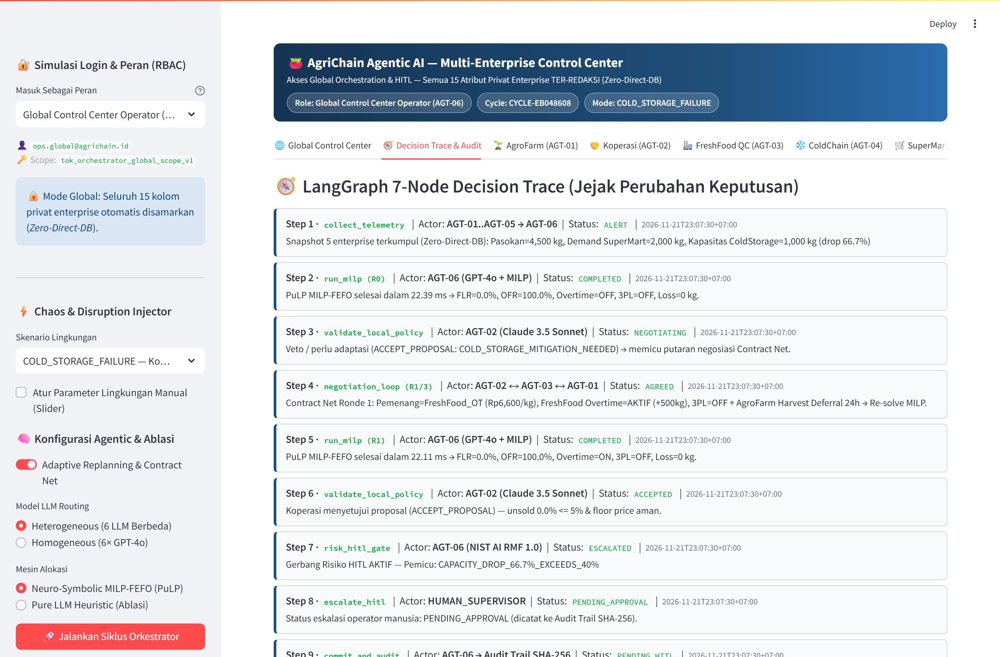
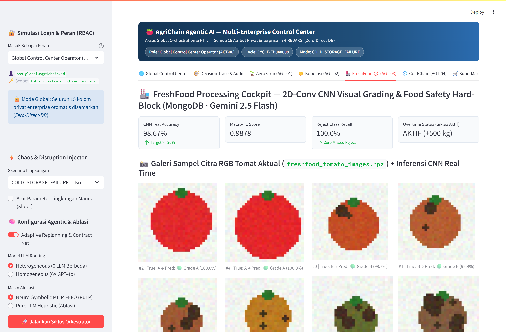
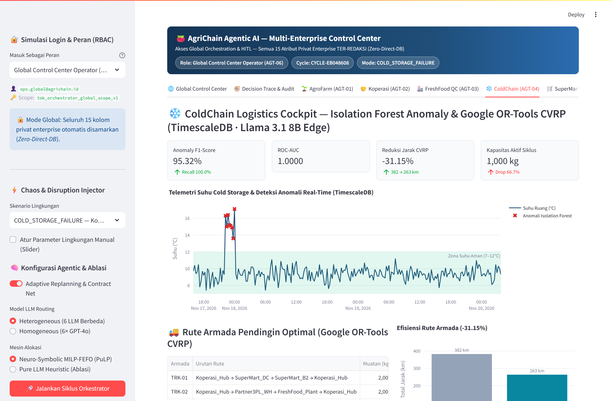
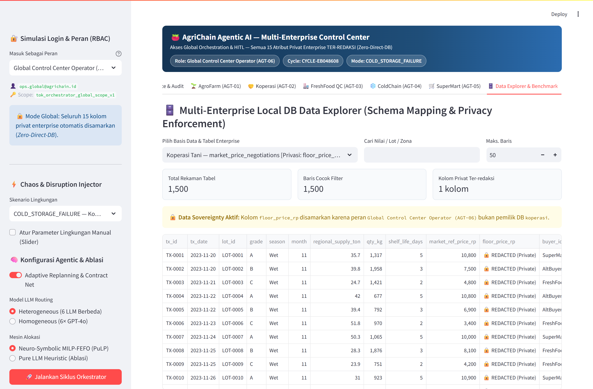
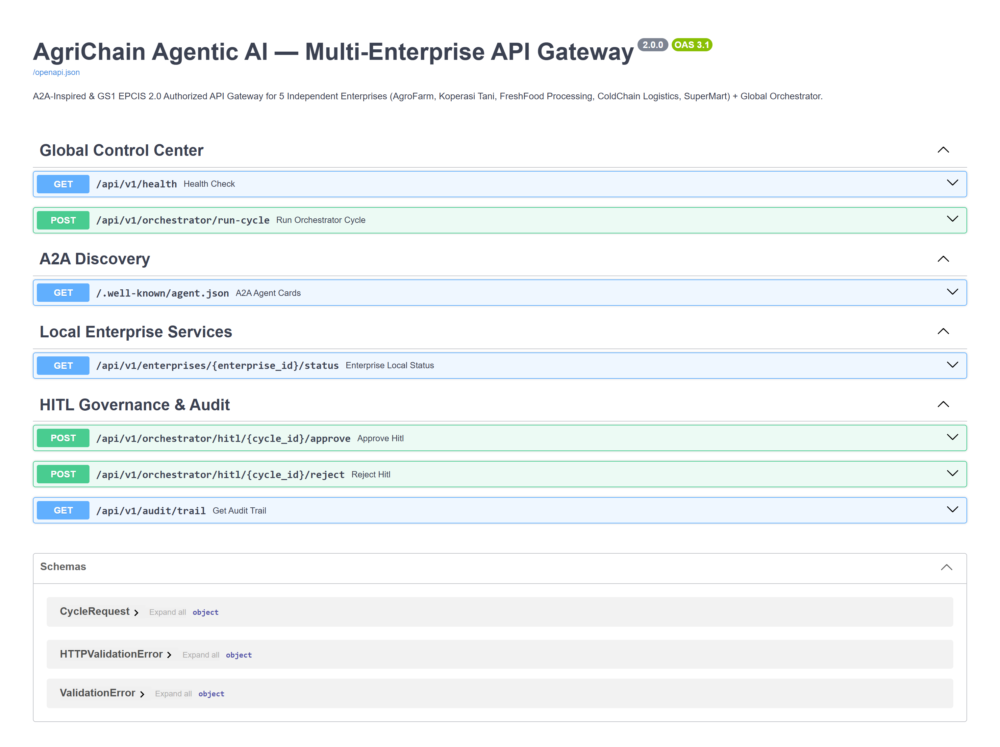
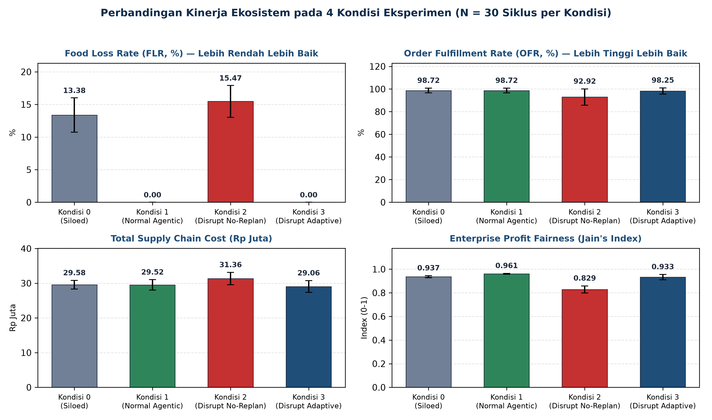

# 🍅 agrichain-agentic-ai

**Smart Agriculture & Food Supply Chain — *Heterogeneous Multi-Enterprise Agentic AI Ecosystem* untuk Optimasi Produksi Pertanian, Distribusi Pangan, Negosiasi Lintas Perusahaan, dan *Adaptive Replanning***


> **Proyek Magister Ilmu Komputer (S2 — Konsentrasi Kecerdasan Artifisial)**  
> **Mata Kuliah:** *AI Agentic Technology Systems for Digital Enterprise Ecosystem*  
> **Laporan Lengkap (Bab 1–11, 45 Halaman):** [`Laporan_Bab1_11_Smart_Agriculture_Agentic_AI.pdf`](./Laporan_Bab1_11_Smart_Agriculture_Agentic_AI.pdf) · [`DOCX`](./Laporan_Bab1_11_Smart_Agriculture_Agentic_AI.docx) · [`Markdown`](./Laporan_Bab1_11_Smart_Agriculture_Agentic_AI.md)

---

## Ringkasan Proyek

`agrichain-agentic-ai` mengoordinasikan **5 perusahaan independen** (*AgroFarm, Koperasi Tani, FreshFood Processing, ColdChain Logistics, SuperMart*) melalui **Global Agentic Control Center** menggunakan **6 agen otonom** dengan **heterogenitas model ganda** (6 model domain ML/optimasi berbeda + 6 keluarga LLM berbeda) serta prinsip **Zero-Direct-DB-Access (*Data Sovereignty*)**.

| ID Agen | Enterprise / Layer | Model Domain AI / Optimasi | Model LLM Backbone | Basis Data Lokal |
| :--- | :--- | :--- | :--- | :--- |
| `AGT-01` | **AgroFarm** | Random Forest Regression | **Qwen 2.5 14B Instruct** *(On-Premise)* | PostgreSQL (`agrofarm_pg.sqlite`) |
| `AGT-02` | **Koperasi Tani** | LightGBM + Contract Net Auction | **Claude 3.5 Sonnet** | MySQL (`koperasi_mysql.sqlite`) |
| `AGT-03` | **FreshFood Processing** | 2D-Conv Visual CNN + Food Safety Hard-Block + FEFO | **Gemini 2.5 Flash** *(Multimodal VLM)* | MongoDB (`freshfood_tomato_qc.json` + RGB NPZ) |
| `AGT-04` | **ColdChain Logistics** | Isolation Forest + Google OR-Tools CVRP | **Llama 3.1 8B Instruct** *(Edge)* | TimescaleDB (`coldchain_timescaledb.sqlite`) |
| `AGT-05` | **SuperMart** | XGBoost Regression + Newsvendor Safety-Stock | **Mistral Small 3 (24B)** | MySQL (`supermart_mysql.sqlite`) |
| `AGT-06` | **Global Control Center** | MILP-FEFO Solver (PuLP / CBC) | **GPT-4o** *(LangGraph Orchestrator)* | Redis + SHA-256 Audit Trail |

---

## Galeri Screenshot Aplikasi Aktual

### 1. Global Control Center — Simulasi Role RBAC, KPI Delta, HITL Console, Sankey & Perubahan Keputusan Terukur


### 2. LangGraph 7-Node Decision Trace, FIPA-ACL Feed & SHA-256 Audit Trail


### 3. Modul FreshFood (`AGT-03`) — Galeri Citra RGB Tomat Aktual, CNN Visual QC & Food Safety Hard-Block


### 4. Modul ColdChain (`AGT-04`) — Deteksi Anomali Suhu Isolation Forest & Optimasi Rute OR-Tools CVRP (-31,15%)


### 5. Multi-Enterprise Data Explorer & Penegakan Privasi Data (`🔒 REDACTED`)


### 6. FastAPI Multi-Enterprise Gateway — Swagger UI (`:8000/docs`)


---

## Hasil Evaluasi Empiris (Aktual dari Eksekusi Kode)

Seluruh angka terekam langsung dari [`src/models/train_all.py`](./src/models/train_all.py) (`results/ml_metrics.json`) dan [`src/experiments/run_experiments.py`](./src/experiments/run_experiments.py) (`results/experiment_results.json`, `seed = 42`, 30 siklus berpasangan per kondisi).

### 1. Kinerja 5 Model AI Domain Lokal & Optimasi
| Agen & Enterprise | Model | Hasil Uji Aktual | Target KPI | Status |
| :--- | :--- | :--- | :--- | :---: |
| `AGT-01` AgroFarm | Random Forest Regression | MAE **93,09 kg (7,24% mean)**, RMSE 120,14 kg, R² **0,9393** | MAE ≤ 10% | Lulus |
| `AGT-02` Koperasi Tani | LightGBM Regressor | MAE **Rp240,1/kg**, MAPE **4,28%**, R² **0,9853** | MAPE ≤ 8% | Lulus |
| `AGT-03` FreshFood | 2D-Conv Spatial-Spectral CNN | Accuracy **98,67%**, Macro-F1 **0,9878**, Reject Recall **100,0%** | Acc ≥ 90% | Lulus |
| `AGT-04` ColdChain | Isolation Forest + OR-Tools CVRP | Anomaly F1 **95,32%** (Recall **100,0%**, AUC **1,0000**); CVRP 382 → 263 km (**-31,15%**) | F1 ≥ 90%, Rute ≥ 10% | Lulus |
| `AGT-05` SuperMart | XGBoost Regression | MAE **26,71 kg**, MAPE **3,72%**, R² **0,9215** | MAPE ≤ 15% | Lulus |
| `AGT-06` Control Center | PuLP CBC MILP-FEFO | Normal & Disrupt Adaptive: FLR **0,0%**, OFR **100,0%**, solve **29,21 ms** | FLR ≤ 5%, OFR ≥ 95% | Lulus |

### 2. Perbandingan 4 Kondisi Eksperimen & 3 Studi Ablasi (30 Siklus Berpasangan)
| Global KPI | Kondisi 0: Siloed Baseline | Kondisi 1: Normal Agentic | Kondisi 2: Disrupt Tanpa Replan | Kondisi 3: Disrupt + Adaptive Replan | Dampak Adaptive (K3 vs K2) |
| :--- | :---: | :---: | :---: | :---: | :---: |
| **Food Loss Rate (FLR, %)** | 13,38 ± 2,63 | **0,00 ± 0,00** | 15,47 ± 2,44 | **0,00 ± 0,00** | **-15,47 poin %** |
| **Order Fulfillment Rate (OFR, %)** | 98,72 ± 2,11 | 98,72 ± 2,11 | 92,92 ± 7,24 | **98,25 ± 2,79** | **+5,33 poin %** |
| **Total Supply Chain Cost (Rp Juta)** | 29,58 ± 1,25 | 29,52 ± 1,51 | 31,36 ± 1,78 | **29,06 ± 1,72** | **-Rp2,31 Jt (-7,35%)** |
| **Net Ecosystem Profit (Rp Juta)** | 21,74 ± 1,01 | **27,38 ± 1,16** | 20,21 ± 1,64 | **28,16 ± 1,51** | **+Rp7,94 Jt (+39,3%)** |
| **Jain's Fairness Index** | 0,9367 | **0,9607** | 0,8286 | **0,9332** | **+0,1046 (+12,6%)** |
| **Replanning Time (dtk)** | — | 2,24 ± 0,06 | — | **4,23 ± 0,09** | **< 5 detik** |
| **Privacy Leaks (Field Privat)** | 0 | **0** | 0 | **0** | **Zero Leak** |

- **Ablasi 1 (*Multi-Agent 6 Agen* vs *Single-Agent Monolitik*):** Menjaga **0 kebocoran data privat** (vs **15 field privat terekspos**) dan menaikkan *Jain's Fairness Index* dari **0,8355 → 0,9332**.
- **Ablasi 2 (*Heterogeneous 6-LLM* vs *Homogeneous 6× GPT-4o*):** Menghemat biaya token **41,71%** (`USD 17,50` → `USD 10,20` per 1.000 siklus) dan mempercepat *replanning* **10,19%** (`4,71 s` → `4,23 s`; *edge alert* ColdChain turun **-78,2%**).
- **Ablasi 3 (*Neuro-Symbolic MILP-FEFO + LLM* vs *Pure LLM*):** Menurunkan pelanggaran kendala dari **100,0% → 0,0%** dan menekan FLR dari **1,52% → 0,00%**.




---

## Petunjuk Menjalankan di Visual Studio Code (VS Code)

Proyek ini sudah dilengkapi konfigurasi siap pakai di [`.vscode/launch.json`](./.vscode/launch.json) dan [`.vscode/tasks.json`](./.vscode/tasks.json):

1. **Buka Folder Proyek di VS Code:**
   - Pilih `File` → `Open Folder...` lalu pilih folder `agrichain-agentic-ai` (atau ekstrak `agrichain-agentic-ai_submission.zip`).
2. **Pilih Python Interpreter (Python 3.11+):**
   - Tekan `Ctrl + Shift + P` → ketik `Python: Select Interpreter` → pilih Python 3.11+ (atau virtual environment `.venv`).
3. **Instal Dependensi:**
   - Buka Terminal (`Ctrl + ~`) atau jalankan Task `AgriChain: Install Requirements`, lalu jalankan:
     ```bash
     pip install -r requirements.txt
     ```
4. **Jalankan Server dengan 1 Klik via *Run & Debug* (`Ctrl + Shift + D`):**
   - Pilih **`AgriChain: FastAPI Gateway (Port 8000)`** → tekan `F5` (Swagger UI aktif di `http://127.0.0.1:8000/docs`).
   - Buka konfigurasi kedua **`AgriChain: Streamlit Control Center (Port 8501)`** → tekan `F5` (Dashboard aktif di `http://127.0.0.1:8501`).
   - *(Opsional via Terminal Split)*:
     ```bash
     # Terminal 1 — FastAPI Gateway
     python -m uvicorn src.api.main:app --reload --port 8000

     # Terminal 2 — Streamlit Multi-Enterprise Control Center
     python -m streamlit run src/dashboard/app.py --server.port 8501
     ```
5. **Jalankan Pengujian & Reproduksi Eksperimen:**
   ```bash
   # Pengujian otomatis (7/7 unit + FastAPI integration tests)
   pytest tests/test_ecosystem.py -v

   # Latih ulang 5 model ML + verifikasi MILP-FEFO & CVRP
   python src/models/train_all.py

   # Jalankan seluruh eksperimen Bab 9 (4 kondisi x 30 siklus + 3 ablasi + 3 grafik)
   python src/experiments/run_experiments.py
   ```
6. *(Opsional)* Mode **LIVE 6-LLM API**: salin `.env.example` menjadi `.env`, ubah `LLM_EXECUTION_MODE=LIVE`, dan isi kredensial OpenAI / Anthropic / Gemini / Mistral / Ollama lokal.

---

## Panduan Alur Demo 5 Menit (Membuktikan Perubahan Keputusan Terukur)

Gunakan alur berikut saat presentasi/demo di hadapan dosen penguji:

1. **Menit 1 — Simulasi Role RBAC & Kedaulatan Data (Tab `Data Explorer & Benchmark`):**
   - Dalam peran default **`Global Control Center Operator (AGT-06)`**, tunjukkan tabel `Koperasi Tani — market_price_negotiations`: kolom `floor_price_rp` otomatis tampil **`🔒 REDACTED (Private)`**.
   - Pindah peran di *sidebar* ke **`Koperasi Tani Manager (AGT-02)`** → kolom `floor_price_rp` langsung terbuka lokal, sementara `private_costs` AgroFarm tetap ter-redaksi.
2. **Menit 2 — Bukti Perubahan Keputusan Terukur saat Gangguan (Tab `Global Control Center`):**
   - Pilih skenario **`COLD_STORAGE_FAILURE`** (kapasitas ruang dingin turun 3.000 → 1.000 kg) dengan **`Adaptive Replanning = ON`**.
   - Tunjukkan grafik **Perubahan Alokasi (kg): Statis vs Adaptive Replanning** — terlihat jelas alokasi 500 kg berpindah dari `ColdStorage` ke `FreshFood_OT` (+500 kg lembur) dengan FLR **0,00%** dan profit naik.
   - Uji juga **`FOOD_SAFETY_FAIL`** (lot `H003` diblokir mutlak `0 kg`) dan **`DEADLOCK`** (berhenti tepat di ronde 3/3 → eskalasi HITL, 0 *privacy leak*).
3. **Menit 3 — *Glass-Box* Decision Trace, Live Agent Status & HITL SHA-256 Audit (Tab `Decision Trace & Audit`):**
   - Tunjukkan **Live Agent Status Matrix** (6 agen heterogen + latensi & biaya token), **LangGraph 7-Node Decision Trace**, log pesan **FIPA-ACL / GS1 EPCIS 2.0**, lalu klik **`Approve & Commit Plan`** dan **`Verifikasi Integritas Rantai SHA-256`** (`VERIFIED ✅`).
4. **Menit 4 — 5 Modul Interaktif Tiap Enterprise:**
   - Buka **`FreshFood QC (AGT-03)`** (galeri citra RGB tomat nyata + CNN + simulator *Food Safety Hard-Block*), **`ColdChain (AGT-04)`** (grafik anomali Isolation Forest + optimasi rute OR-Tools CVRP 382 → 263 km), serta simulator prediksi RF (`AgroFarm`), LightGBM (`Koperasi`), dan XGBoost+Newsvendor (`SuperMart`).
5. **Menit 5 — Arsitektur Server API & Automated Testing:**
   - Tunjukkan Swagger UI `http://127.0.0.1:8000/docs` (`/.well-known/agent.json`, `/api/v1/enterprises/{enterprise_id}/status`, `/api/v1/orchestrator/run-cycle`, `/api/v1/audit/trail`) dan jalankan `pytest tests/test_ecosystem.py -v` (**7/7 PASSED**).

---

## *Endpoint* FastAPI Gateway (`src/api/main.py`)

| Method | Endpoint | Fungsi |
| :---: | :--- | :--- |
| `GET` | `/api/v1/health` | Status layanan, jumlah agen aktif (6), dan validasi rantai audit SHA-256 |
| `GET` | `/.well-known/agent.json` | A2A *Agent Discovery Cards* seluruh 6 agen heterogen |
| `GET` | `/api/v1/enterprises/{enterprise_id}/status` | Status *local microservice*, DB lokal, metrik ML, & daftar field privat yang dilindungi (`agrofarm`, `koperasi`, `freshfood`, `coldchain`, `supermart`) |
| `POST` | `/api/v1/orchestrator/run-cycle` | Menjalankan 1 siklus LangGraph Orchestrator + mengembalikan KPI, alokasi, `decision_trace`, & `agent_statuses` |
| `POST` | `/api/v1/orchestrator/hitl/{cycle_id}/approve` | Persetujuan operator HITL (dicatat dengan hash SHA-256 ke `audit_trail.jsonl`) |
| `POST` | `/api/v1/orchestrator/hitl/{cycle_id}/reject` | Penolakan operator HITL dengan catatan audit SHA-256 |
| `GET` | `/api/v1/audit/trail` | Mengambil catatan *hash-chained audit trail* terbaru + status verifikasi kriptografi |

---

## Struktur Repositori

```text
agrichain-agentic-ai/
├── .vscode/
│   ├── launch.json                      # 1-klik Run & Debug VS Code (FastAPI, Streamlit, Train, Experiments)
│   └── tasks.json                       # Task otomatis VS Code (Install, Pytest, Servers)
├── config/settings.py                   # Registri 6 profil LLM heterogen & ambang HITL NIST AI RMF 1.0
├── src/
│   ├── data/                            # Generator 19.575 rekaman + 3.000 citra RGB + Adapter 5 DB lokal
│   ├── protocols/                       # A2A, FIPA-ACL, GS1 EPCIS 2.0, Privacy Firewall, SHA-256 Audit
│   ├── models/                          # 5 model ML lokal + PuLP MILP-FEFO + OR-Tools CVRP + train_all.py
│   ├── llm/                             # 6 System Prompts + Multi-Provider 6-LLM Router (LIVE & SIMULATED)
│   ├── agents/                          # 5 Enterprise Agents + LangGraph StateGraph Global Orchestrator
│   ├── api/main.py                      # FastAPI Gateway (Global + 5 Local Enterprise Services + Audit)
│   ├── experiments/run_experiments.py   # Benchmark 4 Kondisi x 30 siklus + 3 Ablasi + 3 Failure Cases
│   └── dashboard/app.py                 # Streamlit Role-Based Cockpit (8 Tab + RBAC + Data Explorer)
├── tests/test_ecosystem.py              # 7 Automated Unit & FastAPI Integration Tests (pytest)
├── docs/screenshots/                    # 6 Screenshot aktual dashboard & FastAPI Swagger UI
├── data/                                # Dataset dummy tergenerasi & 5 database lokal terisolasi
├── results/                             # Model terlatih (.pkl), metrik JSON, audit_trail.jsonl, & 3 grafik
├── docker-compose.yml                   # Stack PostgreSQL 16, MySQL 8, MongoDB 7, TimescaleDB, Redis 7
├── Laporan_Bab1_11_Smart_Agriculture_Agentic_AI.{md,docx,pdf}  # Laporan Lengkap (Bab 1–11, 45 halaman)
└── Laporan_Bab1_7_Smart_Agriculture_Agentic_AI.{md,docx,pdf}   # Laporan Rancangan Awal (Bab 1–7, 35 halaman)
```
