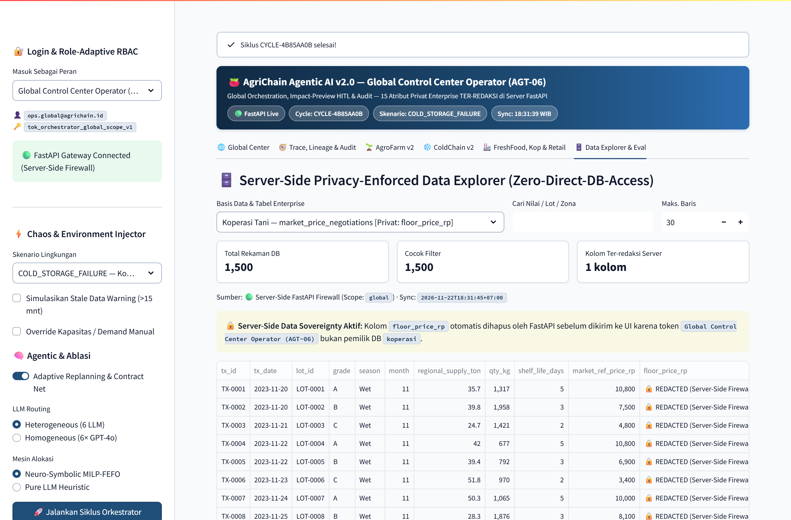
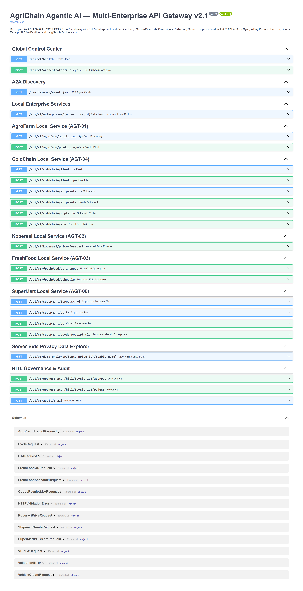
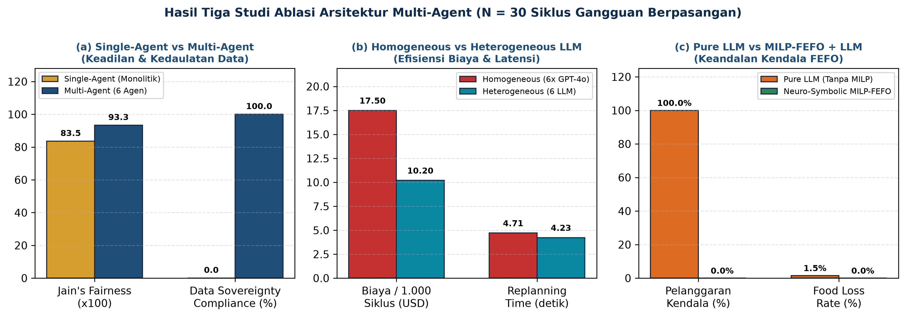

# 🍅 agrichain-agentic-ai (v2.0)

**Smart Agriculture & Food Supply Chain — *Heterogeneous Multi-Enterprise Agentic AI Ecosystem* untuk Optimasi Produksi Pertanian, Distribusi Pangan, Negosiasi Lintas Perusahaan, dan *Adaptive Replanning***


> **Proyek Magister Ilmu Komputer (S2 — Konsentrasi Kecerdasan Artifisial)**  
> **Mata Kuliah:** *AI Agentic Technology Systems for Digital Enterprise Ecosystem*  
> **Laporan Lengkap v2.0 (Bab 1–11, 53 Halaman):** [`Laporan_Bab1_11_Smart_Agriculture_Agentic_AI.pdf`](./Laporan_Bab1_11_Smart_Agriculture_Agentic_AI.pdf) · [`DOCX`](./Laporan_Bab1_11_Smart_Agriculture_Agentic_AI.docx) · [`Markdown`](./Laporan_Bab1_11_Smart_Agriculture_Agentic_AI.md)  
> **Rancangan & Analisis Arsitektur v2.0:** [`Analisis_Insight_ColdChain_AgroFarm_UIUX.md`](./Analisis_Insight_ColdChain_AgroFarm_UIUX.md) · [`Rancangan_Improvement_Proper_AgriChain_v2.md`](./Rancangan_Improvement_Proper_AgriChain_v2.md)

---

## Ringkasan Proyek & Peningkatan v2.0 (4 Pilar)

`agrichain-agentic-ai` mengoordinasikan **5 perusahaan independen** (*AgroFarm, Koperasi Tani, FreshFood Processing, ColdChain Logistics, SuperMart*) melalui **Global Agentic Control Center** menggunakan **6 agen otonom** dengan **heterogenitas model ganda** (6 model domain ML/optimasi berbeda + 6 keluarga LLM berbeda) serta prinsip **Zero-Direct-DB-Access (*Data Sovereignty*)**.

### Peningkatan Utama Versi 2.0
1. **Pilar 1 — Arsitektur, Kontrak Data & *Server-Side RBAC*:** Standarisasi suhu aman tomat **`7,0–12,0°C`** lintas modul, pelacakan *canonical cross-enterprise lineage* (`block_id → lot_id → qc_doc_id → shipment_id → trip_id → vehicle_id → po_ref`), redaksi data privat di **server FastAPI** berbasis header `X-Scoped-Token`, serta rantai audit kriptografi **SHA-256** (*concurrency-safe*).
2. **Pilar 2 — Pendalaman AI Lokal (`AGT-01` AgroFarm v2 & `AGT-04` ColdChain v2):**
   - **AgroFarm v2 (`rf-v2.0`):** Random Forest 250 pohon + fitur **NDVI** + **80% Quantile Prediction Interval (`p10–p90`)** + *Feature Importance* + pembanding *baseline* (*Hist Mean* & *Linear Reg*) + *Crop Monitoring Deviation Engine* (**14 hari ± 2σ**) + *Sensor Outage Safety Fallback* (offline ≥ 3 hari → `FALLBACK_HISTORICAL_MEAN`) + skenario **`EXTREME_RAIN`** (jendela panen maju `-2 hari`).
   - **ColdChain v2 (`iforest-vrptw-v2.0`):** Google OR-Tools **VRPTW (*Time Windows*)** dengan 4 skenario (`NORMAL`, `ROAD_DISRUPTION`, `VEHICLE_BREAKDOWN`, `COLD_STORAGE_DROP`) & koordinat geospasial Yogyakarta/Sleman/Bantul + **XGBoost ETA Regressor** (`MAE 7,66 menit`) + deteksi anomali suhu **Isolation Forest** berbasis SOP `7–12°C`.
3. **Pilar 3 — *Decoupled FastAPI Multi-Enterprise Gateway v2.0*:** Endpoint REST khusus AgroFarm (`/monitoring`, `/predict`), ColdChain (`/fleet` & `/shipments` CRUD dengan validasi ketat, `/vrptw`, `/eta`), *Server-Side Privacy Data Explorer* (`/api/v1/data-explorer/{enterprise_id}/{table_name}`), serta `/api/v1/orchestrator/run-cycle` dengan *Executive Briefing* & *lineage*.
4. **Pilar 4 — *Role-Adaptive Enterprise Cockpit v2.0*:** UI terpisah via HTTP (`ApiBridge` + `X-Scoped-Token`), navigasi adaptif peran (*Global Operator*, *Farm Manager*, *Fleet Manager*, *Koperasi*, *FreshFood*, *SuperMart*), **5 UI State Wajib** (*Loading, Empty, Error + Retry, Stale/Partial Data Warning, Success + SHA-256 Audit*), **Impact-Preview HITL Confirmation Console**, dan **Peta Geospasial VRPTW Interaktif**.

| ID Agen | Enterprise / Layer | Model Domain AI / Optimasi (v2.0) | Model LLM Backbone | Basis Data Lokal |
| :--- | :--- | :--- | :--- | :--- |
| `AGT-01` | **AgroFarm** | Random Forest 250 Trees + NDVI + 80% Quantile PI + 14d ± 2σ Monitor | **Qwen 2.5 14B Instruct** *(On-Premise)* | PostgreSQL (`agrofarm_pg.sqlite`) |
| `AGT-02` | **Koperasi Tani** | LightGBM + Contract Net Auction | **Claude 3.5 Sonnet** | MySQL (`koperasi_mysql.sqlite`) |
| `AGT-03` | **FreshFood Processing** | 2D-Conv Visual CNN + Food Safety Hard-Block + FEFO | **Gemini 2.5 Flash** *(Multimodal VLM)* | MongoDB (`freshfood_tomato_qc.json` + RGB NPZ) |
| `AGT-04` | **ColdChain Logistics** | Isolation Forest (7–12°C) + XGBoost ETA + OR-Tools VRPTW | **Llama 3.1 8B Instruct** *(Edge)* | TimescaleDB (`coldchain_timescaledb.sqlite`) |
| `AGT-05` | **SuperMart** | XGBoost Regression + Newsvendor Safety-Stock | **Mistral Small 3 (24B)** | MySQL (`supermart_mysql.sqlite`) |
| `AGT-06` | **Global Control Center** | MILP-FEFO Solver (PuLP / CBC) + Cross-Enterprise Lineage | **GPT-4o** *(LangGraph Orchestrator)* | Redis + SHA-256 Audit Trail |

---

## Galeri Screenshot Aplikasi Aktual (v2.0)

### 1. Global Command Center — Executive Briefing, Impact-Preview HITL Console, KPI Delta, Sankey & Decision Shift


### 2. LangGraph Decision Trace, Canonical Lineage (`block_id → po_ref`), FIPA-ACL Feed & SHA-256 Audit Trail


### 3. Modul AgroFarm v2 (`AGT-01`) — Crop Monitoring 14d ± 2σ, 80% Quantile PI, Feature Importance & Live Predictor


### 4. Modul ColdChain v2 (`AGT-04`) — Peta Geospasial OR-Tools VRPTW, Fleet/Shipments CRUD, XGBoost ETA & SOP 7–12°C


### 5. Modul FreshFood (`AGT-03`), Koperasi (`AGT-02`) & SuperMart (`AGT-05`) — Galeri Citra RGB CNN, Harga & Permintaan


### 6. Server-Side Privacy Data Explorer (`🔒 REDACTED` via `X-Scoped-Token`) & Grafik Benchmark Bab 9


### 7. FastAPI Multi-Enterprise Gateway v2.0 — Swagger UI (`:8000/docs`)


---

## Hasil Evaluasi Empiris (Aktual dari Eksekusi Kode v2.0)

Seluruh angka terekam langsung dari [`src/models/train_all.py`](./src/models/train_all.py) (`results/ml_metrics.json`) dan [`src/experiments/run_experiments.py`](./src/experiments/run_experiments.py) (`results/experiment_results.json`, `seed = 42`, 30 siklus berpasangan per kondisi).

### 1. Kinerja 5 Model AI Domain Lokal & Optimasi (v2.0)
| Agen & Enterprise | Model | Hasil Uji Aktual (v2.0) | Target KPI | Status |
| :--- | :--- | :--- | :--- | :---: |
| `AGT-01` AgroFarm | Random Forest 250 Trees + NDVI + 80% PI | MAE **87,84 kg (6,83% mean)**, RMSE 114,47 kg, R² **0,9449**, PI80 Cov **91,67%** (unggul vs Hist Mean 421,47 kg & LinReg 125,00 kg) | MAE ≤ 10% | Lulus |
| `AGT-02` Koperasi Tani | LightGBM Regressor | MAE **Rp240,1/kg**, MAPE **4,28%**, R² **0,9853** | MAPE ≤ 8% | Lulus |
| `AGT-03` FreshFood | 2D-Conv Spatial-Spectral CNN | Accuracy **98,67%**, Macro-F1 **0,9878**, Reject Recall **100,0%** | Acc ≥ 90% | Lulus |
| `AGT-04` ColdChain | Isolation Forest (7–12°C) + XGBoost ETA + OR-Tools VRPTW | Anomaly F1 **95,32%** (Recall **100%**, AUC **1,0000**); ETA MAE **7,66 mnt** (MAPE **5,35%**); VRPTW 382 → 263 km (**-31,15%**, **0 TW violations**) | F1 ≥ 90%, Rute ≥ 10% | Lulus |
| `AGT-05` SuperMart | XGBoost Regression | MAE **26,71 kg**, MAPE **3,72%**, R² **0,9215** | MAPE ≤ 15% | Lulus |
| `AGT-06` Control Center | PuLP CBC MILP-FEFO | Normal & Disrupt Adaptive: FLR **0,0%**, OFR **100,0%**, solve **20,67 ms** | FLR ≤ 5%, OFR ≥ 95% | Lulus |

### 2. Perbandingan 4 Kondisi Eksperimen & 3 Studi Ablasi (30 Siklus Berpasangan)
| Global KPI | Kondisi 0: Siloed Baseline | Kondisi 1: Normal Agentic | Kondisi 2: Disrupt Tanpa Replan | Kondisi 3: Disrupt + Adaptive Replan | Dampak Adaptive (K3 vs K2) |
| :--- | :---: | :---: | :---: | :---: | :---: |
| **Food Loss Rate (FLR, %)** | 13,38 ± 2,63 | **0,00 ± 0,00** | 15,47 ± 2,44 | **0,00 ± 0,00** | **-15,47 poin %** |
| **Order Fulfillment Rate (OFR, %)** | 98,72 ± 2,11 | 98,72 ± 2,11 | 92,92 ± 7,24 | **98,25 ± 2,79** | **+5,33 poin %** |
| **Total Supply Chain Cost (Rp Juta)** | 29,58 ± 1,25 | 29,52 ± 1,51 | 31,36 ± 1,78 | **29,06 ± 1,72** | **-Rp2,31 Jt (-7,35%)** |
| **Net Ecosystem Profit (Rp Juta)** | 21,74 ± 1,01 | **27,38 ± 1,16** | 20,21 ± 1,64 | **28,16 ± 1,51** | **+Rp7,94 Jt (+39,3%)** |
| **Jain's Fairness Index** | 0,9367 | **0,9607** | 0,8286 | **0,9332** | **+0,1046 (+12,6%)** |
| **Replanning Time (dtk)** | — | 2,24 ± 0,06 | — | **4,23 ± 0,09** | **< 5 detik** |
| **Privacy Leaks (Field Privat)** | 0 | **0** | 0 | **0** | **Zero Leak** |

- **Ablasi 1 (*Multi-Agent 6 Agen* vs *Single-Agent Monolitik*):** Menjaga **0 kebocoran data privat** (vs **15 field privat terekspos**) dan menaikkan *Jain's Fairness Index* dari **0,8355 → 0,9332**.
- **Ablasi 2 (*Heterogeneous 6-LLM* vs *Homogeneous 6× GPT-4o*):** Menghemat biaya token **41,71%** (`USD 17,50` → `USD 10,20` per 1.000 siklus) dan mempercepat *replanning* **10,19%** (`4,71 s` → `4,23 s`; *edge alert* ColdChain turun **-78,2%**).
- **Ablasi 3 (*Neuro-Symbolic MILP-FEFO + LLM* vs *Pure LLM*):** Menurunkan pelanggaran kendala dari **100,0% → 0,0%** dan menekan FLR dari **1,52% → 0,00%**.





---

## Petunjuk Menjalankan di Visual Studio Code (VS Code)

Proyek ini sudah dilengkapi konfigurasi siap pakai di [`.vscode/launch.json`](./.vscode/launch.json) dan [`.vscode/tasks.json`](./.vscode/tasks.json):

1. **Buka Folder Proyek di VS Code:**
   - Pilih `File` → `Open Folder...` lalu pilih folder `agrichain-agentic-ai` (atau ekstrak `agrichain-agentic-ai_submission.zip`).
2. **Pilih Python Interpreter (Python 3.11+):**
   - Tekan `Ctrl + Shift + P` → ketik `Python: Select Interpreter` → pilih Python 3.11+ (atau virtual environment `.venv`).
3. **Instal Dependensi:**
   - Buka Terminal (`Ctrl + ~`) atau jalankan Task `AgriChain: Install Requirements`:
     ```bash
     pip install -r requirements.txt
     ```
4. **Jalankan Server dengan 1 Klik via *Run & Debug* (`Ctrl + Shift + D`):**
   - Jalankan **`AgriChain: FastAPI Gateway (Port 8000)`** terlebih dahulu (`F5`) → Swagger UI aktif di `http://127.0.0.1:8000/docs`.
   - Jalankan **`AgriChain: Streamlit Control Center (Port 8501)`** (`F5`) → Dashboard v2.0 terhubung penuh ke FastAPI di `http://127.0.0.1:8501`.
   - *(Opsional via Terminal Split)*:
     ```bash
     # Terminal 1 — FastAPI Multi-Enterprise Gateway v2.0
     python -m uvicorn src.api.main:app --reload --port 8000

     # Terminal 2 — Streamlit Decoupled Multi-Enterprise Cockpit v2.0
     python -m streamlit run src/dashboard/app.py --server.port 8501
     ```
5. **Jalankan Pengujian & Reproduksi Eksperimen:**
   ```bash
   # Pengujian otomatis (10/10 unit + server-side RBAC + AgroFarm/ColdChain v2 + FastAPI integration tests)
   pytest tests/test_ecosystem.py -v

   # Latih ulang 5 model ML v2.0 (termasuk NDVI 80% PI & XGBoost ETA + VRPTW)
   python src/models/train_all.py

   # Jalankan seluruh eksperimen Bab 9 (4 kondisi x 30 siklus + 3 ablasi + 3 grafik)
   python src/experiments/run_experiments.py
   ```
6. *(Opsional)* Mode **LIVE 6-LLM API**: salin `.env.example` menjadi `.env`, ubah `LLM_EXECUTION_MODE=LIVE`, dan isi kredensial OpenAI / Anthropic / Gemini / Mistral / Ollama lokal.

---

## Panduan Alur Demo 5 Menit (8 Skenario Adaptif & Perubahan Keputusan Terukur)

1. **Menit 1 — *Server-Side* RBAC & Navigasi Adaptif Peran:**
   - Dalam peran default **`Global Control Center Operator (AGT-06)`**, buka tab **`Server-Side Data Explorer & Benchmark`** dan pilih `Koperasi Tani — market_price_negotiations`: kolom `floor_price_rp` otomatis tampil **`🔒 REDACTED (Server-Side Firewall)`** langsung dari respons API FastAPI.
   - Pindah peran di *sidebar* ke **`Farm Manager — AgroFarm (AGT-01)`** atau **`Fleet Manager — ColdChain (AGT-04)`** untuk melihat ruang kerja lokal khusus peran (*Role-Adaptive Navigation*) sekaligus pembukaan kolom privat miliknya sendiri.
2. **Menit 2 — Bukti Perubahan Keputusan Terukur (8 Skenario Gangguan):**
   - Uji **`COLD_STORAGE_FAILURE`** (kapasitas ruang dingin `3.000 → 1.000 kg`): alokasi `500 kg` berpindah otomatis ke `FreshFood_OT` dengan FLR `0,00%` dan Impact-Preview HITL Console muncul sebelum eksekusi.
   - Uji **`EXTREME_RAIN`** (AgroFarm BLK-11): curah hujan `96 mm/14h` & NDVI turun `0,41` → jendela panen maju **`-2 hari`**, hasil turun ~13,9% dengan interval 80% Quantile PI melebar.
   - Uji **`SENSOR_OUTAGE`**: sensor offline ≥ 3 hari → muncul *banner* kuning **Stale / Partial Data Warning** dan model berpindah aman ke `FALLBACK_HISTORICAL_MEAN`.
   - Uji **`FOOD_SAFETY_FAIL`** (lot `H003` diblokir mutlak `0 kg`) & **`DEADLOCK`** (berhenti tepat di ronde 3/3 → eskalasi HITL).
3. **Menit 3 — *Glass-Box* Decision Trace, Canonical Lineage & HITL SHA-256 Audit:**
   - Buka tab **`Decision Trace, Lineage & Audit`** untuk melihat rantai data end-to-end (`BLK-07 → H001 → QC-H001 → SH001 → TRIP-01 → V001 → PO-SM-001`), 7-node LangGraph trace, pesan FIPA-ACL/EPCIS, lalu klik **`Approve & Commit via API`** dan verifikasi integritas rantai SHA-256 (`VERIFIED ✅`).
4. **Menit 4 — Pendalaman AI Lokal AgroFarm v2 & ColdChain v2:**
   - Di **`AgroFarm v2 (AGT-01)`**, tampilkan tabel *Crop Monitoring 14d ± 2σ*, grafik *Feature Importance*, dan *Live Yield & PI80 Predictor*.
   - Di **`ColdChain v2 (AGT-04)`**, bandingkan skenario VRPTW di **Peta Geospasial Yogyakarta/Sleman/Bantul**, tambahkan kendaraan/shipment baru via form CRUD yang tervalidasi API (deadline & suhu `7–12°C`), serta simulasikan **XGBoost ETA**.
5. **Menit 5 — FastAPI Swagger UI v2.0 & Verifikasi `pytest`:**
   - Buka `http://127.0.0.1:8000/docs` dan jalankan `pytest tests/test_ecosystem.py -v` (**10/10 PASSED**).

---

## *Endpoint* FastAPI Multi-Enterprise Gateway v2.0 (`src/api/main.py`)

| Method | Endpoint | Fungsi |
| :---: | :--- | :--- |
| `GET` | `/api/v1/health` | Status layanan v2.0, SOP suhu tomat (`7,0–12,0°C`), jumlah agen (6), & validasi SHA-256 |
| `GET` | `/.well-known/agent.json` | A2A *Agent Discovery Cards* seluruh 6 agen heterogen |
| `GET` | `/api/v1/enterprises/{enterprise_id}/status` | Status *local microservice*, DB lokal, metrik ML aktual, & field privat yang dilindungi |
| `GET` | `/api/v1/agrofarm/monitoring` | Evaluasi deviasi 14 hari ± 2σ per blok lahan + deteksi *stale sensor* |
| `POST` | `/api/v1/agrofarm/predict` | Prediksi hasil panen RF + NDVI + 80% Quantile PI + jendela panen & *Feature Importance* |
| `GET` / `POST` | `/api/v1/coldchain/fleet` | Master armada reefer & driver (CRUD berizin RBAC `coldchain`/`global` + SHA-256 audit) |
| `GET` / `POST` | `/api/v1/coldchain/shipments` | Inbox permintaan pengiriman dengan validasi ketat `deadline > ready_time` & rentang suhu |
| `POST` | `/api/v1/coldchain/vrptw` | Optimasi rute Google OR-Tools **VRPTW** (*Time Windows*) + pembandingan 4 skenario |
| `POST` | `/api/v1/coldchain/eta` | Prediksi durasi perjalanan berbasis **XGBoost ETA Regressor** + *error band* |
| `GET` | `/api/v1/data-explorer/{enterprise_id}/{table_name}` | Query database lokal terisolasi dengan **Server-Side Privacy Redaction** berbasis `X-Scoped-Token` |
| `POST` | `/api/v1/orchestrator/run-cycle` | Menjalankan 1 siklus LangGraph Orchestrator (8 skenario) + `lineage` + `executive_briefing` + `vrptw_plan` |
| `POST` | `/api/v1/orchestrator/hitl/{cycle_id}/approve` | Persetujuan operator HITL (tercatat hash SHA-256 ke `audit_trail.jsonl`) |
| `POST` | `/api/v1/orchestrator/hitl/{cycle_id}/reject` | Penolakan operator HITL dengan catatan audit SHA-256 |
| `GET` | `/api/v1/audit/trail` | Mengambil catatan *hash-chained audit trail* terbaru + status verifikasi kriptografi |

---

## Struktur Repositori

```text
agrichain-agentic-ai/
├── .vscode/
│   ├── launch.json                      # 1-klik Run & Debug VS Code (FastAPI, Streamlit, Train, Experiments)
│   └── tasks.json                       # Task otomatis VS Code (Install, Pytest, Servers)
├── config/settings.py                   # Registri 6 profil LLM, SOP suhu 7–12°C, ambang HITL & deviasi 2σ
├── src/
│   ├── data/                            # Generator 19.575 rekaman + 3.000 citra RGB + Adapter 5 DB lokal
│   ├── protocols/                       # A2A, FIPA-ACL, GS1 EPCIS 2.0, Server-Side RBAC Firewall, SHA-256 Audit
│   ├── models/                          # 5 model ML v2.0 (RF+NDVI+PI80, LightGBM, CNN, IF+XGB-ETA+VRPTW, XGB) + MILP-FEFO
│   ├── llm/                             # 6 System Prompts + Multi-Provider 6-LLM Router (LIVE & SIMULATED)
│   ├── agents/                          # 5 Enterprise Agents + LangGraph Orchestrator v2.0 (Lineage & Briefing)
│   ├── api/main.py                      # FastAPI Decoupled Gateway v2.0 (14 Endpoint + Server-Side Redaction)
│   ├── experiments/run_experiments.py   # Benchmark 4 Kondisi x 30 siklus + 3 Ablasi + 3 Failure Cases
│   └── dashboard/app.py                 # Streamlit Decoupled Role-Adaptive Cockpit v2.0 (ApiBridge + 5 UI States)
├── tests/test_ecosystem.py              # 10 Automated Unit, RBAC, AgroFarm/ColdChain v2 & FastAPI Integration Tests
├── docs/screenshots/                    # 7 Screenshot aktual aplikasi v2.0 & FastAPI Swagger UI
├── data/                                # Dataset dummy tergenerasi & 5 database lokal terisolasi
├── results/                             # Model terlatih v2.0 (.pkl), metrik JSON, audit_trail.jsonl, & 3 grafik
├── docker-compose.yml                   # Stack PostgreSQL 16, MySQL 8, MongoDB 7, TimescaleDB, Redis 7
├── Analisis_Insight_ColdChain_AgroFarm_UIUX.md                   # Ringkasan analisis 12 dokumen rancangan
├── Rancangan_Improvement_Proper_AgriChain_v2.md                  # Blueprint 4 pilar peningkatan v2.0
├── Laporan_Bab1_11_Smart_Agriculture_Agentic_AI.{md,docx,pdf}    # Laporan Lengkap v2.0 (Bab 1–11, 53 halaman)
└── Laporan_Bab1_7_Smart_Agriculture_Agentic_AI.{md,docx,pdf}     # Laporan Rancangan Awal (Bab 1–7, 35 halaman)
```
